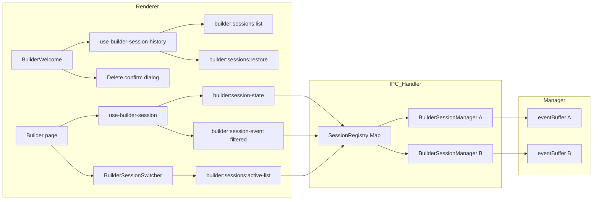

# Implementation Steps

### ✓ Step 1: Add session history types and DB schema
### ✓ Step 2: Implement session history DB functions
### ✓ Step 3: Add orphan worktree detection
### ✓ Step 4: Create BuilderSessionManager class
### ✓ Step 5: Add new IPC channels and types
### ✓ Step 6: Rewrite IPC handler with Map-based registry
### ✓ Step 7: Create renderer hook and update BuilderWelcome UI
### ✓ Step 8: Add event filtering by session ID in use-builder-session
### ✓ Step 9: Add session switcher to active Builder page header
### ✓ Step 10: Add toast feedback and delete confirmation in BuilderWelcome

---

# Requirements

### Overview
Complete the missing UI/UX pieces for multi-session support so the renderer can properly handle multiple concurrent sessions: event filtering, session switching, toast feedback, and delete confirmation.

### What's Already Done (Phase 1)
- Session history table (`builder_session_history`) with migration
- `BuilderSessionManager` class in `src/main/builder/session-manager.ts`
- IPC handler rewritten with `Map<string, BuilderSessionManager>` registry
- 6 new IPC channels: `sessions:list`, `sessions:restore`, `sessions:delete`, `sessions:focus`, `worktrees:list`, `worktrees:cleanup`
- `use-builder-session-history` hook
- `BuilderWelcome` "Recent sessions" and "Orphaned worktrees" sections

### What's Missing (Phase 2 — this plan)

**User Stories**
- As a user, I want to see which session is active when I have multiple sessions, so I know where my prompts are going.
- As a user, I want to switch between active sessions from the Builder page header.
- As a user, I want toast feedback when I restore or delete a session, so I know the operation succeeded.
- As a user, I want a confirmation dialog before deleting a session, so I don't accidentally lose work.

**Functional Requirements**

**Event Filtering**
- The `use-builder-session` hook must filter `builder:session-event` broadcasts by the current session's ID, so events from other sessions don't pollute the active session's event feed.

**Session Switcher**
- The active Builder page header (`PageHeader` in `Builder.tsx`) shows a session switcher dropdown when multiple sessions are active.
- The switcher displays session title, repo name, and running status.
- Switching focus updates `focusedSessionId` and refreshes the session state.

**Toast Feedback**
- Restoring a session from history shows a success toast.
- Deleting a session shows a success toast.
- Failed operations show an error toast.

**Delete Confirmation**
- Clicking the delete button in `BuilderWelcome` opens an `AlertDialog` confirming the deletion (including worktree removal).
- The dialog follows the same pattern as the existing "Discard session" dialog in `Builder.tsx`.

### Scope

**In Scope**
- Update `use-builder-session.ts` to filter events by session ID.
- New `builder:sessions:active-list` IPC channel returning all active sessions.
- Session switcher dropdown in the `Builder.tsx` page header.
- Toast notifications in `use-builder-session-history` actions.
- Delete confirmation `AlertDialog` in `BuilderWelcome`.

**Out of Scope**
- Split-panel multi-session view.
- Sandbox session history.
- Cross-window session sharing.
- Concurrent session limit enforcement (planned as follow-up).


# Technical Design

### Current Implementation (Phase 1 — done)

The backend multi-session infrastructure is complete:
- `BuilderSessionManager` class in `src/main/builder/session-manager.ts` encapsulates per-session state.
- IPC handler uses `Map<string, BuilderSessionManager>` registry with `focusedSessionId`.
- 6 new IPC channels for session management are implemented.
- `builder_session_history` table with CRUD functions exists.
- `use-builder-session-history` hook and `BuilderWelcome` recent sessions UI are in place.

### What still needs work

**`use-builder-session.ts`** subscribes to `builder:session-event` without filtering by session ID. With multiple sessions broadcasting to the same channel, events from all sessions are merged into a single flat list.

**`Builder.tsx`** has no session switcher in the `PageHeader`. When multiple sessions are active, the user cannot tell which session is focused or switch between them.

**`BuilderWelcome.tsx`** calls `restoreSession()` and `deleteSession()` directly without toast feedback or a confirmation dialog.

### Key Decisions

1. **Event filtering in the hook** — `use-builder-session` will track the current `session.id` and filter incoming `builder:session-event` broadcasts to only include events matching that ID.

2. **Active sessions list channel** — A new `builder:sessions:active-list` channel returns a summary of all currently active sessions so the renderer can build a switcher dropdown.

3. **Session switcher in PageHeader** — The `PageHeader` `meta` slot already hosts the `ProjectScopeChip`. A `BuilderSessionSwitcher` component will be added beside it.

4. **Toast via sonner** — The project already uses `sonner` for toasts. The `use-builder-session-history` actions will call `toast.success()` / `toast.error()` directly.

5. **Delete confirmation via AlertDialog** — `BuilderWelcome` will use the same `AlertDialog` pattern as `Builder.tsx` "Discard session" dialog.

### Proposed Changes

#### 1. Event filtering in `use-builder-session.ts`

The `mergeEvents` callback already deduplicates by `eventId`. Add a session ID filter so only events for the current session are merged:

```typescript
// In mergeEvents, add filter after dedup:
const additions = incoming
  .filter((event) => !seen.has(event.eventId))
  .filter((event) => !currentSessionId || event.sessionId === currentSessionId);
```

Track `currentSessionId` from `session?.id` and include it in the `mergeEvents` closure.

#### 2. New `builder:sessions:active-list` IPC channel

**`src/main/ipc/channels.ts`:**
```typescript
'builder:sessions:active-list': {
  req: void;
  res: BuilderActiveSessionSummary[];
};
```

**`src/lib/builder-session.ts`:**
```typescript
export interface BuilderActiveSessionSummary {
  id: string;  // local session ID (the Map key)
  title: string;
  repoDirectory: string;
  branch: string | null;
  running: boolean;
  isFocused: boolean;
}
```

**`src/main/ipc/handlers/builder.ts`:** Iterates `sessions` Map and returns summaries for managers with a non-null `session`.

#### 3. `BuilderSessionSwitcher` component

New component `src/components/builder/BuilderSessionSwitcher.tsx`:
- Fetches active sessions via `builder:sessions:active-list` on mount.
- Shows a `DropdownMenu` (shadcn) when `activeSessions.length > 1`.
- Each item shows title, repo name, and a running indicator.
- The focused session is highlighted with a checkmark.
- Clicking switches focus via `builder:sessions:focus` and triggers a `builder:session-state` refresh in the hook.

#### 4. Integration into `Builder.tsx`

Replace the `ProjectScopeChip` in `PageHeader` `meta` with a fragment containing both the chip and the switcher. When the user switches sessions, the hook re-fetches `builder:session-state`.

#### 5. Toast feedback in `use-builder-session-history.ts`

Add `toast` from `sonner` and wrap actions:
- `restoreSession`: success toast on restore, error toast on failure.
- `deleteSession`: success toast on delete, error toast on failure.
- `cleanupWorktree`: success toast on cleanup.

#### 6. Delete confirmation in `BuilderWelcome.tsx`

Add `AlertDialog` state to `RecentSessionsSection`:
```typescript
const [deleteConfirm, setDeleteConfirm] = useState<{ id: string; title: string } | null>(null);
```

Replace the delete button `onClick` to set the confirm state. Add an `AlertDialog` with a destructive action button, same pattern as `Builder.tsx`.

### Architecture Diagram



### Risks

1. **Event filtering race** — When switching sessions, the hook briefly has no session ID. Events arriving during the gap are dropped. Mitigation: the switch is synchronous (focus change) followed by an async `builder:session-state` fetch; events during that window are buffered in the manager.

2. **Stale session list** — The switcher fetches `builder:sessions:active-list` on mount. If a session is stopped while the dropdown is open, it shows a stale entry. Mitigation: broadcast `builder:sessions:changed` on stop/detach to refresh the list.

3. **Toast spam** — Rapid operations could produce multiple toasts. Mitigation: `sonner` handles deduplication and auto-dismiss.


# Testing

### Validation Approach

TypeScript compilation (`bunx tsc --noEmit`) and manual verification of the renderer behavior. The existing Jest test infrastructure covers DB layer tests.

### Key Scenarios

1. **Event filtering** — Create two sessions, send a prompt to one, verify the hook only receives events for the focused session.
2. **Session switcher** — Create two sessions, verify the switcher dropdown shows both. Switch focus, verify the session state changes.
3. **Toast feedback** — Restore a session from history, verify a success toast appears. Delete a session, verify a success toast.
4. **Delete confirmation** — Click delete in BuilderWelcome, verify the AlertDialog appears. Confirm, verify the session is deleted.
5. **Active list channel** — Create two sessions, call `builder:sessions:active-list`, verify both are returned with correct focus state.

### Edge Cases

1. **Switch to stopped session** — If a session is stopped while the switcher dropdown is open, clicking it should handle gracefully.
2. **Empty active list** — With no sessions, the switcher should not render.
3. **Single session** — With one session, the switcher should not render (no need to switch).
4. **Delete during restore** — Deleting a session while another restore is in progress should not cause issues.