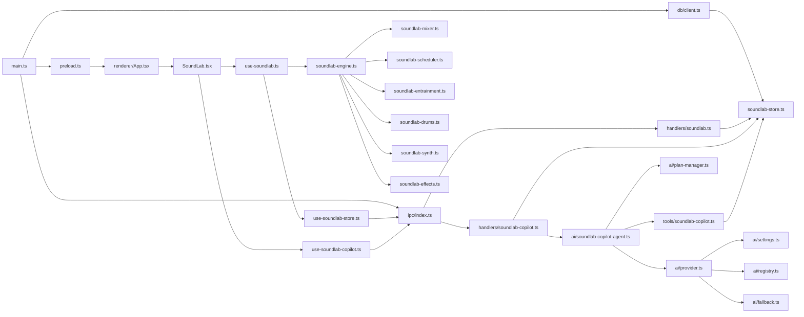

# Requirements

### Overview & Goals
Extract SoundLab from Qeda into a new standalone Electron app (`soundlab-desktop/`) with full feature parity, including the AI copilot. The new app should be a self-contained brainwave entrainment DAW that can be developed, built, and distributed independently of Qeda.

### Scope

**In Scope:**
- New `soundlab-desktop/` directory with its own `package.json`, `electron.vite.config.ts`, and build toolchain
- All 36 SoundLab source files (~10,500 lines) moved as-is
- All 8 test files (~1,880 lines) moved as-is
- Standalone Electron main process (minimal bootstrap, no Qeda features)
- Standalone renderer shell (minimal `App.tsx`, single route, no `AppLayout` or `AppSidebar`)
- SQLite persistence with only SoundLab tables (no Qeda schema)
- AI copilot with replicated shared infrastructure (provider registry, settings, fallback chain, PlanManager, plan tools)
- Direct store calls in renderer (no Electron IPC needed for CRUD — the main process is co-located)
- shadcn UI components copied from `src/components/ui/`

**Out of Scope:**
- Removing SoundLab from Qeda (that's a separate cleanup task)
- Data migration from Qeda's `vellum.db` to the new app
- Packaging and distribution (electron-builder config can be copied but not customized)
- New features or UI changes

### User Stories
- As a developer, I want to clone `soundlab-desktop/` and run `bun install && bun start` to get a working DAW
- As a user, I want to create, edit, and play SoundLab sessions with the AI copilot
- As a user, I want the app to persist my sessions locally in SQLite

### Key Deliverables
1. A new `soundlab-desktop/` directory with a complete, buildable Electron app
2. All SoundLab functionality preserved: audio engine, UI, persistence, AI copilot
3. Tests passing in the new project

# Technical Design

### Current Implementation

SoundLab is embedded in Qeda with 6 coupling points:
1. **`AppSidebar.tsx`** — nav item (`/soundlab`, `BrainCircuitIcon`)
2. **`routes.tsx`** — route block with `:sessionId` param
3. **`ipc/index.ts`** — two `register*Handlers()` calls
4. **`ipc/channels.ts`** — ~30 lines of channel types + type re-exports
5. **`db/schema.ts`** — two `CREATE TABLE` statements + migration entries
6. **`db/client.ts`** — shared singleton `getDb()` with Qeda migrations

SoundLab depends on shared AI infrastructure:
- **`ai/settings.ts`** (411 lines) — encrypted provider settings with Electron `safeStorage`
- **`ai/provider.ts`** (336 lines) — model factory with AI Gateway and OpenAI-compatible adapters
- **`ai/registry.ts`** (197 lines) — provider definitions (Groq, OpenRouter, Gemini, etc.)
- **`ai/fallback.ts`** (384 lines) — cross-provider fallback chain
- **`ai/plan-manager.ts`** (119 lines) — in-session plan state
- **`lib/agent-plan.ts`** (42 lines) — plan types
- **`tools/plan.ts`** (87 lines) — `createPlan`/`updatePlanItem` tools
- **`db/client.ts`** (85 lines) — SQLite singleton with migrations

### Key Decisions

1. **No IPC for CRUD**: The standalone app doesn't need Electron IPC for SoundLab CRUD because the main and renderer processes are co-located in a single-purpose app. The renderer hooks can call the store directly via a simplified bridge, or we keep IPC for architectural consistency. **Decision: Keep IPC** — it's the established pattern, and the copilot streaming already uses it. This avoids rewriting the hooks layer.

2. **Simplified DB client**: The new app only needs two tables (`soundlab_sessions`, `soundlab_tracks`). No sqlite-vec, no FTS, no Qeda migrations. A minimal `db/client.ts` opens a `soundlab.db` file and applies only the SoundLab DDL.

3. **Copied AI infrastructure**: The provider registry, settings, fallback chain, and PlanManager are copied as-is from Qeda. These are ~1,500 lines of well-isolated code that don't depend on Qeda features. The `AppSettings` type is simplified to only include AI-relevant fields (active provider, model, fallback, provider keys).

4. **Minimal renderer shell**: Instead of Qeda's `AppLayout` with sidebar, project scope, onboarding, etc., the new app gets a thin `App.tsx` with just `ThemeProvider`, `MemoryRouter`, and a single route to `SoundLab.tsx`.

5. **shadcn components**: Copy only the shadcn components actually used by SoundLab (determined by grep of imports in `src/components/soundlab/`). This keeps the new app small.

### Proposed Changes

#### New Project Structure
```
soundlab-desktop/
├── package.json                  # new: name "soundlab-desktop", version 1.0.0
├── release/app/package.json      # new: native deps (better-sqlite3 only)
├── electron.vite.config.ts       # new: simplified from Qeda
├── tsconfig.json                 # new: similar to Qeda
├── jest.config.js                # new: similar to Qeda
├── .env.example                  # new: AI provider keys
├── src/
│   ├── main/
│   │   ├── main.ts               # new: minimal Electron bootstrap
│   │   ├── preload.ts            # copy from Qeda
│   │   ├── env.ts                # copy from Qeda
│   │   ├── db/
│   │   │   ├── client.ts         # new: minimal, soundlab.db only
│   │   │   └── soundlab-store.ts # copy from Qeda
│   │   ├── ipc/
│   │   │   ├── index.ts          # new: only SoundLab handlers
│   │   │   ├── channels.ts       # new: only SoundLab channels
│   │   │   └── handlers/
│   │   │       ├── soundlab.ts       # copy from Qeda
│   │   │       └── soundlab-copilot.ts # copy from Qeda
│   │   ├── ai/
│   │   │   ├── soundlab-copilot-agent.ts # copy from Qeda
│   │   │   ├── settings.ts         # copy, simplify AppSettings
│   │   │   ├── provider.ts         # copy from Qeda
│   │   │   ├── registry.ts         # copy from Qeda
│   │   │   ├── fallback.ts         # copy from Qeda
│   │   │   └── plan-manager.ts     # copy from Qeda
│   │   └── tools/
│   │       ├── soundlab-copilot.ts # copy from Qeda
│   │       └── plan.ts             # copy from Qeda
│   ├── renderer/
│   │   ├── index.html            # copy from Qeda
│   │   ├── entry.tsx             # new: minimal entry
│   │   ├── App.tsx               # new: thin shell
│   │   ├── routes.tsx            # new: single route
│   │   └── pages/
│   │       └── SoundLab.tsx      # copy from Qeda
│   ├── components/
│   │   ├── ui/                   # copy: only used shadcn components
│   │   └── soundlab/             # copy: all 14 components
│   ├── hooks/
│   │   ├── use-soundlab.ts       # copy from Qeda
│   │   ├── use-soundlab-store.ts # copy from Qeda
│   │   └── use-soundlab-copilot.ts # copy from Qeda
│   ├── lib/
│   │   ├── soundlab-types.ts     # copy from Qeda
│   │   ├── soundlab-engine.ts    # copy from Qeda
│   │   ├── soundlab-effects.ts   # copy from Qeda
│   │   ├── agent-plan.ts         # copy from Qeda
│   │   ├── utils.ts              # copy: cn re-export
│   │   └── soundlab/
│   │       ├── soundlab-math.ts      # copy
│   │       ├── soundlab-mixer.ts     # copy
│   │       ├── soundlab-scheduler.ts # copy
│   │       ├── soundlab-entrainment.ts # copy
│   │       ├── soundlab-drums.ts     # copy
│   │       └── soundlab-synth.ts     # copy
│   └── __tests__/                # copy: all 8 test files
└── bun.lock                      # generated
```

### Architecture Diagram



### Components Affected

**New files only.** No existing Qeda files are modified. All SoundLab files are copied verbatim from Qeda, with import paths adjusted to the new structure.

### Files to Copy (verbatim, with import path adjustments)

| Source in Qeda | Destination in soundlab-desktop |
|---|---|
| `src/lib/soundlab-types.ts` | `src/lib/soundlab-types.ts` |
| `src/lib/soundlab-engine.ts` | `src/lib/soundlab-engine.ts` |
| `src/lib/soundlab-effects.ts` | `src/lib/soundlab-effects.ts` |
| `src/lib/soundlab/soundlab-*.ts` (6 files) | `src/lib/soundlab/` |
| `src/lib/agent-plan.ts` | `src/lib/agent-plan.ts` |
| `src/main/db/soundlab-store.ts` | `src/main/db/soundlab-store.ts` |
| `src/main/ipc/handlers/soundlab.ts` | `src/main/ipc/handlers/soundlab.ts` |
| `src/main/ipc/handlers/soundlab-copilot.ts` | `src/main/ipc/handlers/soundlab-copilot.ts` |
| `src/main/ai/soundlab-copilot-agent.ts` | `src/main/ai/soundlab-copilot-agent.ts` |
| `src/main/ai/settings.ts` | `src/main/ai/settings.ts` (simplified) |
| `src/main/ai/provider.ts` | `src/main/ai/provider.ts` |
| `src/main/ai/registry.ts` | `src/main/ai/registry.ts` |
| `src/main/ai/fallback.ts` | `src/main/ai/fallback.ts` |
| `src/main/ai/plan-manager.ts` | `src/main/ai/plan-manager.ts` |
| `src/main/tools/soundlab-copilot.ts` | `src/main/tools/soundlab-copilot.ts` |
| `src/main/tools/plan.ts` | `src/main/tools/plan.ts` |
| `src/renderer/pages/SoundLab.tsx` | `src/renderer/pages/SoundLab.tsx` |
| `src/components/soundlab/**` (14 files) | `src/components/soundlab/` |
| `src/hooks/use-soundlab*.ts` (3 files) | `src/hooks/` |
| `src/__tests__/soundlab*.test.*` (8 files) | `src/__tests__/` |

### Files to Create (new)

| File | Purpose |
|---|---|
| `package.json` | Root manifest with deps, scripts, engines |
| `release/app/package.json` | Native deps (better-sqlite3 only, no node-pty or sqlite-vec) |
| `electron.vite.config.ts` | Build config, simplified from Qeda |
| `tsconfig.json` | TypeScript config with `@` alias |
| `jest.config.js` | Test config |
| `src/main/main.ts` | Minimal Electron bootstrap |
| `src/main/preload.ts` | IPC bridge (copy, remove Qeda channels) |
| `src/main/env.ts` | Environment loading (copy) |
| `src/main/db/client.ts` | Minimal SQLite client, `soundlab.db` |
| `src/main/ipc/index.ts` | Only SoundLab handler registration |
| `src/main/ipc/channels.ts` | Only SoundLab channel types |
| `src/renderer/entry.tsx` | React entry point |
| `src/renderer/App.tsx` | Thin shell: ThemeProvider + MemoryRouter |
| `src/renderer/routes.tsx` | Single route to SoundLab |
| `src/renderer/index.html` | HTML entry (copy, update title) |
| `src/lib/utils.ts` | `cn` re-export |
| `.env.example` | Provider key template |

### Risks
- **shadcn component dependencies**: SoundLab components may use shadcn components that have their own dependencies (e.g., `@radix-ui/*`). Need to copy only the used components and their transitive deps.
- **Import path adjustments**: All copied files need `@/` alias paths verified. The `electron.vite.config.ts` needs the same alias config.
- **AI SDK ESM mocks**: Jest mocks for ESM-only packages (`ai`, `@ai-sdk/*`) need to be present in the new project's `jest.config.js`.

# Testing

### Validation Approach
Copy all 8 existing SoundLab test files and ensure they pass in the new project with adjusted import paths.

### Key Scenarios
1. **Build succeeds**: `bun run build` produces `release/app/dist/main/main.js` and `release/app/dist/renderer/renderer.js`
2. **Tests pass**: `bun test` runs all 8 SoundLab test files without errors
3. **App starts**: `bun start` launches the Electron window with the SoundLab page
4. **Audio engine**: `soundlab-engine.test.ts` verifies start/stop, BPM, track controls
5. **Database CRUD**: `soundlab-db.test.ts` verifies session/track persistence
6. **Client store**: `soundlab-store.test.ts` verifies undo/redo, mutations
7. **UI rendering**: `soundlab-ui.test.tsx` verifies components render
8. **Autosave**: `soundlab-autosave.test.tsx` verifies debounced save
9. **Copilot**: `soundlab-copilot.test.ts` verifies tool execution

### Edge Cases
- **No AI provider configured**: App should start and work without AI — copilot shows a configure message
- **Empty database**: First launch shows the session library with templates
- **Missing better-sqlite3**: App should fail gracefully with a clear error on `bun install`

# Delivery Steps

### ✓ Step 1: Scaffold project structure and build toolchain
Create the new `soundlab-desktop/` directory with package.json, electron.vite.config.ts, tsconfig.json, jest.config.js, and .env.example. Wire up the minimal Electron bootstrap (main.ts, preload.ts, env.ts) and renderer entry (index.html, entry.tsx, App.tsx, routes.tsx). The app should launch but show a blank page.

- Create `package.json` with SoundLab-relevant dependencies (ai-sdk, better-sqlite3, react, react-router, shadcn deps, lucide-react, next-themes, sonner, cn, class-variance-authority, zod)
- Create `release/app/package.json` with only `better-sqlite3` as native dep (no node-pty, no sqlite-vec)
- Create `electron.vite.config.ts` simplified from Qeda (main entry, preload, renderer root, `@` alias, external native deps)
- Create `tsconfig.json` with paths matching Qeda (`@/*` → `src/*`)
- Create `jest.config.js` with ESM mocks for ai-sdk packages
- Create `src/main/main.ts` with minimal Electron bootstrap (single window, no tray, no deep links, no PTY, no studio media)
- Create `src/main/preload.ts` with IPC bridge (expose only SoundLab channels)
- Create `src/main/env.ts` to load `.env.local`
- Create `src/renderer/index.html` with SoundLab title
- Create `src/renderer/entry.tsx` with React 19 createRoot
- Create `src/renderer/App.tsx` with ThemeProvider, TooltipProvider, MemoryRouter, Toaster
- Create `src/renderer/routes.tsx` with single route to SoundLab page
- Create `src/lib/utils.ts` with `cn` re-export

### ✓ Step 2: Copy audio engine and domain types
Copy all pure logic files: domain types, audio engine, and sub-modules. These have no dependencies on Qeda infrastructure.

- Copy `src/lib/soundlab-types.ts` (1,121 lines)
- Copy `src/lib/soundlab-engine.ts` (366 lines)
- Copy `src/lib/soundlab-effects.ts` (207 lines)
- Copy `src/lib/agent-plan.ts` (42 lines)
- Copy all 6 sub-modules from `src/lib/soundlab/`:
  - `soundlab-math.ts` (76 lines)
  - `soundlab-mixer.ts` (251 lines)
  - `soundlab-scheduler.ts` (369 lines)
  - `soundlab-entrainment.ts` (201 lines)
  - `soundlab-drums.ts` (162 lines)
  - `soundlab-synth.ts` (57 lines)
- Adjust all import paths to use `@/` alias correctly
- Verify `bun run build` still succeeds

### ✓ Step 3: Copy database layer and IPC handlers
Create the minimal SQLite client and copy the SoundLab store and IPC handlers. The DB client only opens `soundlab.db` and applies the two SoundLab table DDL statements.

- Create `src/main/db/client.ts` (minimal: opens `soundlab.db`, no sqlite-vec, no Qeda migrations)
- Create DDL constants for `soundlab_sessions` and `soundlab_tracks` tables (from Qeda's `schema.ts`)
- Copy `src/main/db/soundlab-store.ts` (264 lines)
- Create `src/main/ipc/channels.ts` with only SoundLab channel types (CRUD + copilot streaming)
- Create `src/main/ipc/index.ts` that registers only SoundLab handlers
- Copy `src/main/ipc/handlers/soundlab.ts` (63 lines)
- Copy `src/main/ipc/handlers/soundlab-copilot.ts` (160 lines)
- Register handlers in `main.ts` via `registerIpcHandlers(mainWindow)`
- Verify `bun run build` succeeds

### ✓ Step 4: Copy AI copilot infrastructure
Copy the shared AI infrastructure that the SoundLab copilot depends on. Simplify `AppSettings` to only include AI-relevant fields.

- Copy `src/main/ai/registry.ts` (197 lines, verbatim)
- Copy `src/main/ai/fallback.ts` (384 lines, verbatim)
- Copy `src/main/ai/plan-manager.ts` (119 lines, verbatim)
- Copy `src/main/ai/settings.ts` (411 lines) — simplify `AppSettings` to remove Qeda-specific fields (builderEngine, mcpServers, e2bSandbox*, onboardingCompleted, activeProject, etc.)
- Copy `src/main/ai/provider.ts` (336 lines) — remove Qeda-specific imports
- Copy `src/main/ai/soundlab-copilot-agent.ts` (218 lines)
- Copy `src/main/tools/plan.ts` (87 lines)
- Copy `src/main/tools/soundlab-copilot.ts` (654 lines)
- Adjust all import paths
- Verify `bun run build` succeeds

### ✓ Step 5: Copy UI components, hooks, and page
Copy all SoundLab UI components, hooks, and the main page. Also copy only the shadcn components actually used by SoundLab.

- Copy `src/renderer/pages/SoundLab.tsx` (243 lines)
- Copy all 14 components from `src/components/soundlab/` (~3,297 lines total)
- Copy all 3 hooks from `src/hooks/use-soundlab*.ts` (~1,000 lines total)
- Identify and copy only the shadcn components used by SoundLab (grep imports in soundlab components):
  - Likely: `button`, `dialog`, `dropdown-menu`, `popover`, `scroll-area`, `sheet`, `slider`, `tabs`, `tooltip`, `sonner`, `select`, `switch`, `separator`, `badge`, `input`, `textarea`, `collapsible`
  - Plus: `@radix-ui/*` deps and `lucide-react` icons
- Adjust all import paths in copied files
- Add `@source` directives in `index.css` for `../components`, `../hooks`, `../lib`
- Verify `bun run build` succeeds

### ✓ Step 6: Copy tests and verify
Copy all 8 SoundLab test files and ensure they pass in the new project. Adjust mocks and import paths.

- Copy all 8 test files from `src/__tests__/soundlab*.test.*` (~1,880 lines)
- Adjust import paths in tests to match new structure
- Ensure Jest mocks for ESM packages are configured (ai-sdk, nanoid, etc.)
- Run `bun run build` then `bun test` — all tests should pass
- Run `bun start` and verify the app launches with the SoundLab page
- Verify basic functionality: create session, add track, play/stop, copilot toggle