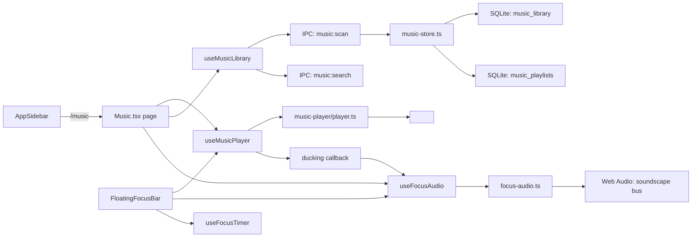

# Requirements

### Overview & Goals
Build a **session-aware Music Player** feature inside Qeda that integrates with the Tasks/Productivity/ADHD system. The player allows users to browse and play local music files alongside ambient soundscapes, with playback tied to focus sessions via the existing Pomodoro timer. The goal is to eliminate context switching between a music app and the productivity app, and to create a consistent audio ritual that supports focus.

### Scope

**In Scope (Phase 1 — MVP):**
- New top-level `/music` route with its own `AppSidebar` nav item
- Local music library indexer (scans user-specified directories for audio files)
- Music playback using `<audio>` element with queue management (play, pause, next, prev, shuffle, repeat)
- Soundscape mixer: move 10 OGG files from `assets/focus-sound-stems/` to `src/renderer/focus-audio/` and wire them into `focus-audio.ts`
- Dual-bus mixing: music channel + soundscape channel with independent volume and automatic ducking
- Extend `FloatingFocusBar` with music controls (now-playing, play/pause, next/prev, soundscape toggle) during focus sessions
- SQLite persistence for playlists, queue state, and library index

**Out of Scope (Phase 2+):**
- AI playlist curation from the library
- Streaming service integrations (Spotify, Apple Music)
- Audio-to-productivity correlation analytics
- Album art display and metadata-rich library browser

### User Stories
- As a user, I want to add folders from my music library so the app can find and index my songs
- As a user, I want to browse my library and play songs with a queue (next, prev, shuffle, repeat)
- As a user, I want to layer ambient sounds (rain, stream, wind) over my music with independent volume control
- As a user, I want music to start when I begin a focus session and pause at breaks
- As a user, I want to see now-playing info and controls in the `FloatingFocusBar` during focus
- As a user, I want to create and save playlists for different task types (deep work, admin, creative)

### Functional Requirements

**Library Management:**
- User specifies one or more directories via a file dialog (IPC handler)
- Main process scans directories for audio files (MP3, FLAC, Ogg, M4A, WAV)
- Metadata (title, artist, album, duration) is read from file headers and stored in SQLite
- Library is re-indexed on demand; changes are broadcast to renderer via `music:library-changed` event

**Playback:**
- `<audio>` element for music playback (handles formats, seek, progress natively)
- Queue management: ordered list of tracks with current index, shuffle mode, repeat mode
- Playback state (playing, paused, track progress) is exposed via `useMusicPlayer` hook
- Progress updates at ~1Hz to avoid React re-render spam

**Soundscape Mixing:**
- 13 total soundscape stems (3 existing + 10 from `assets/focus-sound-stems/`)
- Each stem loaded as `AudioBuffer` via `decodeAudioData()` and played as a looping `AudioBufferSourceNode`
- Independent volume slider per soundscape layer
- Automatic ducking: when music plays, soundscape volume drops by configurable amount; during breaks or no music, soundscape rises

**Focus Integration:**
- `FloatingFocusBar` extends to show now-playing info, play/pause, next/prev, and a soundscape toggle
- When focus timer starts, music can auto-resume; when break starts, music pauses and soundscape may change
- Focus session completion records which tracks were played (for future analytics)

### Non-Functional Requirements
- **Performance**: Library indexing should not block the main thread; use chunked scanning for large libraries
- **Privacy**: All data stays local; no telemetry on listening habits
- **Format support**: MP3, FLAC, Ogg Vorbis, M4A, WAV via the `<audio>` element
- **Offline**: All playback works without network access

# Technical Design

### Current Implementation

**Existing focus audio system:**
- `src/lib/focus-audio.ts` (352 lines): Web Audio mixer with three buses — noise (procedural), clip (OGG ambience), tone (binaural/isochronic) — feeding a compressor and master gain
- `src/hooks/use-focus-audio.ts` (83 lines): React hook that manages `FocusAudioEngine` singleton, config state, and start/stop/toggle
- `src/components/tasks/FocusAudioPanel.tsx` (187 lines): Soundscape controls (noise type, binaural toggle, volume sliders)
- `src/components/focus/FloatingFocusBar.tsx` (243 lines): Floating bar during focus with timer, soundscape toggle, task completion
- `src/renderer/focus-audio/`: 3 OGG clips (forest, rain, waves) + `SOURCES.md`
- `assets/focus-sound-stems/`: 10 OGG files not wired into the app (drizzle, heavy_rain, roof_rain, stream, etc.)

**Existing focus timer:**
- `src/hooks/use-focus-timer.ts` (206 lines): Pomodoro/flow timer, phase machine (idle → work → break), fires `onPhaseComplete`
- `src/main/db/focus-sessions.ts` (196 lines): Persistence for completed focus phases
- `src/main/db/schema.ts`: `focus_sessions` table with task_id linkage

**Existing navigation:**
- `src/renderer/routes.tsx`: Route tree with `AppLayout` shell
- `src/components/AppSidebar.tsx`: Nav items for each feature

### Key Decisions

1. **Separate music player module, not extension of `focus-audio.ts`**: The music player uses `<audio>` element (not Web Audio API) for playback, which is fundamentally different from the soundscape mixer. A new `src/lib/music-player/` module owns music playback, queue, and library state. The soundscape mixer remains in `focus-audio.ts`. A ducking callback bridges the two.

2. **`<audio>` element for music, Web Audio for soundscapes**: The `<audio>` element handles format decoding, seeking, and metadata natively. Web Audio API is used only for the soundscape channel (looping OGG stems with gain control). Ducking is achieved by adjusting the soundscape bus volume when music playback state changes.

3. **SQLite for library index and playlists**: New tables `music_library`, `music_playlists`, `music_playlist_tracks` store indexed tracks and user playlists. The library index is rebuilt on demand; the main process does the filesystem scanning via IPC.

4. **Soundscape assets moved to renderer**: The 10 OGG files from `assets/focus-sound-stems/` are moved to `src/renderer/focus-audio/` and registered in `SOUNDSCAPE_CLIPS` in `focus-audio.ts`. This makes them available to Vite's asset handling and ensures they're bundled.

5. **FloatingFocusBar extension**: The existing `FloatingFocusBar` gains a music section with now-playing info, play/pause, next/prev, and a soundscape volume slider. It receives both `UseFocusAudioReturn` and a new `UseMusicPlayerReturn` as props.

### Proposed Changes

#### New Module Structure
```
src/
├── lib/
│   ├── music-player/
│   │   ├── types.ts              # Track, Queue, Playlist, LibraryIndex types
│   │   └── player.ts             # MusicPlayer class: <audio> wrapper, queue, shuffle, repeat
│   └── focus-audio.ts            # MODIFIED: expanded SOUNDSCAPE_CLIPS, ducking support
├── main/
│   ├── db/
│   │   ├── schema.ts             # MODIFIED: new music tables + migration entries
│   │   └── music-store.ts        # NEW: SQLite CRUD for library, playlists
│   └── ipc/
│       ├── channels.ts           # MODIFIED: music channels added
│       └── handlers/
│           └── music.ts          # NEW: library scan, metadata read, playlist CRUD
├── renderer/
│   ├── focus-audio/              # MODIFIED: 10 new OGG files added
│   └── pages/
│       └── Music.tsx             # NEW: Music player page
├── components/
│   ├── music/
│   │   ├── MusicLibrary.tsx      # Library browser with search, filter, folder view
│   │   ├── MusicPlayerBar.tsx    # Now-playing bar with transport controls
│   │   ├── MusicQueue.tsx        # Queue browser (current, next up, played)
│   │   ├── MusicPlaylistPanel.tsx # Playlist management
│   │   └── SoundscapeMixer.tsx   # Soundscape selector with volume per stem
│   └── focus/
│       └── FloatingFocusBar.tsx  # MODIFIED: adds music controls section
├── hooks/
│   ├── use-music-player.ts       # NEW: music playback state, queue, transport
│   ├── use-music-library.ts      # NEW: library browsing, search, filter
│   └── use-focus-audio.ts        # MODIFIED: adds ducking callback
└── __tests__/
    └── music-player.test.ts      # NEW: player, queue, library tests
```

### Architecture Diagram



### Data Models / Contracts

**IPC Channels (added to `channels.ts`):**
- `music:scan`: req `{ paths: string[] }`, res `{ count: number }`
- `music:search`: req `{ query: string; limit?: number }`, res `Array<Track>`
- `music:get-by-id`: req `{ id: string }`, res `Track | null`
- `music:create-playlist`: req `{ name: string }`, res `{ id: string }`
- `music:add-to-playlist`: req `{ playlistId: string; trackIds: string[] }`, res `void`
- `music:list-playlists`: req `void`, res `Array<Playlist>`
- `music:delete-playlist`: req `{ id: string }`, res `void`
- `music:library-changed`: broadcast event

**Domain Types:**
- `Track`: id, path, title, artist?, album?, duration, fileSize, addedAt
- `Playlist`: id, name, trackIds[], createdAt, updatedAt
- `MusicQueue`: tracks[], currentIndex, shuffle, repeat ('none'|'one'|'all')
- `MusicPlayerState`: queue, playing, progress, currentTime, duration, volume

**Database Schema (added to `schema.ts`):**
- `music_library` (id PK, path UNIQUE, title, artist, album, duration, file_size, added_at)
- `music_playlists` (id PK, name, created_at, updated_at)
- `music_playlist_tracks` (playlist_id FK, track_id FK, sort_order, PK: playlist_id+track_id)

### Components

**New Components:**

| Component | Purpose |
|---|---|
| `Music.tsx` (page) | Main music page: library browser left, now-playing + queue right, soundscape mixer bottom |
| `MusicLibrary` | Browse library by folder, search, filter by artist/album |
| `MusicPlayerBar` | Now-playing info, transport controls (play/pause, next, prev, shuffle, repeat), volume |
| `MusicQueue` | Current queue with drag-to-reorder, "next up" section, played history |
| `MusicPlaylistPanel` | Create/edit/delete playlists, add/remove tracks |
| `SoundscapeMixer` | Grid of 13 soundscape stems with toggle and volume per stem |

**Modified Components:**

| Component | Change |
|---|---|
| `FloatingFocusBar.tsx` | Add music section: now-playing title, play/pause, next/prev, soundscape volume |
| `FocusAudioPanel.tsx` | Expand to show all 13 soundscape stems with individual volume |
| `AppSidebar.tsx` | Add `/music` nav item with `Music` icon |
| `routes.tsx` | Add `{ path: 'music', element: <Music /> }` |
| `focus-audio.ts` | Register 10 new OGG clips, add `onMusicPlayingChange` callback for ducking |
| `use-focus-audio.ts` | Accept `onMusicPlayingChange` callback for ducking |
| `index.css` | Add `@source '../components/music'` for Tailwind class purging |

### Risks
- **Audio metadata reading**: Requires `music-metadata` package (pure JS) in the main process IPC handler
- **Large library scanning**: Chunk scanning into 100-file batches with `setImmediate()` yields to avoid blocking
- **`<audio>` element limitations**: No sample-level control for ducking music. **Mitigation**: Duck the *soundscape* bus volume (Web Audio), not the music volume
- **OGG file bundling**: 10 new OGG files add ~4MB to bundle. Acceptable for a desktop app
- **Focus timer coupling**: Music player works independently of focus. `FloatingFocusBar` is the only integration point

# Testing

### Validation Approach
Unit tests for the music player class (queue, shuffle, repeat logic), library scanning, and IPC handlers. Component smoke tests for rendering.

### Key Scenarios
1. **Build succeeds**: `bun run build` after all changes
2. **Library scan**: IPC handler scans a directory and returns indexed tracks
3. **Playback**: MusicPlayer class plays, pauses, seeks, and advances queue
4. **Queue management**: Shuffle, repeat modes, next/prev work correctly
5. **Soundscape mixing**: All 13 stems load and play; ducking works when music starts
6. **UI rendering**: Music page, library browser, player bar, queue render correctly
7. **Focus integration**: FloatingFocusBar shows music controls during focus
8. **Playlist CRUD**: Create, add tracks, list, delete playlists via IPC

### Edge Cases
- **Empty library**: Music page shows "add folders" prompt
- **Missing audio file**: Track is skipped; user is notified
- **Unsupported format**: File is skipped during scan with a warning
- **No focus session**: Music player works independently; FloatingFocusBar doesn't show music controls
- **Large library (10,000+ files)**: Scanning completes without freezing the UI
