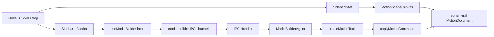

# Requirements

### Overview
Create a **Model Builder Dialog** — a modal dialog containing a Sidebar-based AI copilot panel and a live 3D viewport. The user describes a 3D model in natural language, the AI agent builds it step-by-step, and the 3D scene renders the model being created in real-time.

### Scope

**In Scope:**
- Full-screen Dialog with two-column layout: 3D viewport (left, flex-1) + Sidebar copilot (right, ~16rem)
- New dedicated "Model Builder" AI agent with its own IPC channels (`model-builder:*`)
- Ephemeral MotionDocument created on dialog open, discarded on close (with optional save)
- Real-time 3D preview via MotionSceneCanvas as the agent adds nodes
- ai-elements chat UI (Conversation, PromptInput, MessageList) inside the Sidebar
- Suggestion chips for common model-building prompts
- Plan panel showing multi-step agent progress

**Out of Scope:**
- Persisting models to disk by default (optional save is a nice-to-have)
- Asset marketplace integration in the model builder
- Export functionality from the model builder dialog
- Multi-user collaboration

### User Stories
1. As a user, I want to open a Model Builder dialog so I can describe a 3D model in natural language.
2. As a user, I want to see the 3D scene update in real-time as the AI builds my model.
3. As a user, I want to iterate on my model conversationally ("make it bigger", "add details", "change material").
4. As a user, I want to optionally save the created model to a Motion document when I'm done.

# Technical Design

### Current Implementation

**Copilot pattern:** Each copilot follows the same stack:
- `useAgentChat` hook (`src/hooks/use-agent-chat.ts`) — IPC transport, streaming, approvals
- Domain-specific hook (e.g., `useMotionCopilot`) — wraps `useAgentChat` with transport config + plan
- IPC handler (`src/main/ipc/handlers/motion-copilot.ts`) — `ipcMain.handle` over domain channels
- Agent factory (`src/main/ai/motion-copilot-agent.ts`) — `ToolLoopAgent` with tools + instructions
- UI component (`CopilotPanel.tsx`, `StudioCopilotSheet.tsx`) — `Sheet`/overlay with ai-elements primitives

**3D scene pattern:** `MotionSceneCanvas` (`src/components/motion/scene/MotionSceneCanvas.tsx`) renders any `MotionDocument` via React Three Fiber. It takes `doc`, `clock`, view mode, and selection props.

**Sidebar component:** `@/components/ui/sidebar.tsx` — `SidebarProvider` → `Sidebar` + `SidebarInset`. Designed for app-level layout but can be embedded in a Dialog.

### Key Decisions

1. **Dialog with Sidebar inside:** The Dialog wraps `SidebarProvider` → `Sidebar` (right side, copilot chat) + `SidebarInset` (3D viewport). The Sidebar's mobile fallback (Sheet) works naturally inside a Dialog.

2. **Ephemeral MotionDocument:** Created via `createStarterMotionDocument()` on dialog open. The agent mutates this document in-memory. On close, the user can optionally save to a new Motion project.

3. **New Model Builder Agent:** Dedicated `model-builder:*` IPC channels. Reuses `createMotionTools` (scene director, node builder, procedural modeling) with a model-focused system prompt. No timeline/keyframe focus — pure geometry and scene composition.

4. **PlaybackClock for live rendering:** Uses `PlaybackClock` from `@/lib/timeline/clock` in paused state so the scene renders statically but updates on document changes.

### Proposed Changes

**New files:**
- `src/components/model-builder/ModelBuilderDialog.tsx` — Dialog wrapper with Sidebar + 3D viewport layout
- `src/hooks/use-model-builder.ts` — Copilot hook (transport config + plan, wraps `useAgentChat`)
- `src/main/ai/model-builder-agent.ts` — Agent factory with model-building instructions
- `src/main/ipc/handlers/model-builder.ts` — IPC handler for `model-builder:chat`

**Modified files:**
- `src/main/ipc/channels.ts` — Add `model-builder:*` channel entries
- `src/main/ipc/index.ts` — Register `registerModelBuilderHandlers`
- `src/renderer/index.css` — Add `@source '../components/model-builder'` for Tailwind

### Data Models / Contracts

**IPC Channels (channels.ts):**
```
'model-builder:chat': { req: { messages: UIMessage[]; context: { document: MotionDocument } }; res: void }
'model-builder:stream-chunk': { data: string }
'model-builder:stream-done': { runId: string }
'model-builder:stream-error': { error: string }
'model-builder:stream-fallback': { fromProvider, fromModel, toProvider, toModel, reason }
'model-builder:plan-event': { data: AgentPlanEvent }
```

**useModelBuilder hook return:**
```
{ messages, status, error, fallbackNotice, dismissFallbackNotice, sendMessage, respondToApproval, clearMessages, plan, clearPlan }
```

### Components

**ModelBuilderDialog** (new):
- `Dialog` (shadcn, `open` controlled, `max-w-screen` sizing)
- `SidebarProvider` wrapping the content
- `Sidebar` (right side, `w-80`): Header with title + close, `Conversation` → `MessageList`, `PromptInput`
- `SidebarInset`: `MotionSceneCanvas` rendering the ephemeral document
- Toolbar: "Save to Motion" button, grid toggle, view mode toggle

**Model Builder Agent** (new):
- System prompt focused on 3D model creation (geometry, materials, composition)
- Tools: `sceneDirector` (add/update/remove nodes), `nodeBuilder`, `proceduralModeling`
- No keyframe tool (model building is static geometry)
- Plan tools for multi-step builds

### Architecture Diagram



### Risks
- **Sidebar in Dialog:** The Sidebar uses `fixed` positioning by default. Inside a Dialog, this may conflict with Dialog's overlay. May need to override Sidebar's CSS or use `variant="floating"`.
- **Tailwind purging:** New `src/components/model-builder/` directory needs `@source` in `index.css`.
- **Agent prompt quality:** The model builder needs a well-crafted system prompt to produce good 3D models from text descriptions. May need iteration.
- **Performance:** Complex procedural models (5000 instances) in a Dialog viewport may strain rendering. The existing `MotionSceneCanvas` DPR and demand-mode frameloop should handle this.

# Testing

### Validation Approach
The agent validates by verifying the file structure, imports, and IPC channel registration match existing patterns.

### Key Scenarios
1. **Dialog opens:** Ephemeral MotionDocument is created, 3D viewport renders empty scene with grid, copilot panel shows empty state with suggestions
2. **User sends prompt:** Message appears, agent streams response, tool calls add nodes to the document, 3D viewport updates in real-time
3. **Multi-step build:** Plan panel shows progress, each step completes and updates the scene
4. **Dialog closes:** Document is discarded (or saved if user chooses)
5. **Sidebar collapse:** Copilot panel collapses to icon width, 3D viewport expands

### Edge Cases
- WebGL unavailable → Canvas fallback message shown
- No AI provider configured → Error message in copilot
- Agent tool call fails → Error displayed in MessageList, scene unchanged
- Very large procedural model → DPR and demand-mode frameloop handle gracefully

### Test Changes
No new tests required for this planning phase. The existing pattern tests (`copilot-agent.test.ts`, `motion-copilot` handlers) serve as reference.

# Delivery Steps

### ✓ Step 1: Add IPC channels and handler for Model Builder agent
Create the backend infrastructure: new `model-builder:*` IPC channels, handler module, and agent factory.
- Add `model-builder:chat`, `model-builder:stream-*`, and `model-builder:plan-event` channels to `src/main/ipc/channels.ts`
- Create `src/main/ipc/handlers/model-builder.ts` — mirrors `motion-copilot.ts` but without document persistence (ephemeral)
- Create `src/main/ai/model-builder-agent.ts` — `ToolLoopAgent` with model-building system prompt, reuses `createMotionTools` (sceneDirector, nodeBuilder, proceduralModeling), excludes keyframe tool
- Register handler in `src/main/ipc/index.ts` (`registerModelBuilderHandlers`)
- Add `@source '../components/model-builder'` to `src/renderer/index.css`

### ✓ Step 2: Create useModelBuilder hook
React hook that binds the Model Builder agent to IPC streaming.
- Create `src/hooks/use-model-builder.ts` — mirrors `use-motion-copilot.ts` pattern: `useAgentChat` with `model-builder:*` transport + `useIpcPlan` for plan events
- Returns `{ messages, status, error, fallbackNotice, dismissFallbackNotice, sendMessage, respondToApproval, clearMessages, plan, clearPlan }`
- Ephemeral session: `persist: false, hydrate: false`
- Context passes the ephemeral `MotionDocument`

### ✓ Step 3: Implement ModelBuilderDialog with Sidebar and 3D viewport
The main dialog component combining Sidebar-based copilot and live 3D preview.
- Create `src/components/model-builder/ModelBuilderDialog.tsx`
- Dialog wrapper: shadcn `Dialog` with `max-w-screen` sizing, controlled `open` state
- Inside Dialog: `SidebarProvider` → `Sidebar` (right, copilot) + `SidebarInset` (3D viewport)
- Sidebar content: Header (title + clear button), `Conversation` → `MessageList` with empty state + suggestions, `PromptInput` footer
- SidebarInset: `MotionSceneCanvas` rendering the ephemeral `MotionDocument`, with `PlaybackClock` in paused state
- Toolbar: "Save to Motion" button, view mode toggle, grid toggle
- Creates ephemeral document via `createStarterMotionDocument()` on mount
- Wires `useModelBuilder` hook to the copilot UI
- On close: optional save dialog to persist the document to a new Motion project