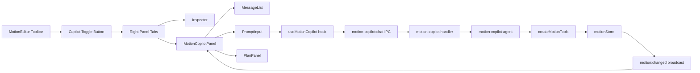

# Requirements

## Motion Copilot — Right-Side AI Panel

### Overview
Add a **Motion Copilot** panel to the Motion editor — a right-side, resizable panel that slides in from the right, providing an AI conversational interface for Motion-specific operations. The copilot uses the existing `createMotionTools` (scene director, keyframe, node builder, procedural modeling) to perform actions on the Motion document.

### Scope
**In Scope:**
- New `MotionCopilotPanel` component — right-side resizable panel (not a Sheet overlay)
- Tab bar in the right panel area to switch between **Inspector** and **Copilot**
- `useMotionCopilot` hook — binds to `motion-copilot:*` IPC channels
- IPC channels: `motion-copilot:chat`, `motion-copilot:stream-*`, `motion-copilot:plan-event`
- IPC handler: `motion-copilot.ts` — streams agent turns using `createMotionTools`
- Motion-specific agent: `motion-copilot-agent.ts` — system prompt + tools
- Toolbar toggle button in MotionEditor

**Out of Scope:**
- Changes to the global command palette
- New Motion tool definitions (using existing `createMotionTools`)
- Asset marketplace integration in copilot

### User Stories
- As a Motion editor user, I want to ask the AI to add nodes, set keyframes, or create animations, so I can work conversationally.
- As a Motion editor user, I want to switch between the Inspector and Copilot without losing panel width, so I can toggle contexts easily.
- As a Motion editor user, I want the copilot panel to be resizable, so I can give it more or less space.

### Functional Requirements
- The copilot appears as a right-side panel, toggled via a toolbar button (alongside the Inspector toggle).
- A tab bar ("Inspector" | "Copilot") in the right panel allows switching without collapsing.
- The copilot uses the same chat surface as other copilots: `Conversation`, `MessageList`, `PromptInput`.
- The copilot has Motion-specific suggestions (e.g., "Add a camera push animation", "Create a keyframe at playhead").
- The copilot can execute Motion ops via `createMotionTools` (scene director, keyframe, node builder, procedural modeling).
- Plan panel shows when the copilot creates a multi-step plan.

# Technical Design

### Current Implementation
- **MotionEditor layout** (lines 357-431): `ResizablePanelGroup` (vertical) → top panel with `ResizablePanelGroup` (horizontal: Scene | Viewport | Inspector) → bottom Timeline panel.
- **Inspector panel** (lines 399-411): `ResizablePanel` with `MotionInspector`, collapsible, 22% default size.
- **Existing copilot pattern**: `StudioCopilotSheet` → `useStudioCopilot` → `studio-copilot:chat` IPC → `createStudioCopilotAgent` + tools.
- **Existing Motion tools**: `createMotionTools` in `src/main/tools/motion.ts` provides `sceneDirector`, `keyframe`, `nodeBuilder`, `proceduralModeling` tools.
- **useAgentChat**: Shared hook for IPC-based agent chat streaming (`src/hooks/use-agent-chat.ts`).
- **useIpcPlan**: Hook for plan events (`src/hooks/use-agent-plan.ts`).

### Key Decisions
- **Tabbed right panel, not a Sheet**: The user explicitly wants a panel that slides in, not a modal overlay. The right panel area will have a tab bar (Inspector | Copilot) so both can share the same resizable slot.
- **Reuse createMotionTools**: Motion tools already exist with full scene ops, keyframe, node builder, and procedural modeling. The copilot agent will use these directly.
- **Dedicated IPC namespace**: `motion-copilot:*` channels, separate from `studio-copilot:*` and `copilot:*`, following the existing pattern.
- **Ephemeral session**: `persist: false, hydrate: false` — same as Studio Copilot, since the tools are what persist.

### Proposed Changes

**1. Create `src/hooks/use-motion-copilot.ts`**
- Binds `useAgentChat` to `motion-copilot:*` IPC transport.
- Includes `useIpcPlan` for plan display.
- Context: `projectId` (from Motion project).

**2. Add IPC channels in `src/main/ipc/channels.ts`**
- `motion-copilot:chat` (req: messages + context, res: void)
- `motion-copilot:stream-chunk`, `motion-copilot:stream-done`, `motion-copilot:stream-error`, `motion-copilot:stream-fallback`
- `motion-copilot:plan-event` (data: AgentPlanEvent)

**3. Create `src/main/ipc/handlers/motion-copilot.ts`**
- Follows `studio-copilot.ts` pattern: provider fallback loop, plan manager, stream chunks.
- Creates agent via `createMotionCopilotAgent` with `createMotionTools` bound to `motionStore`.
- Broadcasts `motion:changed` on any mutation.

**4. Create `src/main/ai/motion-copilot-agent.ts`**
- System prompt for Motion editing (scene ops, keyframes, animation, assets).
- Uses `createMotionTools` with `MotionToolContext` backed by `motionStore`.

**5. Create `src/components/motion/MotionCopilotPanel.tsx`**
- Chat surface: `Conversation` → `ConversationContent` → `MessageList` + `PlanPanel` + `PromptInput`.
- Motion-specific suggestions (camera push, keyframe at playhead, etc.).
- Empty state with Motion branding.

**6. Modify `src/components/motion/MotionEditor.tsx`**
- Add tab bar (Inspector | Copilot) in the right panel area.
- Add toolbar button to toggle copilot panel.
- Wire copilot state to switch between Inspector and Copilot content.

**7. Register handler in `src/main/ipc/index.ts`**

### File Structure
```
src/components/motion/
  MotionCopilotPanel.tsx    (NEW — chat UI panel)
  MotionEditor.tsx          (MODIFIED — tab bar + toggle)
src/hooks/
  use-motion-copilot.ts     (NEW — IPC transport hook)
src/main/ai/
  motion-copilot-agent.ts   (NEW — agent + system prompt)
src/main/ipc/
  channels.ts               (MODIFIED — motion-copilot:* channels)
  handlers/motion-copilot.ts (NEW — IPC handler)
  index.ts                  (MODIFIED — register handler)
```

### Architecture Diagram


### Risks
- **Panel complexity**: Adding a tab bar to the right panel changes the Inspector panel's structure. Mitigation: wrap the existing Inspector content in a tab container, keeping the Inspector UI unchanged.
- **Tool context bridge**: `createMotionTools` expects a `MotionToolContext` with `getDocument()` and `apply()`. The IPC handler needs to bridge this to the renderer's `motionStore`. Mitigation: the handler reads the document from the project store and applies ops via the same op registry.
- **Agent system prompt**: Needs to be Motion-specific and reference the available tools. Mitigation: follow the `studio-copilot-agent.ts` pattern closely.

# Delivery Steps

### ✓ Step 1: Create MotionCopilotPanel UI component
Create `src/components/motion/MotionCopilotPanel.tsx` — the chat UI panel.
- Use `Conversation`, `ConversationContent`, `ConversationScrollButton` from ai-elements.
- Use `MessageList` from `@/components/chat/MessageList` for rendering messages, tool cards, and streaming.
- Use `PromptInput`, `PromptInputBody`, `PromptInputTextarea`, `PromptInputFooter`, `PromptInputSubmit`, `PromptInputTools` from ai-elements.
- Use `PlanPanel` from `@/components/plan/PlanPanel` for sticky plan display.
- Motion-specific suggestions: "Add a camera push animation", "Create a keyframe at playhead", "Build a product spin scene", "Generate procedural geometry".
- Empty state with Motion branding (SparklesIcon, "Motion Copilot" title).
- Accept props: `messages`, `status`, `error`, `plan`, `sendMessage`, `respondToApproval`, `clearMessages`, `fallbackNotice`, `dismissFallbackNotice`.

### ✓ Step 2: Create useMotionCopilot hook and IPC channels
Create the backend plumbing for the copilot.
- Create `src/hooks/use-motion-copilot.ts`: binds `useAgentChat` to `motion-copilot:*` transport, includes `useIpcPlan`.
- Add `motion-copilot:chat`, `motion-copilot:stream-chunk`, `motion-copilot:stream-done`, `motion-copilot:stream-error`, `motion-copilot:stream-fallback`, and `motion-copilot:plan-event` channels to `src/main/ipc/channels.ts`.
- Create `src/main/ipc/handlers/motion-copilot.ts`: follows `studio-copilot.ts` pattern with provider fallback loop, plan manager, and stream chunks.
- Create `src/main/ai/motion-copilot-agent.ts`: system prompt for Motion editing, uses `createMotionTools` with `MotionToolContext`.
- Register handler in `src/main/ipc/index.ts`.

### ✓ Step 3: Integrate Copilot into MotionEditor with tabbed right panel
Wire `MotionCopilotPanel` into `src/components/motion/MotionEditor.tsx`.
- Add a tab bar ("Inspector" | "Copilot") inside the right `ResizablePanel`, replacing the bare `MotionInspector`.
- Add a toolbar button (SparklesIcon) to switch the right panel to Copilot tab.
- Add `rightPanelTab` state (`'inspector' | 'copilot'`) to control which content renders.
- Pass `projectId` from `useParams()` to `useMotionCopilot`.
- Wire `motion:changed` IPC event to refresh the editor when the copilot mutates the document.
- Verify panel resize, tab switching, and chat functionality.