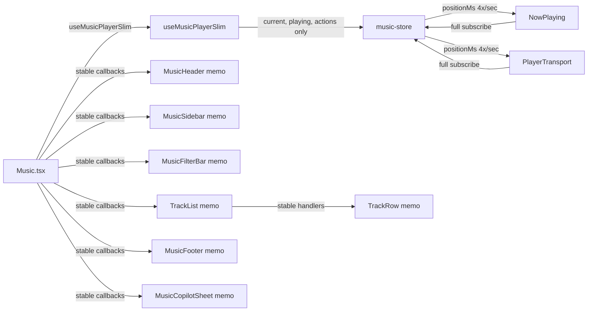

# Problem Analysis

### Root Cause

The Music page re-renders ~4 times per second during playback. `useMusicPlayer` (lines 16-17 of `use-music-player.ts`) subscribes to `positionMs` and `durationMs` from the Zustand store. These values are updated by `handleSnapshot` in `music-store.ts` (line 432-456) on every playback tick (~250ms interval).

### Cascade Effect

When the Music page re-renders, every inline arrow function in `Music.tsx` gets a new reference, defeating `memo()` on MusicHeader, MusicSidebar, AlbumGrid, ArtistGrid, and PlaylistGrid — they all re-render even though their actual data hasn't changed.

### Contributing Issues

1. **TrackList not memoized** — `TrackList.tsx` exports a plain function, not wrapped in `memo()`.
2. **TrackRow callbacks defeat memo** — `TrackRowImpl` (line 94-98) creates `useCallback` wrappers that depend on `track` object references that change each render.
3. **MusicFilterBar, MusicFooter, CreatePlaylistDialog, PreviewFileDialog not memoized** — these components re-render on every parent change.
4. **`heading` not memoized in useMusicLibrary** — line 322-339 computes `heading` on every render with string operations.
5. **`useMusicCopilot` creates new context object** — line 35-41 creates a new object on every render (minor impact since useAgentChat stores it in a ref).

### Why Copilot Feels Laggy

When you click the Copilot button, React must first complete all pending re-renders triggered by the playback tick. With 500 tracks, filter computations, and all inline callbacks being recreated, the main thread is blocked for hundreds of milliseconds before the Sheet can animate open.

# Technical Design

### Current Architecture

```
Music.tsx (320 lines)
├─ useMusicPlayer() → subscribes to 16 store slices (positionMs updates 4x/sec)
├─ useMusicLibrary() → returns new object every render
├─ MusicHeader (memoized) ← defeated by new prop refs
├─ MusicSidebar (memoized) ← defeated by new prop refs
├─ MusicFilterBar (NOT memoized)
├─ TrackList (NOT memoized)
│  └─ TrackRow (memoized) ← defeated by unstable callbacks
├─ NowPlaying (subscribes to useMusicPlayer)
├─ MusicFooter (NOT memoized)
├─ MusicCopilotSheet (NOT memoized)
└─ Dialogs (NOT memoized)
```

### Key Decisions

1. **Slim player hook for Music page** — create `useMusicPlayerSlim` that subscribes only to `current`, `playing`, and action methods. No `positionMs`, `durationMs`, `volume`, etc. This prevents the Music page from re-rendering on playback ticks.

2. **Memoize all extracted components** — wrap TrackList, MusicFilterBar, MusicFooter, CreatePlaylistDialog, PreviewFileDialog, and MusicCopilotSheet in `memo()`.

3. **Stabilize inline callbacks in Music.tsx** — wrap `openArtist`, `openAlbum`, and all inline arrow functions in `useCallback`.

4. **Memoize `heading` in useMusicLibrary** — add `useMemo` for the heading computation.

5. **Stabilize TrackRow callbacks** — remove unnecessary `useCallback` wrappers in `TrackRowImpl` that depend on unstable `track` object references.

### Architecture Diagram



NowPlaying and PlayerTransport still subscribe to the full store (they need positionMs for progress bars), but the Music page only subscribes to the slices it actually reads.

# Delivery Steps

### ✓ Step 1: Create useMusicPlayerSlim hook and update Music.tsx
Create a slim player hook that subscribes only to fields the Music page actually reads, preventing 4x/sec re-renders.
- Create `src/hooks/use-music-player-slim.ts` subscribing only to `current`, `playing`, `toggle`, `playTracks`, `playTrack`, `enqueue`, `next`, `previous` from the music store.
- Update `Music.tsx` to import `useMusicPlayerSlim` instead of `useMusicPlayer`.
- This alone eliminates the root cause: the Music page will no longer re-render on playback position ticks.

### ✓ Step 2: Memoize all components and stabilize callbacks
Wrap all extracted components in `memo()` and stabilize inline callbacks in Music.tsx.
- Wrap `TrackList` export in `memo()` in `TrackList.tsx`.
- Wrap `MusicFilterBar` export in `memo()` in `MusicFilterBar.tsx`.
- Wrap `MusicFooter` export in `memo()` in `MusicFooter.tsx`.
- Wrap `CreatePlaylistDialog` export in `memo()` in `CreatePlaylistDialog.tsx`.
- Wrap `PreviewFileDialog` export in `memo()` in `PreviewFileDialog.tsx`.
- Wrap `MusicCopilotSheet` export in `memo()` in `MusicCopilotSheet.tsx`.
- Wrap `openArtist`, `openAlbum` in `useCallback` in `Music.tsx`.
- Replace inline arrow functions in `Music.tsx` props with `useCallback`-wrapped stable handlers.
- Memoize `heading` computation in `useMusicLibrary` with `useMemo`.
- Memoize context object in `useMusicCopilot` with `useMemo`.

### ✓ Step 3: Stabilize TrackRow callbacks and verify
Fix TrackRow callback instability and verify all changes compile and work correctly.
- In `TrackRowImpl`, replace `useCallback` wrappers that depend on `track` object with simple inline handlers (the closure creation cost is negligible; the issue was that `track` reference changes defeat memo).
- Run `bunx tsc --noEmit -p tsconfig.json` to verify typecheck passes.
- Verify the Music page no longer re-renders on playback ticks and Copilot opens responsively.