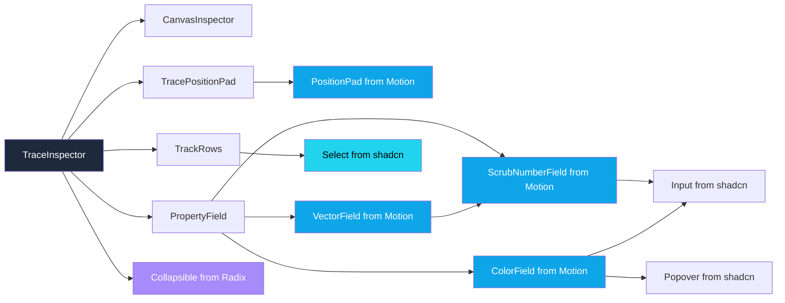

# Requirements

### Current Implementation

**TraceInspector.tsx** (619 lines) is the property editor for NovaTrace's 2D SVG animation system. It has two modes:
- **No selection** → `CanvasInspector`: Artboard dimensions, duration, FPS, document stats, shortcuts
- **Element selected** → Property fields grouped by kind (transform, appearance, geometry, text, content)

**Current controls:**
- `NumberInput`: Raw HTML number input with direct `onChange` — every keystroke fires `updateAttributes`
- `ColorInput`: Native color swatch + text input, no presets, no validation
- `FieldRow`: Label with hidden stopwatch toggle (opacity-0 until hover)
- `TrackRows`: Inline keyframe editor with raw `<select>` for easing
- `Section`: Simple section wrapper with border and title

**Theming issue**: All colors are hardcoded (`bg-[#080e1a]`, `text-slate-200`, `border-white/10`) — cannot adapt to light mode or custom themes.

**Property descriptor system** (`registry.ts`): 6 kinds (number, percent, color, text, boolean, select), 5 groups, ~30 animatable properties across 10 element types.

### Key Decisions

**1. Reuse Motion controls directly, not copy.** The Motion Inspector controls (`ScrubNumberField`, `ColorField`, `PositionPad`, `VectorField`) are already polished and tested. Import them from `components/motion/inspector/controls/` rather than duplicating.

**2. Adapt PositionPad for 2D, not reuse as-is.** Motion's `PositionPad` uses `MotionVector3` (3-element array). NovaTrace uses separate `x` and `y` properties with `getElementPosition` / `positionPatch`. Create a thin adapter component `TracePositionPad` that bridges the two.

**3. Keep the PropertyDescriptor system unchanged.** The registry is the single source of truth for all element types. Instead of modifying descriptors, the `PropertyField` component will dispatch to different controls based on `kind` and `property` name.

**4. Draft/commit in ScrubNumberField, not a wrapper.** `ScrubNumberField` already implements draft/commit internally. No additional wrapper needed.

**5. Collapsible groups with persisted state.** Use `Collapsible` from Radix UI with `useState` for open/closed state (no persistence to localStorage in Phase 3 — keep it simple).

**6. X/Y fields replaced by PositionPad + VectorField.** The transform group will show:
- `TracePositionPad` (visual 2D pad)
- `VectorField` with axes `['x', 'y']` (numeric fields)
- Rotation, Scale X, Scale Y as individual `ScrubNumberField` components

### Proposed Changes

**File: `TraceInspector.tsx`** — Major refactor

1. **Theming**: Replace all hardcoded colors with shadcn tokens:
   - `bg-[#080e1a]` → `bg-card/35`
   - `text-slate-200` → `text-foreground`
   - `text-slate-400` → `text-muted-foreground`
   - `border-white/10` → `border-border`
   - `bg-white/[0.04]` → `bg-accent/30`

2. **Import Motion controls**:
   ```
   import { ScrubNumberField } from '@/components/motion/inspector/controls/scrub-number';
   import { ColorField } from '@/components/motion/inspector/controls/color-field';
   import { VectorField } from '@/components/motion/inspector/controls/vector-field';
   ```

3. **Create `TracePositionPad`** (inline component):
   - Adapts `PositionPad` for 2D: reads `x`/`y` from element via `getElementPosition`, writes via `positionPatch`
   - Uses `extent` based on canvas dimensions (e.g., canvas width / 2)
   - Shows X and Y values in degrees/pixels

4. **Replace `NumberInput` with `ScrubNumberField`**:
   - For `x`/`y` properties: use `VectorField` with axes `['x', 'y']`
   - For rotation, scaleX, scaleY: use `ScrubNumberField` with appropriate step
   - For percent properties (opacity, fillOpacity): use `ScrubNumberField` with 0-100 range

5. **Replace `ColorInput` with `ColorField`**:
   - For fill, stroke, and other color properties
   - Adds preset palette, hex validation, oklch support

6. **Make `Section` collapsible**:
   - Wrap each `Section` in `Collapsible` with `CollapsibleTrigger` (chevron icon)
   - Default all groups expanded

7. **Replace easing `<select>` with shadcn `Select`**:
   - Import `Select`, `SelectContent`, `SelectItem`, `SelectTrigger`, `SelectValue`
   - Style with theme tokens

8. **Reorganize `CanvasInspector`**:
   - Artboard section: Width, Height, Duration, FPS (collapsible)
   - Document section: Stats only (collapsible, default collapsed)
   - Shortcuts section: Keyboard shortcuts (collapsible, default collapsed)

9. **Improve stopwatch visibility**:
   - Change from `opacity-0 group-hover:opacity-100` to always visible with lower opacity
   - Add tooltip or label for discovery

10. **Replace raw labels with `FieldLabel`**:
    - Use `Field` and `FieldLabel` from `@/components/ui/field` for consistent styling

### Architecture Diagram



### Risks

- **PositionPad extent**: The pad needs a sensible default extent. If the canvas is 1920×1080, an extent of 960 would make the pad too small. Use canvas dimensions / 4 as a starting point.
- **ScrubNumberField axis colors**: The Motion version uses chart CSS variables (`--chart-5`, `--chart-3`). Ensure these exist in the NovaTrace theme context.
- **ColorField oklch support**: The canvas-based color conversion in `ColorField` requires a DOM context. This works fine in the browser but won't work in SSR (not an issue for Electron).
- **TrackRows complexity**: The inline track editor is verbose but functional. Moving it to a collapsible section reduces visual noise but doesn't solve the underlying complexity. A future phase could delegate to the timeline.

# Delivery Steps

### * Step 1: Phase 1 — Theming, draft/commit, and shadcn primitives
Replace all hardcoded colors with shadcn theme tokens and implement draft/commit for numeric inputs.

- Replace `bg-[#080e1a]`, `text-slate-200`, `border-white/10`, `bg-white/[0.04]` with shadcn tokens (`bg-card/35`, `text-foreground`, `border-border`, `bg-accent/30`) in `TraceInspector.tsx`
- Replace `NumberInput` with `ScrubNumberField` from Motion Inspector for all numeric properties (rotation, scaleX, scaleY, percent properties)
- Replace `ColorInput` with `ColorField` from Motion Inspector for all color properties (fill, stroke)
- Import and use `Field` and `FieldLabel` from `@/components/ui/field` for consistent label styling
- Improve stopwatch visibility: change from `opacity-0` to always visible with `opacity-60` and hover state
- Replace raw `<select>` for easing with shadcn `Select` component
- Verify all controls work with the existing `PropertyDescriptor` system without modifying `registry.ts`

###   Step 2: Phase 2 — ScrubNumberField, ColorField, and 2D PositionPad
Add a 2D PositionPad for X/Y editing and integrate VectorField for numeric position fields.

- Create `TracePositionPad` component in `TraceInspector.tsx` that adapts Motion's `PositionPad` for 2D:
  - Reads X/Y from element via `getElementPosition(element, timeMs)`
  - Writes via `positionPatch(element, target, timeMs)` through `updateAttributes`
  - Uses canvas dimensions / 4 as the default extent
  - Shows pixel values with step=1
- Import `VectorField` from Motion Inspector with axes `['x', 'y']` for numeric position fields
- Replace the separate X and Y `PropertyField` renders in the transform group with:
  - `TracePositionPad` (visual 2D pad)
  - `VectorField` (numeric X/Y fields)
- Keep rotation, scaleX, scaleY as individual `ScrubNumberField` components
- Update the `PropertyField` component to skip X and Y properties (handled by PositionPad + VectorField)
- Verify drag-to-scrub works on all numeric fields with draft/commit behavior

###   Step 3: Phase 3 — Collapsible groups, easing Select, and CanvasInspector reorganization
Make property groups collapsible and reorganize the CanvasInspector into cleaner sections.

- Import `Collapsible`, `CollapsibleTrigger`, `CollapsibleContent` from `@/components/ui/collapsible`
- Wrap each property group section in a `Collapsible` component with a chevron icon trigger
- Default all property groups to expanded state
- Reorganize `CanvasInspector` into three collapsible sections:
  - Artboard: Width, Height, Duration, FPS (default expanded)
  - Document: Stats only (default collapsed)
  - Shortcuts: Keyboard shortcuts (default collapsed)
- Add `ChevronDown` / `ChevronRight` icons from lucide-react for collapsible triggers
- Verify the inspector remains responsive with all groups expanded and collapsed
- Test the complete flow: select element → edit properties → animate with stopwatch → keyframe with easing Select