# Requirements

### Overview
Two related goals:
1. **Fix the WebGPU error** — `no available backend found. ERR: [webgpu] Error: Failed to get GPU adapter.` This prevents Transformers.js from running in Electron.
2. **Integrate offline models into the regular Settings → AI & Models view** so downloaded models appear as a selectable provider alongside cloud providers.

### Scope

**In Scope:**
- Enable WebGPU in Electron via `--enable-unsafe-webgpu` flag
- Add an "Offline (Transformers.js)" provider to the AI registry
- Show downloaded offline models in the Settings → AI & Models model selector
- Route copilot chat through the renderer's `use-offline-ai` hook when an offline model is selected
- Persist the selected offline model via settings

**Out of Scope:**
- Running Transformers.js in the main process (not possible — it requires a browser environment)
- Tool calling for offline models (the renderer-side agent bypasses the main process tool system)
- Embedding models via Transformers.js in the RAG pipeline

### User Stories
- As a user, I want to select an offline model in Settings → AI & Models so my copilot chat runs locally without internet.
- As a user, I want WebGPU to work in Electron so my offline model runs fast.
- As a user, I want downloaded models from the Offline Models view to appear in the regular model selector.

### Functional Requirements
- The WebGPU flag is enabled before the Electron window is created
- An "Offline (Transformers.js)" provider appears in the provider dropdown
- When selected, the model dropdown shows downloaded language models from the offline catalog
- When an offline model is active, the copilot chat uses `use-offline-ai` in the renderer instead of the main process agent
- The offline model selection persists across app restarts via settings

# Technical Design

### Current Implementation

**WebGPU in Electron:** The `src/main/main.ts` file creates the BrowserWindow at line 125 but never enables WebGPU. Electron disables WebGPU by default for security. The fix is a single line before `app.whenReady()`.

**Provider Registry:** `src/main/ai/registry.ts` defines `PROVIDERS` — an array of `ProviderConfig` objects. Each has `id`, `name`, `baseURL`, `apiKeyEnvs`, and `freeModels`. The `providers:list` IPC handler in `src/main/ipc/handlers/settings.ts` (line 200) returns these as `ProviderInfo[]` to the renderer.

**Model Resolution:** All agents call `resolveModel(providerId, modelId)` from `src/main/ai/provider.ts`. It only knows about cloud providers (OpenAI-compatible endpoints). There is no path for offline models.

**Offline Models (Renderer-Only):** 
- `src/lib/offline-ai/models.ts` — curated catalog of 10 models
- `src/components/settings/views/OfflineModelsView.tsx` — download/manage UI
- `src/hooks/use-offline-ai.ts` — React hook for inference via Transformers.js
- The `offlineModel` setting is saved via `settings:save` IPC but never read by the main process

**Copilot Chat:** `src/hooks/use-copilot-chat.ts` uses `useAgentChat` which sends requests to the main process via `copilot:chat` IPC. The main process agent (`src/main/ai/agent.ts`) calls `resolveModel()` to get a language model.

### Key Decisions

**Renderer-side routing for offline models.** When the user selects an offline model, the copilot chat bypasses the main process agent and routes through `use-offline-ai` in the renderer. This is the simplest approach because Transformers.js requires a browser environment (WebGPU/WASM). The trade-off is that offline models won't have access to the main process tool system (file operations, RAG, etc.) — they provide raw text generation only.

**Offline provider in the registry.** We add an `offline` provider to `PROVIDERS` with no `baseURL` and no `apiKeyEnvs` (like Ollama). The `providers:list` handler will include it, and `providers:models` will return downloaded models from the offline catalog.

### Proposed Changes

#### 1. Fix WebGPU in Electron
- **`src/main/main.ts`** — Add `app.commandLine.appendSwitch('enable-unsafe-webgpu')` before `app.whenReady()` (around line 82, near the existing hardware acceleration check)

#### 2. Add Offline Provider to Registry
- **`src/main/ai/registry.ts`** — Add an `offline` provider entry:
  ```ts
  {
    id: 'offline',
    name: 'Offline (Transformers.js)',
    freeModels: [],
    note: 'Runs locally in the browser. Download models in Settings → Offline Models first.',
  }
  ```
- **`src/main/ai/provider.ts`** — Update `listProviderModels` to handle the `offline` provider by returning downloaded models from the catalog (since it has no `/models` endpoint)

#### 3. IPC for Downloaded Models
- **`src/main/ipc/channels.ts`** — Add `offline-models:list` channel type
- **`src/main/ipc/handlers/settings.ts`** — Add handler that returns the list of downloaded model IDs from the renderer's cache state

#### 4. ModelsView Integration
- **`src/components/settings/views/ModelsView.tsx`** — When `activeProvider === 'offline'`, load models from `offline-models:list` IPC instead of `providers:models`

#### 5. Copilot Chat Routing
- **`src/hooks/use-copilot-chat.ts`** — Detect when the active provider is `offline` and route through `use-offline-ai` instead of `useAgentChat`
- **`src/hooks/use-offline-ai.ts`** — Ensure the hook supports the model ID from settings

### Data Flow

```mermaid
graph LR
    A[OfflineModelsView<br/>downloads models] --> B[Transformers.js Cache<br/>Cache API]
    B --> C[offline-models:list<br/>IPC handler]
    C --> D[ModelsView<br/>Settings → AI & Models]
    D --> E[Settings store<br/>activeProvider: offline]
    E --> F[use-copilot-chat<br/>detects offline]
    F --> G[use-offline-ai hook<br/>renderer]
    G --> H[Transformers.js<br/>Web Worker]
    H --> I[Response stream<br/>to UI]
```



# Testing

### Validation Approach
TypeScript compilation via `bunx tsc --noEmit` after each stage.

### Key Scenarios
1. **WebGPU flag** — Launch the app and verify no `Failed to get GPU adapter` error in the console when using Transformers.js
2. **Offline provider visible** — Open Settings → AI & Models and confirm "Offline (Transformers.js)" appears in the provider dropdown
3. **Downloaded models listed** — After downloading a model in Settings → Offline Models, select the Offline provider in AI & Models and confirm the model appears in the model dropdown
4. **Offline chat works** — Select an offline model, send a message in the copilot chat, and confirm the response streams from the renderer
5. **Settings persist** — Restart the app and confirm the offline provider/model selection is preserved

### Edge Cases
- No models downloaded yet → model dropdown shows "Download models in Settings → Offline Models first"
- WebGPU unavailable → falls back to WASM (CPU) automatically
- Offline model not initialized → `use-offline-ai` initializes on first generation call
- Switching from offline to cloud provider → chat routes back to main process agent seamlessly

# Delivery Steps

### ✓ Step 1: Fix WebGPU in Electron
Add the `--enable-unsafe-webgpu` Chromium flag to Electron startup so Transformers.js can access the GPU adapter.
- Add `app.commandLine.appendSwitch('enable-unsafe-webgpu')` to `src/main/main.ts` before `app.whenReady()` (near line 82, after the hardware acceleration check).
- Verify the app launches without the `Failed to get GPU adapter` error.

### ✓ Step 2: Add Offline provider to registry and settings
Register an "Offline (Transformers.js)" provider so it appears in Settings → AI & Models.
- Add an `offline` entry to `PROVIDERS` in `src/main/ai/registry.ts` (no baseURL, no apiKeyEnvs, with a note about downloading models first).
- Update `listProviderModels` in `src/main/ai/provider.ts` to handle `offline` — return language models from the offline catalog instead of calling a `/models` endpoint.
- Add `offline-models:list` IPC channel in `src/main/ipc/channels.ts` and a handler in `src/main/ipc/handlers/settings.ts` that returns available offline model IDs.
- Update `ModelsView.tsx` to load offline models via the new IPC channel when the offline provider is selected.

### ✓ Step 3: Route copilot chat through renderer for offline models
When an offline model is selected, the copilot chat uses the renderer's use-offline-ai hook instead of the main process agent.
- Update `use-copilot-chat.ts` to read the active provider from settings. When `activeProvider === 'offline'`, use `use-offline-ai` with the saved `offlineModel` ID instead of `useAgentChat`.
- Ensure `use-offline-ai.ts` reads the model ID from settings (`offlineModel`) and initializes the model on first use.
- Verify TypeScript compilation passes with `bunx tsc --noEmit`.