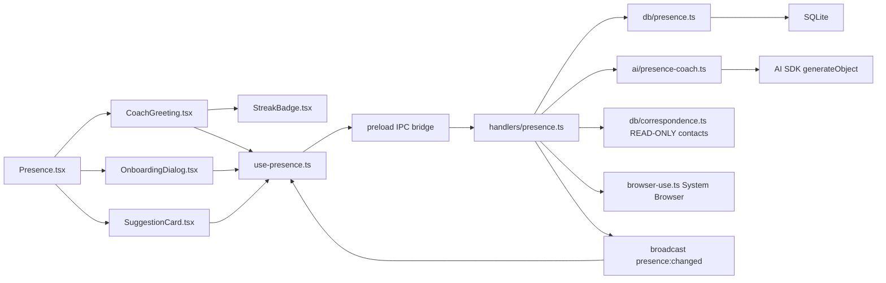

# Requirements

### Overview & Goals

Replace the **Correspondence** system with a **Presence** system — a warm, encouraging social presence coach at `/presence` that helps users reconnect with society and build their social media presence across platforms. It proposes post drafts, platform suggestions, connection prompts, and engagement prompts. The user acts manually (copy to clipboard, open platform in the System Browser) and reports back; the coach adapts from accumulated feedback. No autonomous posting — aligned with "own the intent, not the delivery."

Presence reuses the existing `contacts` and `contact_channels` tables from the Correspondence data layer (these remain unchanged) but replaces all Correspondence UI, IPC channels, and handlers with Presence-specific functionality. The coach reads contacts read-only to suggest who to reach out to, helping users "knock on doors" by researching and finding opportunities.

The system is designed to feel like checking in with a supportive mentor who remembers you, celebrates small wins, and gently nudges you forward — not a sterile task tracker.

### Scope

**In Scope:**
- **Replaces Correspondence**: Removes Correspondence UI page, sidebar entry, IPC channels, and handlers. The contacts database tables remain as a shared read-only data source.
- Project-scoped coach: suggestions generated per project from context (outcome, contacts registry, documents, workspace pages, prior feedback)
- Five suggestion kinds: `post_draft`, `platform_suggestion`, `connection_suggestion`, `engagement_prompt`, `group_suggestion`
- **System Browser integration**: Opens a visible Electron BrowserWindow (via `browser-use.ts`) for browsing social media platforms, signing up, and engaging — not just `shell.openExternal`
- **Daily streak tracking**: consecutive days the user completed at least one action, with gentle milestone celebrations
- **Coach greeting**: personalized welcome message on landing, based on recent activity and streak
- **Coach onboarding**: first-run conversation where the coach introduces itself and asks about goals and platforms
- **Conversational suggestion cards**: each card feels like the coach is talking to you, with conversational action buttons
- Feedback capture: per-item status (`pending | done | skipped | edited`) + free-text feedback/outcome
- Persistent history across sessions (SQLite)
- **Five platforms**: LinkedIn, X/Twitter, Facebook, Instagram, Discord (plus `any` for platform-agnostic suggestions)
- Navigation entry in sidebar (replaces Correspondence position — after Tasks), route in `routes.tsx`

**Out of Scope (v1):**
- Autonomous posting or messaging
- Auto metric fetch from platforms
- Chat-agent tool exposure
- Engagement prompts requiring live platform data scraping
- Streak freeze/recovery mechanics (v2 consideration)
- Push notifications for reminders

### User Stories

1. As a user wanting to reconnect with social media, I want Presence to greet me warmly and show me what to focus on today, so I feel guided rather than overwhelmed.
2. As a user, I want to see my streak and feel encouraged to keep it going, so building a daily habit feels rewarding.
3. As a user, I want suggestion cards that feel like a coach talking to me, so acting on them feels natural and supportive.
4. As a user, I want to copy a suggested post draft and open the platform in the System Browser to publish it without leaving the app.
5. As a user, I want to mark suggestions as done/skipped/edited and add feedback so the coach learns what works for me.
6. As a first-time user, I want the coach to introduce itself and ask about my goals before generating suggestions, so I feel set up for success.
7. As a user building a brand, I want the coach to suggest people from my contacts registry to reach out to, so I can "knock on doors" with targeted outreach.

### Functional Requirements

#### Coach Greeting and Today's Focus
- On landing, a warm greeting appears: "Welcome back!" with a personalized message based on recent activity and streak
- Below the greeting, 1–3 "Today's focus" suggestions are highlighted as the top actions for the day
- If the streak is active, it is shown with an encouraging message: "3 days in a row — you're building a habit!"
- If the streak was broken, a gentle nudge: "Welcome back! Let's pick up where you left off."

#### Coach Onboarding (First Run)
- First time the user opens Presence, a modal conversation appears:
  1. Coach introduces itself: "I'm your Presence coach. I'll help you build your social presence, one step at a time."
  2. Asks 2–3 questions via selectable chips: which platforms the user is on or wants to join, what their main goal is (personal brand, business growth, networking, learning)
  3. Generates the first batch of suggestions based on the answers
- Answers are stored in `context_json` of the first batch for future reference

#### Daily Streak
- Tracks consecutive days where the user marked at least one item as `done` or `edited`
- Stored as `streak_count` and `last_active_date` in a new `presence_profile` row per project (or derived from `presence_items`)
- Shown in the header with a flame icon and count
- Milestone celebrations at days 3, 7, 14, 30: "Week 1 complete! You're finding your rhythm."

#### Conversational Suggestion Cards
- Each card has a coach-style intro line: "Here's a post idea based on your recent work" or "You mentioned wanting to connect with people in X — here's someone to reach out to"
- Action buttons are phrased conversationally: "I'll post this" / "Not today" / "Let me think about it"
- After marking done, a follow-up prompt: "How did it go?" with a feedback textarea
- Platform suggestion cards have a prominent "Join Platform" button with encouraging copy: "Ready to join LinkedIn? I'll open it for you."

#### Generate
- Button in header (optional focus text) triggers AI generation; returns 3–8 suggestions mixed across kinds
- The AI system prompt includes the coach persona: warm, encouraging, action-first, celebrates small wins

#### SuggestionCard
- Shows kind badge, platform badge, title, editable body, source chip, conversational actions
- Copy to clipboard, **Open in System Browser** (visible BrowserWindow via `browser-use.ts`), Mark done/skipped/edited, feedback textarea, log outcome

#### Batches
- Displayed newest-first; each expands to show cards
- Each batch header shows a summary from the AI: "Here are 5 suggestions for this week"

#### Empty State
- After onboarding, if no suggestions exist: "Your social presence journey starts here" with a single "Generate suggestions" button
- If project has no docs/contacts: gentle nudge to add content first

#### Counts Subtitle
- Shows pending/done/skipped counts in header

#### System Browser
- Uses `browser-use.ts` `openBrowser()` with `visible: true` and `partition: 'presence'` so cookies persist across Presence sessions for each platform

# UX Design

### Design Philosophy

Presence is not a task tracker. It is a **warm, encouraging coach** that helps the user reconnect with society. Every interaction should feel like checking in with a supportive mentor who remembers you, celebrates small wins, and gently nudges you forward.

**Design principles:**
- **Warmth over efficiency**: The interface prioritizes feeling welcome over raw speed. Greetings, encouragement, and conversational language are features, not decoration.
- **Progress over perfection**: Small actions are celebrated. One post is better than zero. The streak system makes showing up daily feel meaningful.
- **Guidance over choice paralysis**: Instead of dumping all suggestions at once, the coach highlights 1–3 "Today's focus" items so the user knows where to start.
- **Conversation over commands**: Action buttons use natural language ("I'll post this" / "Not today") instead of sterile labels ("Mark Done" / "Skip").
- **Empty states as invitations**: Never show a blank screen. Always show what to do next, with encouraging copy.

### Coach Greeting and Today's Focus

The landing page opens with a personalized greeting section (`src/components/presence/CoachGreeting.tsx`):

```
┌─────────────────────────────────────────────────────┐
│  🔥 3-day streak                                    │
│                                                     │
│  Welcome back! You're building a habit.             │
│  Here's what to focus on today:                     │
│                                                     │
│  ┌─ Post a reflection on your recent project ─────┤│
│  ┌─ Connect with Sarah Chen on LinkedIn ──────────┤│
│  ┌─ Comment on 2 posts in your Discord community ─┤│
│                                                     │
│  [Generate more suggestions]                        │
└─────────────────────────────────────────────────────┘
```

**Greeting logic** (computed in `use-presence.ts` from streak + recent activity):
- Active streak ≥ 3 days: "You're building a habit!" + flame icon
- Active streak 1–2 days: "Great start! Keep it going."
- Streak broken, returned: "Welcome back! Let's pick up where you left off."
- No activity yet (post-onboarding): "Ready to start? Here are some ideas."
- First time (pre-onboarding): triggers onboarding modal instead

**Today's focus**: The 1–3 most recent `pending` items from the latest batch, surfaced as prominent cards. If fewer than 3 pending items exist, the "Generate more suggestions" button is highlighted.

### Coach Onboarding (First Run)

A modal conversation (`src/components/presence/OnboardingDialog.tsx`) that appears the first time the user opens Presence:

**Step 1 — Introduction:**
```
┌─────────────────────────────────────────────────────┐
│  Hi! I'm your Presence coach.                       │
│                                                     │
│  I'll help you build your social presence,          │
│  one step at a time. I'll suggest posts to make,    │
│  people to connect with, and platforms to join.     │
│                                                     │
│  You take it from there — I'll open the platform    │
│  for you, and we'll learn together what works.      │
│                                                     │
│  Let's start with a few questions...                │
│                                                     │
│                        [Skip]  [Let's go →]        │
└─────────────────────────────────────────────────────┘
```

**Step 2 — Platforms (multi-select chips):**
```
Which platforms are you on — or want to join?

[ LinkedIn ] [ X/Twitter ] [ Facebook ] [ Instagram ] [ Discord ]
```

**Step 3 — Goal (single-select chips):**
```
What's your main goal?

[ Personal brand ] [ Business growth ] [ Networking ] [ Learning ]
```

**Step 4 — Auto-generate first batch** using the answers as context.

Onboarding answers are stored in `presence_profile` table (new) so the coach remembers them across sessions. The user can re-answer at any time via a "Update my goals" button in the header.

### Daily Streak

A visible streak counter in the header (`src/components/presence/StreakBadge.tsx`):

```
🔥 3    (with tooltip: "3 days in a row")
```

**Streak computation** (in `db/presence.ts`, `getStreak()`):
- Counts consecutive days (including today) where at least one item was marked `done` or `edited`
- Uses `last_active_date` and `streak_count` from `presence_profile` for O(1) reads
- Updated on every `item-update` with status `done` or `edited`

**Milestone celebrations** (inline toast/banner, not modal):
- Day 3: "3 days in a row — you're building a habit!"
- Day 7: "Week 1 complete! You're finding your rhythm."
- Day 14: "Two weeks! This is becoming part of your routine."
- Day 30: "One month! Your social presence is growing."

### Conversational Suggestion Cards

Each card (`src/components/presence/SuggestionCard.tsx`) has three states:

**State 1 — Pending (coach introduces the suggestion):**
```
┌─────────────────────────────────────────────────────┐
│  POST DRAFT  ·  LinkedIn                             │
│                                                     │
│  Here's a post idea based on your recent work on    │
│  the Q2 project. It reflects your expertise and     │
│  invites conversation:                              │
│                                                     │
│  [editable body text...]                            │
│                                                     │
│  [ Copy ]  [ Open LinkedIn ]                        │
│  [I'll post this]  [Not today]  [Let me think]     │
└─────────────────────────────────────────────────────┘
```

**State 2 — Done (coach asks for feedback):**
```
┌─────────────────────────────────────────────────────┐
│  POST DRAFT  ·  LinkedIn  Done                      │
│                                                     │
│  Nice! How did it go? Any reactions or comments     │
│  worth noting? (This helps me suggest better next   │
│  time)                                              │
│                                                     │
│  [feedback textarea...]                             │
│                                                     │
│  [Save feedback]                                    │
└─────────────────────────────────────────────────────┘
```

**State 3 — Skipped (coach acknowledges, no pressure):**
```
┌─────────────────────────────────────────────────────┐
│  POST DRAFT  ·  LinkedIn  · Skipped                 │
│                                                     │
│  No problem — we'll try something else next time.   │
│                                                     │
│  [Undo]                                             │
└─────────────────────────────────────────────────────┘
```

### Emotional Design Language

| Context | Copy Example |
|---|---|
| Welcome back, active streak | "Welcome back! You're on a {n}-day streak. Let's keep it going." |
| Welcome back, broken streak | "Welcome back! Let's pick up where you left off." |
| First generation | "Here are some ideas to get you started." |
| Re-generation | "Fresh suggestions based on what you've tried so far." |
| All items done in batch | "You've tackled everything in this batch! Want more?" |
| All items skipped | "No pressure. When you're ready, I'll have new ideas." |
| Milestone reached | "Week 1 complete! You're finding your rhythm." |
| Empty, post-onboarding | "Your social presence journey starts here." |
| Platform suggestion | "Ready to join {platform}? I'll open it for you." |
| Connection suggestion | "You mentioned wanting to connect with people in {field} — here's someone to reach out to." |

# Technical Design

### Current Implementation

The project follows a well-established pattern for new systems, demonstrated by the Correspondence system:

- **Schema**: `src/main/db/schema.ts` — DDL statements in `MIGRATION_STATEMENTS` array, applied idempotently
- **Storage**: `src/main/db/correspondence.ts` — sync better-sqlite3, `getDb()`, CRUD functions for contacts and channels
- **IPC channels**: `src/main/ipc/channels.ts` — `IpcChannels` interface with `req`/`res` types, domain type re-exports
- **IPC handlers**: `src/main/ipc/handlers/correspondence.ts` — `registerCorrespondenceHandlers({ mainWindow })`, `broadcastChanged()` pattern
- **Handler registration**: `src/main/ipc/index.ts` — import + call in `registerIpcHandlers`
- **AI**: `src/main/ai/task-copilot.ts` — `generateObject()` with zod schema, `resolveModel(settings.activeProvider, settings.activeModel)`
- **Hooks**: `src/hooks/use-correspondence.ts` — `useDbResource` for reads, `useCallback` for writes, event-based invalidation
- **UI**: `src/renderer/pages/Correspondence.tsx` — `PageHeader`, `useProjectScope`, surface components
- **Tests**: `src/__tests__/correspondence-db.test.ts` — in-memory SQLite, `useTestDatabase`, `applyMigrations`
- **Routes**: `src/renderer/routes.tsx` — simple path entry
- **Sidebar**: `src/components/AppSidebar.tsx` — `NAV_ITEMS` array with `to`, `label`, `icon`
- **System Browser**: `src/main/browser-use.ts` — `openBrowser(url, { visible, partition })` creates a visible Electron BrowserWindow with persistent cookies via `persist:` partition. Used by chat agent tools (`src/main/tools/browser-use.ts`) but not yet exposed to any UI page.

### Key Decisions

1. **Presence replaces Correspondence UI** — The Correspondence page, sidebar entry, IPC channels, and handlers are removed. The `contacts` and `contact_channels` database tables remain as a shared read-only data source that Presence reads to suggest outreach targets.
2. **Four new tables** (`presence_batches`, `presence_items`, `presence_posts`, `presence_profile`) — the profile table stores streak data, onboarding answers, and user preferences
3. **Five platforms**: LinkedIn, X/Twitter, Facebook, Instagram, Discord — plus `any` for platform-agnostic suggestions
4. **`platform_suggestion` kind** — A new suggestion kind that proposes platforms to join, with a "Join Platform" button opening the platform's landing page in the System Browser
5. **System Browser via `browser-use.ts`** — Instead of `shell.openExternal` (which opens the user's default browser), Presence opens a visible Electron BrowserWindow with `partition: 'presence'` so login cookies persist across sessions. This keeps the user within the app while browsing social media.
6. **Single `generateObject` call** for AI generation — follows `task-copilot.ts` pattern, not a multi-step agent
7. **`presence:changed` broadcast** after every mutation — follows the existing invalidation pattern
8. **No chat-agent tool exposure** — deferred per spec; v1 is UI-triggered only
9. **Context gathered in IPC handler** — the handler collects project name/outcome/deadline, contacts from `listContacts()` (top 20, read-only), document titles (top 20), page titles (top 20), last 10 presence items with feedback, **plus onboarding answers and streak data from `presence_profile`**
10. **Coach persona in AI system prompt** — the prompt instructs the AI to write warm, encouraging suggestions with conversational intro lines, not sterile task descriptions

### Proposed Changes

**Removed files (16):**
1. `src/renderer/pages/Correspondence.tsx` — replaced by Presence page
2. `src/main/ipc/handlers/correspondence.ts` — replaced by Presence handlers
3. `src/hooks/use-correspondence.ts` — replaced by Presence hooks
4. `src/hooks/use-correspondence-copilot.ts` — Correspondence-specific copilot hook
5. `src/components/correspondence/AttentionBoard.tsx` — Correspondence-only UI
6. `src/components/correspondence/ContactList.tsx` — Correspondence-only UI
7. `src/components/correspondence/CorrespondenceEmpty.tsx` — Correspondence-only UI
8. `src/components/correspondence/DeadlineRail.tsx` — Correspondence-only UI
9. `src/components/correspondence/HarvestReviewGrid.tsx` — Correspondence-only UI
10. `src/components/correspondence/HarvestSheet.tsx` — Correspondence-only UI
11. `src/components/correspondence/MessageComposer.tsx` — Correspondence-only UI
12. `src/components/correspondence/RecipientLane.tsx` — Correspondence-only UI
13. `src/components/correspondence/RecipientLanePreview.tsx` — Correspondence-only UI
14. `src/components/correspondence/SequenceTrail.tsx` — Correspondence-only UI
15. `src/components/copilot/CorrespondenceCopilotSheet.tsx` — Correspondence copilot (unimported)
16. `src/__tests__/correspondence-db.test.ts` — replaced by Presence tests

**Preserved (not removed):**
- `src/main/db/correspondence.ts` — contacts and channels storage remains as a shared read-only data source
- `src/lib/correspondence.ts` — shared correspondence utilities (channel normalization, dedup keys) remain for the contacts layer
- `src/main/ai/correspondence-capability.ts` — preserved as it may be referenced by research/agent systems

**New files (11):**
1. `src/lib/presence.ts` — shared labels (platform names, kind labels, status labels, **platform URLs** for System Browser navigation, **greeting copy templates**)
2. `src/main/db/presence.ts` — storage module: `listBatches`, `getBatch`, `createBatch`, `deleteBatch`, `listItems`, `getItem`, `updateItem`, `deleteItem`, `logPost`, `listPosts`, `counts`, **`getStreak`**, **`getProfile`**, **`updateProfile`**
3. `src/main/ai/presence-coach.ts` — `generatePresenceBatch()` via `generateObject`, zod schema for 3-8 items including `platform_suggestion`, **with coach persona in system prompt**
4. `src/main/ipc/handlers/presence.ts` — `registerPresenceHandlers({ mainWindow })`, all channels including `presence:open-browser`
5. `src/hooks/use-presence.ts` — `usePresenceBatches`, `usePresenceBatchDetail`, `usePresenceCounts`, `usePresencePosts`, `usePresenceActions`, **`usePresenceStreak`**, **`usePresenceProfile`**
6. `src/components/presence/SuggestionCard.tsx` — **conversational** kind/platform badges, editable body, **three-state card** (pending/done/skipped), actions (Copy, **Open in System Browser**, Mark status, feedback)
7. `src/components/presence/CoachGreeting.tsx` — **new**: personalized greeting, streak display, today's focus section
8. `src/components/presence/OnboardingDialog.tsx` — **new**: multi-step onboarding modal (intro, platforms, goals, auto-generate)
9. `src/components/presence/StreakBadge.tsx` — **new**: flame icon + count, milestone toast
10. `src/renderer/pages/Presence.tsx` — route page, header with Generate, **coach greeting**, batches list, empty state
11. `src/__tests__/presence-db.test.ts` — in-memory SQLite tests for CRUD operations, **including streak and profile**

**Edited files (5):**
1. `src/main/db/schema.ts` — add 4 `CREATE_*` constants (batches, items, posts, **profile**) with extended platforms/kinds, append to `MIGRATION_STATEMENTS`
2. `src/main/ipc/channels.ts` — **remove** all `correspondence:*` channels, add presence channels + `presence:changed` event. Keep Contact/ContactChannel type imports as Presence reuses them.
3. `src/main/ipc/index.ts` — **remove** `registerCorrespondenceHandlers`, add `registerPresenceHandlers`
4. `src/renderer/routes.tsx` — **remove** correspondence route, add `{ path: 'presence', element: <Presence /> }`
5. `src/components/AppSidebar.tsx` — **replace** Correspondence entry with Presence entry (same position — after Tasks)

### Data Models

**PresenceBatch**: `{ id, project_id, focus, context_json, created_at }`
**PresenceItem**: `{ id, batch_id, kind, title, body, platform, source_kind, source_id, status, feedback, outcome, posted_at, created_at, updated_at }`
- `kind`: `post_draft`, `platform_suggestion`, `connection_suggestion`, `engagement_prompt`, `group_suggestion`
- `platform`: `linkedin`, `x`, `facebook`, `instagram`, `discord`, `any`
- `status`: `pending`, `done`, `skipped`, `edited`
**PresencePost**: `{ id, project_id, platform, content, posted_at, metrics, item_id, created_at }`
**PresenceProfile**: `{ id, project_id, streak_count, last_active_date, onboarding_complete, platforms_json, goal, created_at, updated_at }`
**PresenceItemPatch**: `{ status?, feedback?, outcome?, posted_at?, body? }`
**PresenceBatchDetail**: `{ batch: PresenceBatch; items: PresenceItem[] }`

### Architecture Diagram



# Testing

### Validation Approach

Follow the existing verification sequence:

1. `bunx tsc --noEmit -p tsconfig.json` — type check
2. `python3 scripts/verify-ipc-split.py` — IPC channel coverage
3. `bun run build` — production build
4. `bun test` — unit tests (new `presence-db.test.ts`)
5. `bun run lint` — lint check

### Key Scenarios

- **CRUD**: Create batch → list batches → get batch detail → update item status → delete item
- **Generate flow**: Call `presence:generate` with projectId → returns batch with 3-8 items → items persisted
- **Post logging**: Call `presence:post-log` → creates post record linked to item
- **Counts**: `presence:counts` returns correct batch/pending/done/skipped totals
- **Feedback loop**: Update item with feedback → next generate includes feedback in context
- **Streak**: Mark item done → streak increments; next day mark done → streak increases; skip a day → streak resets
- **Profile**: Onboarding answers stored → retrieved for next generate context
- **System Browser**: Click "Open in System Browser" → visible BrowserWindow opens with platform URL and persistent partition
- **Platform Suggestion**: `platform_suggestion` card shows "Join Platform" button → opens platform landing page in System Browser
- **Empty state**: No batches for project → UI shows generation prompt
- **Onboarding**: First run → modal appears → answers stored → first batch generated
- **Correspondence removal**: No Correspondence route, sidebar entry, or IPC channels remain

### Edge Cases

- No AI model configured → clear error from `resolveModel`
- Project with no contacts/documents → coach generates from minimal context
- Batch with all items skipped → counts reflect correctly
- Delete batch → cascading delete of items (CASCADE constraint)
- Re-generate for same project → new batch, old batches preserved
- System Browser already open → reuses existing BrowserWindow via `browser-use.ts` session map
- Streak computation across midnight boundary → correct day rollover
- Onboarding skipped → coach still generates, but without platform/goal context

# Delivery Steps

### ✓ Step 1: Remove Correspondence and add Presence database schema
Remove all Correspondence UI, components, hooks, IPC, and tests. Add Presence database tables and storage layer.
- **Remove Correspondence page**: `src/renderer/pages/Correspondence.tsx`
- **Remove Correspondence components** (10 files): `src/components/correspondence/` directory (AttentionBoard, ContactList, CorrespondenceEmpty, DeadlineRail, HarvestReviewGrid, HarvestSheet, MessageComposer, RecipientLane, RecipientLanePreview, SequenceTrail)
- **Remove Correspondence copilot**: `src/components/copilot/CorrespondenceCopilotSheet.tsx`, `src/hooks/use-correspondence-copilot.ts`
- **Remove Correspondence hooks**: `src/hooks/use-correspondence.ts`
- **Remove Correspondence IPC handler**: `src/main/ipc/handlers/correspondence.ts`
- **Remove Correspondence tests**: `src/__tests__/correspondence-db.test.ts`
- **Remove** Correspondence route from `src/renderer/routes.tsx`
- **Remove** Correspondence nav entry from `src/components/AppSidebar.tsx`
- **Remove** Correspondence IPC handler registration from `src/main/ipc/index.ts`
- **Remove** all `correspondence:*` channels from `src/main/ipc/channels.ts`. Keep Contact/ContactChannel type imports as Presence reuses them.
- **Preserve**: `src/main/db/correspondence.ts` (contacts storage), `src/lib/correspondence.ts` (utilities), `src/main/ai/correspondence-capability.ts` (agent capability)
- Add `CREATE_PRESENCE_BATCHES`, `CREATE_PRESENCE_ITEMS`, `CREATE_PRESENCE_POSTS`, **`CREATE_PRESENCE_PROFILE`** DDL constants to `src/main/db/schema.ts` with extended platforms (linkedin, x, facebook, instagram, discord, any) and kinds (including platform_suggestion)
- Append all four to `MIGRATION_STATEMENTS` array
- Create `src/main/db/presence.ts` with: `listBatches`, `getBatch` (batch + items), `createBatch`, `deleteBatch`, `listItems`, `getItem`, `updateItem`, `deleteItem`, `logPost`, `listPosts`, `counts`, **`getStreak`**, **`updateStreak`**, **`getProfile`**, **`updateProfile`**
- Create `src/lib/presence.ts` with shared labels (platform names, kind labels, status labels, platform URLs for System Browser, **greeting copy templates for streak states and milestones**)
- Create `src/__tests__/presence-db.test.ts` with in-memory SQLite tests for all CRUD operations, **including streak computation and profile storage**

### ✓ Step 2: AI coach module with contacts and coach persona
Implement the AI generation layer for presence suggestions, reading contacts from the existing contacts table.
- Create `src/main/ai/presence-coach.ts` with `generatePresenceBatch(input: { projectId, focus?, context }) → { summary, items }`
- Use `generateObject` with zod schema: `summary: z.string()`, `items: z.array({...}).min(3).max(8)` with kind (including platform_suggestion), title, body, platform (5 platforms + any), sourceKind, sourceId
- **System prompt includes coach persona**: warm, encouraging, writes conversational intro lines for each suggestion, helps user reconnect with society, proposes never posts, uses only provided context, mixes suggestion kinds including platform suggestions, action-first, coaches user to "knock on doors"
- Model resolution: `resolveModel(settings.activeProvider, settings.activeModel)` with clear error if none configured
- Context shape: project name/outcome/deadline, contacts from `listContacts()` (top 20, read-only from existing contacts table), document titles (top 20), page titles (top 20), last 10 presence items with status/feedback, **onboarding answers (platforms, goal) from `presence_profile`**

### ✓ Step 3: IPC channels, handlers, and System Browser integration
Wire the IPC layer connecting renderer to main process, including System Browser for in-app platform browsing.
- In `src/main/ipc/channels.ts`: import types from `db/presence.ts`, re-export `PresenceBatch`, `PresenceBatchDetail`, `PresenceItem`, `PresenceItemPatch`, `PresencePost`, **`PresenceProfile`**; add presence channels + `presence:changed` event to `IpcChannels`
- Create `src/main/ipc/handlers/presence.ts` with `registerPresenceHandlers({ mainWindow })` implementing all channels:
  - `presence:batches-list`, `presence:batch-get`, `presence:generate` (gathers context including contacts and profile, calls coach, persists batch+items, broadcasts), `presence:item-update` (**also updates streak**), `presence:item-delete`, `presence:post-log`, `presence:posts-list`, `presence:counts`
  - `presence:profile-get` — returns profile for project
  - `presence:profile-update` — stores onboarding answers
  - `presence:streak-get` — returns current streak count and last active date
  - `presence:open-browser` — calls `browser-use.ts` `openBrowser(url, { visible: true, partition: 'presence' })` to open a visible in-app browser window for social media platforms
- Register in `src/main/ipc/index.ts`: import + `registerPresenceHandlers({ mainWindow })`
- Verify with `python3 scripts/verify-ipc-split.py`

### ✓ Step 4: React hooks including streak and profile
Create client-side state and transport hooks.
- Create `src/hooks/use-presence.ts`:
  - `usePresenceBatches(projectId)` — reads via `useDbResource` with `presence:changed` event
  - `usePresenceBatchDetail(id)` — per-batch read with `resourceKey`
  - `usePresenceCounts(projectId)` — counts subscription
  - `usePresencePosts(projectId)` — posts history
  - `usePresenceActions()` — `generate`, `updateItem`, `deleteItem`, `logPost`, `openBrowser` via `useCallback` and `window.electron.ipc.invoke`
  - **`usePresenceStreak(projectId)`** — streak count, last active date, milestone state
  - **`usePresenceProfile(projectId)`** — onboarding answers, platforms, goal
  - **`useGreeting(projectId)`** — computed greeting message based on streak + activity
- Follow the pattern: reads through `useDbResource`, writes are plain invokes (no local state patch)

### ✓ Step 5: UX components — greeting, onboarding, streak, and conversational cards
Build the coach-facing UI components that make Presence feel warm and engaging.
- Create `src/components/presence/CoachGreeting.tsx`: personalized greeting section with streak display, "Today's focus" cards (1–3 pending items), and "Generate more" button. Uses `useGreeting()` for dynamic copy.
- Create `src/components/presence/OnboardingDialog.tsx`: multi-step modal (intro → platforms → goals → auto-generate). Stores answers in `presence_profile`. Shown only when `onboarding_complete` is false.
- Create `src/components/presence/StreakBadge.tsx`: flame icon + count in header, with milestone toast at days 3/7/14/30
- Create `src/components/presence/SuggestionCard.tsx`: **three-state card** (pending/done/skipped) with conversational copy:
  - **Pending**: coach intro line, editable body, "I'll post this" / "Not today" / "Let me think" buttons, Copy, Open in System Browser
  - **Done**: "Nice! How did it go?" feedback prompt, textarea, save button
  - **Skipped**: "No problem — we'll try something else next time" + Undo
  - **Platform suggestion**: "Ready to join {platform}?" + "Join Platform" button → System Browser
- Create `src/renderer/pages/Presence.tsx`: route `/presence`, project scope via `useProjectScope`, **onboarding check**, header with Generate button and **StreakBadge**, **CoachGreeting** body, batches list below, empty state
- Add route in `src/renderer/routes.tsx`: `{ path: 'presence', element: <Presence /> }`
- Add nav entry in `src/components/AppSidebar.tsx`: replace Correspondence entry with Presence (use `Share2Icon` from lucide-react, positioned where Correspondence was — after Tasks)
- Run `bunx tsc --noEmit -p tsconfig.json`, `bun run build`, `bun run lint`, `bun test`