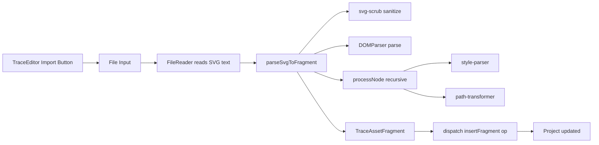

# Requirements

### Problem
When an element has its opacity animated to 0 at a certain timeframe, it becomes completely invisible on the stage. Even if the element is selected (and has a gizmo/selection outline), the user cannot see the element itself to work with it.

### Goal
Make selected elements always visible on the stage, regardless of their animated opacity value. When an element is selected, its opacity should never drop below a minimum threshold (e.g., 0.4) so the user can always see what they're editing.

### Scope
- **In scope**: Override opacity for selected elements in the DOM renderer during playback and scrubbing
- **Out of scope**: Export behavior (exports should still render the actual opacity), inspector display, timeline display

# Technical Design

### Current Implementation

The DOM renderer (`dom-renderer.ts`) evaluates every element's tracks at the current time and mutates SVG nodes directly. The main entry point is `syncTraceDomAtTime(timeMs, project)` which iterates all elements and calls `applyElementAnimationAtTime(node, element, timeMs)`. Opacity is applied at line 105-108:
```ts
case 'opacity':
  if (style) style.opacity = String(value);
  node.setAttribute('opacity', String(value));
  return;
```

Selection state lives in the Zustand store (`selectedElementIds: string[]`) and is exposed through the runtime bridge, but the bridge currently exposes only `getProject()` and `getPlayback()` — no selection.

### Key Decisions

1. **Extend the runtime bridge with `getSelection()`** — adds `selectedElementIds` to the bridge interface so the DOM renderer can read selection without importing the store. This follows the existing bridge pattern.

2. **Clamp opacity in `applyTrackValue`** — when the element is selected and the resolved opacity is below a threshold (0.4), clamp it. This is the single point where opacity is written to the DOM, so it's the cleanest place.

3. **Pass selected IDs through `syncTraceDomAtTime`** → `applyElementAnimationAtTime` — the selected IDs are read from the bridge once per sync cycle and passed down.

### Proposed Changes

**1. `src/lib/trace/runtime/bridge.ts`**
- Add `getSelection: () => string[]` to `TraceRuntimeBridge` interface (returns selected element IDs)

**2. `src/stores/trace-store.ts`**
- Register `getSelection` in the bridge: `() => useTraceStore.getState().selection.selectedElementIds`

**3. `src/lib/trace/runtime/dom-renderer.ts`**
- In `syncTraceDomAtTime()`: read selected IDs from the bridge once, pass them to `applyElementAnimationAtTime()`
- In `applyElementAnimationAtTime()`: accept `selectedIds?: Set<string>` parameter
- In `applyTrackValue()`: when property is `'opacity'` and the element is selected, clamp the value to `Math.max(value, 0.4)`
- Also clamp in the base opacity fallback (line 226-228) where non-animated opacity is applied

### Files Modified
- `src/lib/trace/runtime/bridge.ts` — add `getSelection` to bridge interface
- `src/stores/trace-store.ts` — register `getSelection` in bridge
- `src/lib/trace/runtime/dom-renderer.ts` — clamp opacity for selected elements

# SVG Importer

## Requirements

### Overview
Allow users to import SVG files into the NovaTrace editor. The importer parses raw SVG markup into TraceElement objects and inserts them into the current project using the existing `insertFragment` op.

### Scope
- **In scope**: Parse SVG string into `TraceAssetFragment`, insert via `insertFragment` op, add "Import SVG" button to the TraceEditor header with a file picker.
- **Out of scope**: Auto-animation generation, drag-and-drop on stage, saving to library.

## Technical Design

### Current Implementation

The sagedesigns-os project has a complete SVG importer at `lib/motion/parser/` with 4 files:
- `svg-importer.ts` (497 lines) — main parser using DOMParser, recursively processes SVG nodes into MotionElement objects
- `style-parser.ts` (24 lines) — parses inline CSS style strings into camelCase attributes
- `path-transformer.ts` (93 lines) — translates SVG path coordinates and extracts transform offsets
- `svg-scrub.ts` (55 lines) — removes dangerous SVG markup (scripts, event handlers, foreignObject)

The NovaTrace `insertFragment` op already exists and handles inserting a `TraceAssetFragment` into the project with ID remapping, scene assignment, and optional grouping.

### Key Decisions

1. **Adapt, don't copy** — Port the sagedesigns-os parser to NovaTrace's type system (`TraceElement` instead of `MotionElement`, `TraceAssetFragment` as the output). The core logic is identical but the attribute names and element structure differ slightly.

2. **Framework-agnostic parser** — The parser lives in `lib/trace/parser/` and uses `DOMParser` (browser API). It returns a `TraceAssetFragment`, not a `TraceProject`, keeping it composable with the ops engine.

3. **UI via header button** — Add an "Import" button to the TraceEditor header (between Loop and Export). Clicking opens a hidden file input that reads the SVG file and dispatches `insertFragment`.

4. **Security first** — Port `svg-scrub.ts` to sanitize untrusted SVG before parsing.

### Proposed Changes

**1. `src/lib/trace/parser/svg-scrub.ts`** (new file)
- Port of sagedesigns-os `svg-scrub.ts` with minimal changes (already framework-agnostic)

**2. `src/lib/trace/parser/style-parser.ts`** (new file)
- Port of sagedesigns-os `style-parser.ts` (already framework-agnostic)

**3. `src/lib/trace/parser/path-transformer.ts`** (new file)
- Port of sagedesigns-os `path-transformer.ts` (already framework-agnostic)

**4. `src/lib/trace/parser/svg-importer.ts`** (new file, ~400 lines)
- Adapted from sagedesigns-os `svg-importer.ts`
- Returns `TraceAssetFragment` instead of `MotionProject`
- Maps SVG elements to NovaTrace element types (path, rect, circle, ellipse, line, polyline, polygon, text, group)
- Handles: viewBox, inline styles, CSS custom properties, group transforms, inherited fill/stroke, path length measurement
- Exports: `parseSvgToFragment(svgString: string): TraceAssetFragment`

**5. `src/lib/trace/parser/index.ts`** (new file)
- Re-exports `parseSvgToFragment`

**6. `src/components/trace/TraceEditor.tsx`** (modified)
- Add hidden file input for SVG files
- Add "Import" button in the header (between Loop and Export buttons)
- On file select: read file as text, call `parseSvgToFragment()`, dispatch `insertFragment` op
- Select the first imported element after import

### File Structure
```
src/lib/trace/parser/
  index.ts              (re-exports)
  svg-importer.ts       (main parser, adapted from sagedesigns-os)
  svg-scrub.ts          (security scrubber)
  style-parser.ts       (inline CSS parser)
  path-transformer.ts   (path coordinate translation)
```

### Architecture Diagram



### Risks
- **DOMParser dependency**: The parser requires a browser environment (DOMParser, document.createElementNS). This is fine for the Electron renderer but means the parser can't run in Node.js tests without jsdom.
- **Path length measurement**: The sagedesigns-os parser temporarily appends a hidden SVG to measure path lengths. This is a DOM side effect but is cleaned up immediately.
- **Large SVGs**: Very complex SVGs with thousands of elements may slow the parser. The recursive approach is O(n) but DOM operations add overhead.

## Delivery Steps

### ✓ Step 3: Port parser utilities (scrub, style, path)
Create the framework-agnostic helper modules that the SVG parser depends on.
- Create `src/lib/trace/parser/svg-scrub.ts` — port of sagedesigns-os security scrubber (removes scripts, event handlers, foreignObject, dangerous URLs)
- Create `src/lib/trace/parser/style-parser.ts` — port of inline CSS style parser (converts `style="fill:#fff; stroke-width:2"` to camelCase attributes)
- Create `src/lib/trace/parser/path-transformer.ts` — port of path coordinate translator (translates absolute path commands, extracts transform offsets)
- Create `src/lib/trace/parser/index.ts` — re-exports `parseSvgToFragment`

### ✓ Step 4: Implement SVG-to-fragment parser
Adapt the sagedesigns-os SVG importer to return a `TraceAssetFragment` instead of a `MotionProject`.
- Create `src/lib/trace/parser/svg-importer.ts` (~400 lines)
- Parse SVG using DOMParser, extract viewBox, defs, CSS custom properties
- Recursively process nodes: path, rect, circle, ellipse, line, polyline, polygon, text, group
- Map SVG attributes to NovaTrace element attributes (fill, stroke, opacity, strokeWidth, etc.)
- Handle group nesting with parentId/childrenIds
- Measure path lengths using temporary hidden SVG for stroke-dasharray support
- Return `TraceAssetFragment` with elements, rootElementIds, width, height, and defs
- Export `parseSvgToFragment(svgString: string): TraceAssetFragment`

### ✓ Step 5: Add Import button to TraceEditor header
Wire the parser into the UI so users can import SVG files.
- In `src/components/trace/TraceEditor.tsx`: add a hidden file input (`accept=".svg,image/svg+xml"`)
- Add "Import" button in the header between Loop and Export buttons
- On file select: read file as text via FileReader, call `parseSvgToFragment()`, dispatch `insertFragment` op
- After import: select the first imported root element
- Show error if the SVG is invalid or empty

# Delivery Steps

### ✓ Step 1: Extend runtime bridge with selection access
Add `getSelection()` to the runtime bridge so the DOM renderer can read selected element IDs without importing the store.
- Add `getSelection: () => string[]` to `TraceRuntimeBridge` interface in `bridge.ts`
- Register `getSelection` in `trace-store.ts` bridge registration, returning `selection.selectedElementIds`

### ✓ Step 2: Clamp opacity for selected elements in DOM renderer
Make selected elements always visible by clamping their opacity to a minimum of 0.4 during DOM rendering.
- In `syncTraceDomAtTime()`: read selected IDs from the bridge once per cycle, build a `Set<string>` for fast lookup
- Pass `selectedIds` to `applyElementAnimationAtTime()` as an optional parameter
- In `applyTrackValue()`: when property is `'opacity'` and the element ID is in `selectedIds`, clamp the value to `Math.max(Number(value), 0.4)`
- In the base opacity fallback (line 226-228): apply the same clamp for non-animated opacity
- No changes to export code — exports use a separate path and should render actual opacity values

---