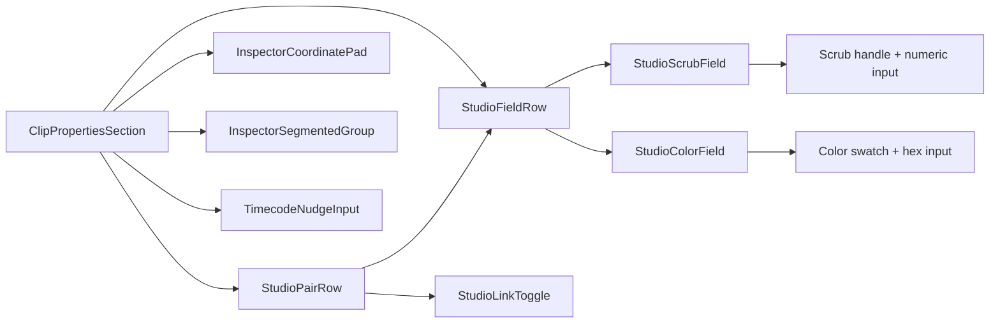

# Studio Inspector Modernization — Requirements

### Overview
Modernize the Studio inspector's property controls and layout to align with the professional patterns used in Motion and NovaTrace. Replace the current slider-based `InspectorSliderInput` with a compact scrub-field numeric input, adopt the FieldRow/PairRow layout pattern, add axis color coding, and streamline the section shell. The goal is a denser, more precise inspector that matches the rest of the system's UI.

### Scope

**In Scope:**
- Create `StudioScrubField` component (drag-to-scrub numeric input, inspired by Motion's `ScrubNumberField` and Trace's `ScrubField`)
- Create `StudioFieldRow` and `StudioPairRow` layout primitives (inspired by Trace's `FieldRow`/`PairRow`)
- Create `StudioLinkToggle` for paired fields (e.g., scale X/Y link)
- Replace `InspectorSliderInput` usage in `ClipPropertiesSection` with `StudioScrubField` + `StudioFieldRow`
- Replace `InspectorSection` with a compact section shell (inspired by Trace's `PanelSection`)
- Add axis color coding (X=chart-5/red, Y=chart-3/green) to transform position and scale fields
- Add `StudioColorField` for device frame color (inspired by Trace's `ColorField`)
- Streamline `ClipPropertiesSection` layout: use PairRow for position X/Y and scale X/Y

**Out of Scope:**
- Animation stopwatch (TrackButton-style per-field keyframe recording) — deferred
- PositionPad visual surface for 2D position — deferred (keep InspectorCoordinatePad for now)
- Tabbed transform layout (Position/Rotation/Scale tabs like Motion) — deferred
- Descriptor-driven property rendering (like Trace's PropertyDescriptor system) — deferred

### User Stories
- As an editor, I want to drag-to-scrub numeric values so I can adjust properties precisely with one undoable operation
- As an editor, I want paired fields (position X/Y, scale X/Y) displayed side-by-side with a link toggle so I can edit them together
- As an editor, I want axis-colored fields (X=red, Y=green) so I can distinguish properties at a glance
- As an editor, I want a compact inspector layout so more properties are visible without scrolling

### Functional Requirements
1. **ScrubField**: Drag-to-scrub numeric input with draft value during drag, single commit on release. Supports axis tone coloring, prefix icon, unit suffix, min/max/step, arrow key stepping, Enter to commit, Escape to revert.
2. **FieldRow**: Label + control row with fixed label width (~74px) and control column (~150px or wide variant).
3. **PairRow**: Two fields side-by-side with optional link toggle in the center.
4. **LinkToggle**: Link/unlink icon button for paired fields (e.g., uniform scale).
5. **Axis Colors**: X fields use chart-5 (red), Y fields use chart-3 (green) for the scrub handle prefix.
6. **Compact Section**: Replace `InspectorSection` with a thinner section shell (Trace's `PanelSection` style: ~28px header, space-y-2 content).
7. **ColorField**: Compact color swatch + hex text input for device frame color.

# Studio Inspector Modernization — Technical Design

### Current Implementation
- `InspectorSliderInput`: Full-width slider track + separate numeric text input + unit tag. Each field occupies ~60px vertical height (label row + slider row). Uses `InspectorFieldRow` wrapper with label, icon, and readout.
- `InspectorSegmentedGroup`: Pill button grid in a bordered container. Each button is ~28px tall with active state styling.
- `InspectorCoordinatePad`: 2D crosshair pad with rule-of-thirds grid, numeric X/Y inputs, and reset button. Uses `InspectorFieldRow` wrapper.
- `InspectorSection`: Collapsible accordion with icon, title, badge, and chevron toggle. Header is ~36px tall, content has `gap-3.5` spacing.
- `InspectorFieldRow`: Label + icon + readout header with children below. Two variants: default (vertical) and inline (horizontal).
- Motion `ScrubNumberField`: Drag-to-scrub handle (4px wide, axis-colored) + numeric input in a single 28px row. Draft value during drag, commit on release. Supports axis coloring via CSS chart tokens.
- Trace `ScrubField`: Similar to Motion but with `trailing` slot for stopwatch, `prefix` icon, `suffix` unit, and `tone` axis coloring. Arrow key stepping with Shift multiplier.
- Trace `FieldRow`: Label (~74px) + control (~150px fixed or wide). 28px row height.
- Trace `PairRow`: Two fields side-by-side with optional link toggle in center.
- Trace `PanelSection`: Collapsible with chevron, title, action slot. ~28px header, `space-y-2` content.
- Trace `ColorField`: Color swatch (16px) + hex input in a single 28px row.

### Key Decisions
1. **New Studio-specific components rather than importing from Trace/Motion**: The Studio inspector has its own design language (denser headers, different section styling). Creating `StudioScrubField`, `StudioFieldRow`, etc. keeps the Studio inspector self-contained while borrowing interaction patterns.
2. **ScrubField over SliderInput**: The drag-to-scrub pattern is more precise (pixel-per-pixel mapping), professional (industry standard), and compact (single 28px row vs 60px for slider). Draft value during drag means one undoable operation per scrub.
3. **Axis color coding via CSS chart tokens**: Reuse `var(--chart-5)` for X and `var(--chart-3)` for Y, matching Motion and Trace. This ensures theme consistency.
4. **PairRow for paired properties**: Position X/Y and scale X/Y are naturally paired. The PairRow layout with optional link toggle reduces vertical space and makes the relationship explicit.
5. **Compact section shell**: Replace `InspectorSection` with a thinner header (~28px vs ~36px) and tighter content spacing (`space-y-2` vs `gap-3.5`). This matches Trace's `PanelSection` and allows more properties to be visible.
6. **Keep InspectorCoordinatePad**: The 2D coordinate pad is already functional and unique to the Studio. Replace it with Motion's `PositionPad` in a future iteration.
7. **Backward compatibility**: Keep `InspectorSliderInput` and `InspectorSection` exported for global sections that don't need the new pattern. Only the clip properties section uses the new components.

### Proposed Changes

#### 1. StudioScrubField (`components/studio/inspector/components/StudioScrubField.tsx`)
New component based on Trace's `ScrubField`:
```
interface StudioScrubFieldProps {
  label: string;
  value: number;
  onChange: (value: number) => void;
  prefix?: React.ReactNode;  // axis letter or icon
  suffix?: string;           // unit (px, °, x, ms)
  tone?: 'x' | 'y' | 'neutral';  // axis color
  min?: number;
  max?: number;
  step?: number;
  disabled?: boolean;
  className?: string;
}
```
- Single 28px row: scrub handle (left) + numeric input (right) + suffix
- Drag handle: pointer capture, draft value during drag, commit on release
- Arrow keys: step by `step` value, Shift multiplies by 10
- Enter: commit, Escape: revert to `value`
- Axis colors: X = `var(--chart-5)`, Y = `var(--chart-3)`

#### 2. StudioFieldRow (`components/studio/inspector/components/StudioFieldRow.tsx`)
New layout primitive based on Trace's `FieldRow`:
```
interface StudioFieldRowProps {
  label: string;
  children: React.ReactNode;
  wide?: boolean;  // control fills row instead of fixed 150px
  className?: string;
}
```
- Label: ~74px fixed width, truncated, 11px muted text
- Control: 150px fixed (or flex-1 if `wide`)
- 28px row height, items-center

#### 3. StudioPairRow (`components/studio/inspector/components/StudioPairRow.tsx`)
New layout primitive based on Trace's `PairRow`:
```
interface StudioPairRowProps {
  left: React.ReactNode;
  right: React.ReactNode;
  link?: React.ReactNode;  // optional link toggle
  className?: string;
}
```
- Two fields side-by-side with optional link toggle in center
- Grid layout: `grid-cols-2` (no link) or `grid-cols-[1fr auto 1fr]` (with link)

#### 4. StudioLinkToggle (`components/studio/inspector/components/StudioLinkToggle.tsx`)
New toggle button based on Trace's `LinkToggle`:
```
interface StudioLinkToggleProps {
  linked: boolean;
  onToggle: () => void;
  label?: string;
}
```
- Link2Icon (linked) / UnlinkIcon (unlinked)
- Sky-400 when linked, muted-foreground when unlinked

#### 5. StudioColorField (`components/studio/inspector/components/StudioColorField.tsx`)
New color input based on Trace's `ColorField`:
```
interface StudioColorFieldProps {
  label: string;
  value: string;
  onChange: (value: string) => void;
  className?: string;
}
```
- Color swatch (16px) + hex text input in single 28px row
- Native color picker overlay on swatch click
- Hex validation, draft value during edit

#### 6. StudioPanelSection (`components/studio/inspector/components/StudioPanelSection.tsx`)
New compact section shell based on Trace's `PanelSection`:
```
interface StudioPanelSectionProps {
  title: string;
  children: React.ReactNode;
  action?: React.ReactNode;
  defaultOpen?: boolean;
}
```
- Collapsible with chevron, title, action slot
- ~28px header, `space-y-2` content
- Border-bottom divider

#### 7. ClipPropertiesSection Rewrite (`components/studio/inspector/sections/ClipPropertiesSection.tsx`)
Replace all `InspectorSliderInput` usage with `StudioScrubField` + `StudioFieldRow`/`StudioPairRow`:

**Transform Section** (video/overlay tracks):
- Position X/Y: `StudioPairRow` with two `StudioScrubField` (tone x/y, suffix "px", range -500 to 500)
- Scale X/Y: `StudioPairRow` with link toggle, two `StudioScrubField` (tone x/y, suffix "x", range 0.1 to 3.0)
- Rotation: `StudioFieldRow` with `StudioScrubField` (suffix "°", range -180 to 180)
- Anchor Point: keep `InspectorCoordinatePad` (deferred replacement)

**Animations Section** (all tracks):
- Enter/Exit type: keep `InspectorSegmentedGroup` (no better alternative yet)
- Enter/Exit duration: `StudioFieldRow` with `StudioScrubField` (suffix "ms", range 100 to 1000)

**Timing Section** (all tracks):
- Start/Duration: keep `TimecodeNudgeInput` (specialized for timecode display)

**Audio Section**:
- Volume: `StudioFieldRow` with `StudioScrubField` (suffix "%", range 0 to 200)

**Overlay Section**:
- Width: `StudioFieldRow` with `StudioScrubField` (suffix "%", range 10 to 100)
- Opacity: `StudioFieldRow` with `StudioScrubField` (suffix "%", range 0 to 100)
- Rotation: `StudioFieldRow` with `StudioScrubField` (suffix "°", range -180 to 180)
- Corner Radius: `StudioFieldRow` with `StudioScrubField` (suffix "px", range 0 to 48)

#### 8. Update components index (`components/studio/inspector/components/index.ts`)
Export new components alongside existing ones for backward compatibility.

### File Structure
- **Added:**
  - `src/components/studio/inspector/components/StudioScrubField.tsx` — drag-to-scrub numeric input
  - `src/components/studio/inspector/components/StudioFieldRow.tsx` — label + control row
  - `src/components/studio/inspector/components/StudioPairRow.tsx` — paired fields layout
  - `src/components/studio/inspector/components/StudioLinkToggle.tsx` — link/unlink toggle
  - `src/components/studio/inspector/components/StudioColorField.tsx` — color swatch + hex input
  - `src/components/studio/inspector/components/StudioPanelSection.tsx` — compact section shell
- **Modified:**
  - `src/components/studio/inspector/components/index.ts` — export new components
  - `src/components/studio/inspector/sections/ClipPropertiesSection.tsx` — replace InspectorSliderInput with StudioScrubField + StudioFieldRow/PairRow

### Architecture Diagram



# Visual Clip Properties — Requirements

### Overview
Extend the `StudioClip` model with visual properties so every clip on the timeline can be individually transformed, animated, and framed. This enables multi-track editing where clips from different sources can be positioned, scaled, rotated, and given enter/exit animations — the building blocks of professional video editing.

### Scope

**In Scope:**
- Add `transform` properties to `StudioClip` (position, scale, rotation, anchor point)
- Add `enterAnimation` / `exitAnimation` presets to `StudioClip` (fade, slide, scale, blur)
- Add `deviceFrame` per-clip (optional device mockup overlay)
- Extend `ClipPropertiesSection` in the inspector with new subsections for these properties
- Update `convert.ts` to pass transform/animation data through to `TimelineClip.payload`
- Reuse existing animation presets and transition types from the codebase

**Out of Scope:**
- Keyframe editor (mid-clip animation curves) — deferred to a future phase
- Blend modes, color correction, masks — deferred
- Canvas rendering of the new properties (export/renderer) — deferred
- Media pool UI panel — deferred

### User Stories
- As an editor, I want to reposition clips on the canvas so I can create picture-in-picture layouts
- As an editor, I want to scale and rotate clips so I can fit multiple sources in the frame
- As an editor, I want to add enter/exit animations to clips so they appear and disappear with style
- As an editor, I want to apply a device frame to individual clips so I can wrap screen recordings in mockups

### Functional Requirements
1. **Transform**: Each clip supports position (x,y), scale (x,y), rotation (degrees), and anchor point (x,y 0-1). Defaults: position (0,0), scale (1,1), rotation 0°, anchor (0.5, 0.5)
2. **Animations**: Each clip supports an enter and exit animation, chosen from presets (fade, slide-left, slide-right, slide-up, slide-down, scale, blur). Each animation has a duration (100-1000ms) and optional easing
3. **Device Frame**: Each clip can optionally have a device frame (none, iphone, macbook, android, browser). This is a per-clip override of the global device frame
4. **Inspector**: New collapsible sections in `ClipPropertiesSection` for Transform, Animations, and Device Frame
5. **Persistence**: All new properties are stored in `StudioClip` and serialized to the database via the existing JSON columns

# Visual Clip Properties — Technical Design

### Current Implementation
- `StudioClip` in `types.ts` has: `id`, `trackId`, `name`, `startMs`, `durationMs`, `sourceInMs`, `mediaAssetId`, `speed`, `volume`, `opacity`, `color`
- `TimelineClip.payload` (`StudioClipPayload`) already has spatial fields: `x`, `y`, `widthPct`, `opacity`, `rotation`, `cornerRadius` — but these are used only for overlays
- `AnimationPreset` in `doc.ts`: `none`, `fade-in`, `rise-in`, `slide-in-left`, `scale-in`
- `StudioCompositionTransitionType` in `types.ts`: `none`, `fade`, `slide-left`, `slide-right`, `slide-up`, `slide-down`, `scale`
- `composition-motion.ts` has `evaluateStudioCompositionLayerFrame()` — evaluates enter/exit transitions with easing
- `ClipPropertiesSection.tsx` handles per-track-type properties (zoom, caption, video, audio, overlay)
- `convert.ts` maps `StudioClip` → `TimelineClip` via `studioClipToTimelineClip()`

### Key Decisions
1. **Animation presets over keyframes**: Use preset-based animations (type + duration + easing) rather than raw keyframe curves. This covers 90% of use cases and is simpler for the UI. The data structure is designed to allow keyframe expansion later.
2. **Reuse existing types**: Extend `StudioCompositionTransitionType` for clip animations instead of creating a new type. The transition types already cover the animations we need.
3. **Transform as a sub-object**: Group transform properties in a `transform` sub-object on `StudioClip` rather than flat fields. This keeps the type organized and allows adding more transform properties later (skew, flip, etc.)
4. **Device frame per-clip**: Store as a `deviceFrame` sub-object on `StudioClip`, reusing `DeviceFrameType` from `types.ts`. This allows different clips to have different frames.
5. **Payload passthrough**: Pass transform/animation data through `TimelineClip.payload` so the existing timeline store and UI work unchanged. The payload is already a flat optional bag.

### Proposed Changes

#### 1. Type definitions (`lib/studio/types.ts`)
Add to `StudioClip`:
```
interface StudioClip {
  // ... existing fields ...
  transform?: ClipTransform
  enterAnimation?: ClipAnimation
  exitAnimation?: ClipAnimation
  deviceFrame?: ClipDeviceFrame
}

interface ClipTransform {
  position?: { x: number, y: number }  // px offset from default position
  scale?: { x: number, y: number }     // 1 = original size
  rotation?: number                     // degrees
  anchorPoint?: { x: number, y: number } // 0-1 normalized pivot
}

interface ClipAnimation {
  type: StudioCompositionTransitionType  // reuse existing type
  durationMs: number                     // 100-1000ms
  easing?: string                        // CSS easing name, defaults to ease-out
}

interface ClipDeviceFrame {
  type: DeviceFrameType                  // reuse existing type
  color?: string
  padding?: number
}
```

#### 2. Timeline conversion (`lib/studio/timeline/convert.ts`)
Update `studioClipToTimelineClip()` to include transform and animation data in the `TimelineClip.payload`:
```
payload: {
  speed: clip.speed,
  volume: clip.volume,
  opacity: clip.opacity,
  // New transform data
  transform: clip.transform,
  // New animation data
  enterAnimation: clip.enterAnimation,
  exitAnimation: clip.exitAnimation,
  // New device frame
  deviceFrame: clip.deviceFrame,
}
```

#### 3. StudioClipPayload (`lib/studio/types.ts`)
Extend `StudioClipPayload` to include the new sub-objects:
```
interface StudioClipPayload {
  // ... existing fields ...
  transform?: ClipTransform
  enterAnimation?: ClipAnimation
  exitAnimation?: ClipAnimation
  deviceFrame?: ClipDeviceFrame
}
```

#### 4. Inspector sections (`components/studio/inspector/sections/ClipPropertiesSection.tsx`)
Add three new subsections that render for all track types (not just specific tracks):

**Transform Section** (always visible for video/overlay clips):
- Position X/Y: two `InspectorSliderInput` components (-500 to 500px)
- Scale X/Y: two `InspectorSliderInput` components (0.1 to 3.0)
- Rotation: `InspectorSliderInput` (-180 to 180°)
- Anchor Point: `InspectorCoordinatePad` (0-1 normalized)

**Animations Section** (always visible):
- Enter Animation: dropdown for type, `InspectorSliderInput` for duration
- Exit Animation: dropdown for type, `InspectorSliderInput` for duration
- Reuses `StudioCompositionTransitionType` for the dropdown options

**Device Frame Section** (always visible for video clips):
- Frame type: segmented control (none, iphone, macbook, android, browser)
- Reuses `DeviceFrameType` from existing types

#### 5. Database (`main/db/studio-store.ts`)
No schema changes needed. The new properties are part of `StudioClip`, which is serialized into the existing `tracks_json` column. The `parseJsonSafe` pattern already handles the nested structure.

### File Structure
- **Modified:**
  - `src/lib/studio/types.ts` — new interfaces: `ClipTransform`, `ClipAnimation`, `ClipDeviceFrame`; extended `StudioClip` and `StudioClipPayload`
  - `src/lib/studio/timeline/convert.ts` — `studioClipToTimelineClip()` passes new properties
  - `src/components/studio/inspector/sections/ClipPropertiesSection.tsx` — new subsections for Transform, Animations, Device Frame
  - `src/main/ipc/channels.ts` — re-export new types

# Multi-Track Editing Foundation — Requirements

### Overview
Complete the multi-track editing foundation by addressing the three critical gaps identified in the timeline assessment: persist multi-track clip edits, enable video track mobility for multi-track projects, and render transform properties on the canvas viewport.

### Scope

**In Scope:**
- Add `extractClipsFromTracks()` to persist multi-track clip edits back to `StudioTake.tracks`
- Enable video track clip movement for multi-track projects (feature-flagged by take model)
- Render `transform` properties (position offset, rotation) on the canvas viewport for visual feedback
- Update `handleTimelineTracksChange` in `Studio.tsx` to call the new extract function for multi-track takes

**Out of Scope:**
- Cross-track clip operations (copy/paste, duplicate) — deferred
- Track management UI (add, delete, rename tracks) — deferred
- Media pool panel — deferred
- Canvas rendering of animations and device frames — deferred (transform only for now)

### User Stories
- As an editor, I want my multi-track clip edits to persist so they survive a reload
- As an editor, I want to move video clips freely on the timeline in multi-track mode
- As an editor, I want to see transform changes (position, rotation) reflected on the canvas

### Functional Requirements
1. **Multi-track persistence**: `extractClipsFromTracks()` converts `TimelineTrack[]` back to `StudioTrack[]` with `StudioClip[]`, preserving all clip properties including transforms, animations, and device frames
2. **Video track mobility**: Multi-track projects allow video clip moves; legacy takes keep the restriction
3. **Canvas transform rendering**: The canvas viewport applies `transform.position` offset and `transform.rotation` to clip rendering so inspector changes have visual feedback
4. **Persist integration**: `handleTimelineTracksChange` in `Studio.tsx` branches on take model and calls the appropriate extract functions

# Multi-Track Editing Foundation — Technical Design

### Current Implementation
- `extractCutsFromTracks`, `extractZoomsFromTracks`, `extractCaptionsFromTracks`, `extractEffectsFromTracks`, `extractOverlaysFromTracks` exist in `convert.ts` — all assume the legacy single-recording model with source-time semantics
- No `extractClipsFromTracks()` exists for the multi-track model
- `moveClip()` in `use-timeline-store.ts` (line 419) returns early for `track.type === 'video'` — blocks all video moves
- `TimelineCanvasViewport.tsx` draws clips at `clipX = clip.startMs * zoomPxPerMs - scrollX` with no transform applied
- `Studio.tsx` `handleTimelineTracksChange` calls the legacy extract functions and saves via `updateTimelineData`
- `use-studio.ts` `updateTimelineData` accepts `{ zooms, captions, cuts, effects, overlays }` — no `tracks` field
- `convertTakeToTimeline()` in `convert.ts` already prefers multi-track when `take.tracks` is defined (even if empty)

### Key Decisions
1. **Feature flag by take model**: The timeline store accepts an `isMultiTrack` flag via `setTracksAndDuration()`. `moveClip` checks this flag instead of track type. Legacy takes keep the video restriction; multi-track allows all moves.
2. **`extractClipsFromTracks` as a reverse of `convertProjectToTracks`**: The function converts `TimelineTrack[]` back to `StudioTrack[]` by reversing the mapping done by `studioClipToTimelineClip()`. It reads all clip properties including the new visual properties from `payload`.
3. **New `updateTracks` in `useStudio`**: Add a new callback that saves `tracks` to the take via `studio:save-take`. This is separate from `updateTimelineData` which handles legacy fields.
4. **Canvas transform as visual offset only**: Apply `transform.position` as a pixel offset to clip drawing position and `transform.rotation` as a canvas rotation. This provides visual feedback in the timeline viewport. Note: this is a timeline visualization, not the preview canvas — it shows clip arrangement hints, not the final rendered output.
5. **Branch in `handleTimelineTracksChange`**: Check if `activeTake.tracks !== undefined` to determine multi-track mode. For multi-track, call `extractClipsFromTracks` and `updateTracks`. For legacy, continue calling the existing extract functions.

### Proposed Changes

#### 1. Timeline store — multi-track flag (`hooks/use-timeline-store.ts`)
Add `isMultiTrack` to `TimelineState` and `setTracksAndDuration()`:
```
interface TimelineState {
  // ... existing fields ...
  isMultiTrack: boolean;  // true when take.tracks is defined
}
```
Update `setTracksAndDuration()` to accept an optional `isMultiTrack` parameter.
Update `moveClip()` to check `this.state.isMultiTrack` before the video track restriction:
```
if (!this.state.isMultiTrack && track.type === 'video') return;
```

#### 2. Extract function (`lib/studio/timeline/convert.ts`)
Add `extractClipsFromTracks()` that converts `TimelineTrack[]` back to `StudioTrack[]`:
```
export function extractClipsFromTracks(
  tracks: TimelineTrack[],
): { tracks: StudioTrack[] } | null {
  // Convert each TimelineTrack to StudioTrack
  // Convert each TimelineClip back to StudioClip using payload data
  // Include transform, enterAnimation, exitAnimation, deviceFrame from payload
}
```
The function reads `clip.payload.transform`, `clip.payload.enterAnimation`, etc. and maps them back to `StudioClip` fields.

#### 3. Studio.tsx — persist integration (`renderer/pages/Studio.tsx`)
Update `handleTimelineTracksChange` to branch on take model:
```
const isMultiTrack = activeTake.tracks !== undefined;
if (isMultiTrack) {
  const extracted = extractClipsFromTracks(tracks);
  if (extracted) {
    void updateTracks(extracted.tracks);
  }
} else {
  // existing legacy extract logic
}
```
Import `extractClipsFromTracks` from `studio-types`.

#### 4. useStudio hook — `updateTracks` (`hooks/use-studio.ts`)
Add `updateTracks` callback:
```
const updateTracks = useCallback(
  async (tracks: StudioTrack[]) => {
    if (!activeTake) return;
    setActiveTake(prev => prev ? { ...prev, tracks } : null);
    await window.electron.ipc.invoke('studio:save-take', {
      id: activeTake.id,
      tracks,
    });
  },
  [activeTake],
);
```
Export from the hook return value.

#### 5. Canvas viewport — transform rendering (`components/studio/timeline/TimelineCanvasViewport.tsx`)
In the clip rendering loop (line ~294), apply transform before drawing:
```
const transform = clip.payload?.transform;
const offsetX = transform?.position?.x ?? 0;
const offsetY = transform?.position?.y ?? 0;
const rotation = transform?.rotation ?? 0;

// For video/overlay tracks, apply visual offset to clip position
if (transform && (track.type === 'video' || track.type === 'overlays')) {
  ctx.save();
  const centerX = clipX + clipW / 2 + offsetX;
  const centerY = clipY + clipH / 2 + offsetY;
  ctx.translate(centerX, centerY);
  ctx.rotate((rotation * Math.PI) / 180);
  ctx.translate(-centerX, -centerY);
}
// ... existing draw logic ...
if (transform && (track.type === 'video' || track.type === 'overlays')) {
  ctx.restore();
}
```

#### 6. StudioCanvasTimeline — pass multi-track flag (`components/studio/timeline/StudioCanvasTimeline.tsx`)
Pass `isMultiTrack` to `setTracksAndDuration()`:
```
const tracks = convertTakeToTimeline(activeTake);
const isMultiTrack = activeTake.tracks !== undefined;
timelineStore.setTracksAndDuration(tracks, durationMs, isNewTake, isMultiTrack);
```

### File Structure
- **Modified:**
  - `src/hooks/use-timeline-store.ts` — add `isMultiTrack` state, update `setTracksAndDuration()` and `moveClip()`
  - `src/lib/studio/timeline/convert.ts` — add `extractClipsFromTracks()`
  - `src/renderer/pages/Studio.tsx` — branch `handleTimelineTracksChange` for multi-track, import new extract
  - `src/hooks/use-studio.ts` — add `updateTracks` callback
  - `src/components/studio/timeline/StudioCanvasTimeline.tsx` — pass `isMultiTrack` flag
  - `src/components/studio/timeline/TimelineCanvasViewport.tsx` — apply transform to clip rendering
  - `src/main/ipc/channels.ts` — re-export `extractClipsFromTracks`

### Architecture Diagram

```mermaid
graph LR
    A[TimelineCanvasViewport] -->|onTracksChange| B[StudioCanvasTimeline]
    B -->|onTracksChange| C[Studio.tsx handleTimelineTracksChange]
    C -->|Multi-track| D[extractClipsFromTracks]
    C -->|Legacy| E[extractCuts/Zooms/Captions/etc]
    D -->|StudioTrack[]| F[updateTracks in useStudio]
    E -->|legacy fields| G[updateTimelineData in useStudio]
    F -->|studio:save-take| H[Database tracks_json]
    G -->|studio:save-take| H
    I[use-timeline-store moveClip] -->|isMultiTrack?| J{Check}
    J -->|Yes| K[Allow all moves]
    J -->|No| L[Block video moves]
```

# Studio Ecosystem Alignment — Requirements

### Overview
Align all Studio-related systems (Copilot, IPC, DB, Take Summary) with the new multi-track clip model so the entire ecosystem is consistent. Currently, the Copilot agent, AI tools, blank take creator, and take summary are unaware of the multi-track model, tracks, clips, and visual properties.

### Scope

**In Scope:**
- Update `getTakeDetails` Copilot tool to return multi-track fields (tracks, mediaAssets, clip counts)
- Update Copilot instructions to mention clips, tracks, transforms, and animations
- Initialize `tracks: []` in `studio:create-blank-take` IPC for blank projects
- Add `isMultiTrack` flag to `StudioTakeSummary` so the browser can distinguish project types
- Add `blur` to `StudioCompositionTransitionType` for animation presets

**Out of Scope:**
- New Copilot tools for clip manipulation (addClip, setClipTransform, etc.) — deferred
- Media pool Copilot tools — deferred
- Track management Copilot tools — deferred

### User Stories
- As a Copilot user, I want the agent to know about my project's tracks and clips so it can reason about multi-track edits
- As a Copilot user, I want the agent to understand transforms and animations so it can suggest and apply them
- As a browser user, I want to see which projects are multi-track vs legacy recordings
- As a blank project creator, I want the editor to open with an empty multi-track timeline

### Functional Requirements
1. **Copilot awareness**: `getTakeDetails` returns `tracks`, `mediaAssets`, and clip counts with visual property summaries
2. **Copilot instructions**: Updated to mention multi-track model, clips, transforms, and animations as editable concepts
3. **Blank take initialization**: `studio:create-blank-take` sets `tracks: []` so the editor recognizes it as multi-track
4. **Take summary flag**: `StudioTakeSummary` includes `isMultiTrack` boolean derived from `tracks_json` presence
5. **Animation type completeness**: `StudioCompositionTransitionType` includes `blur` for the animation inspector

# Studio Ecosystem Alignment — Technical Design

### Current Implementation
- `getTakeDetails` in `studio.ts` (line 136) returns legacy fields: cuts, zooms, captions, effects, overlays, styling — no tracks, clips, or mediaAssets
- `buildStudioInstructions` in `studio-copilot-agent.ts` (line 53) references "zooms, cuts, captions" but never mentions clips, tracks, transforms, or animations
- `studio:create-blank-take` in `studio.ts` (line 802) creates a take with `cuts: [], zooms: [], captions: []` but no `tracks` field
- `listStudioTakes` in `studio-store.ts` (line 144) returns `StudioTakeSummary[]` without any indication of multi-track mode
- `StudioCompositionTransitionType` has `none | fade | slide-left | slide-right | slide-up | slide-down | scale` but no `blur`
- `StudioTakeSummary` type (line 461) has no `isMultiTrack` field

### Key Decisions
1. **Additive to `getTakeDetails`**: Append multi-track fields to the existing response rather than replacing. Legacy fields remain for backward compatibility with existing Copilot workflows.
2. **`tracks: []` for blank takes**: Setting an empty array (not `undefined`) signals to `convertTakeToTimeline()` that the take is multi-track, so the editor shows an empty canvas with no derived tracks.
3. **SQL-level `isMultiTrack`**: Use `CASE WHEN json_valid(t.tracks_json) THEN 1 ELSE 0 END` in the `listStudioTakes` query to avoid loading full take objects just to check one field.
4. **Instructions as context, not constraints**: Update Copilot instructions to inform the agent about the new model without restricting its existing capabilities.

### Proposed Changes

#### 1. `getTakeDetails` tool (`main/tools/studio.ts`)
Append multi-track fields to the return value:
```
return {
  success: true,
  take: {
    // ... existing fields ...
    isMultiTrack: take.tracks !== undefined,
    trackCount: (take.tracks ?? []).length,
    clipCount: (take.tracks ?? []).reduce((sum, t) => sum + t.clips.length, 0),
    mediaAssetCount: (take.mediaAssets ?? []).length,
    tracks: take.tracks,
    mediaAssets: take.mediaAssets,
  },
};
```

#### 2. Copilot instructions (`main/ai/studio-copilot-agent.ts`)
Add a new section to `buildStudioInstructions`:
```
8. **Multi-Track Clip Editing**:
   - When the take is a multi-track project (isMultiTrack: true), it contains tracks with clips instead of a single recording.
   - Each clip can have transform properties (position, scale, rotation), enter/exit animations, and device frames.
   - Use these properties to create picture-in-picture layouts, kinetic animations, and styled presentations.
   - The inspector allows editing these properties per-clip.
```

#### 3. Blank take IPC (`main/ipc/handlers/studio.ts`)
Add `tracks: []` to the `saveStudioTake` call in `studio:create-blank-take`:
```
const saved = saveStudioTake({
  id,
  // ... existing fields ...
  tracks: [],  // Initialize as multi-track project
});
```

#### 4. Take summary (`main/db/studio-store.ts` + `lib/studio/types.ts`)
Add `isMultiTrack` to `StudioTakeSummary`:
```
export interface StudioTakeSummary {
  // ... existing fields ...
  isMultiTrack: boolean;
}
```
Update the SQL query in `listStudioTakes`:
```
CASE WHEN json_valid(t.tracks_json) THEN 1 ELSE 0 END AS is_multi_track,
```
Map in the result:
```
isMultiTrack: r.is_multi_track === 1,
```

#### 5. Animation type (`lib/studio/types.ts`)
Add `blur` to `StudioCompositionTransitionType`:
```
export type StudioCompositionTransitionType =
  | 'none'
  | 'fade'
  | 'slide-left'
  | 'slide-right'
  | 'slide-up'
  | 'slide-down'
  | 'scale'
  | 'blur';
```

### File Structure
- **Modified:**
  - `src/main/tools/studio.ts` — `getTakeDetails` returns multi-track fields
  - `src/main/ai/studio-copilot-agent.ts` — instructions mention clips, tracks, transforms, animations
  - `src/main/ipc/handlers/studio.ts` — `studio:create-blank-take` initializes `tracks: []`
  - `src/main/db/studio-store.ts` — `listStudioTakes` includes `isMultiTrack` in SQL and result
  - `src/lib/studio/types.ts` — `StudioTakeSummary` gets `isMultiTrack`, `StudioCompositionTransitionType` gets `blur`

### Architecture Diagram

```mermaid
graph LR
    A[studio:create-blank-take] -->|tracks: []| B[saveStudioTake]
    B -->|tracks_json| C[Database]
    D[listStudioTakes] -->|SQL CASE json_valid| C
    D -->|isMultiTrack| E[StudioTakeSummary]
    E -->|Browser UI| F[StudioProjectsView]
    G[getTakeDetails tool] -->|full take| C
    G -->|tracks, clips, assets| H[Copilot Agent]
    H -->|instructions| I[Multi-track aware editing]
```

# Clip Enter/Visible/Exit Animations — Requirements

### Overview
Implement a full clip animation system with pre-built animation presets, GSAP-powered playback, and timeline keyframes for enter, visible (hold), and exit phases. Each clip can animate its transform properties (position, scale, rotation, opacity) using either preset animations or custom keyframe curves.

### Scope

**In Scope:**
- Expand `ClipAnimation` to support keyframe-based animation curves (not just presets)
- Add `ClipKeyframe` type for per-property keyframes on a clip
- Add pre-built animation presets (e.g., "Fly In Left", "Zoom Fade", "Bounce In", "Typewriter", "Blur Reveal")
- Use GSAP to evaluate and play back clip animations on the preview canvas
- Add animation keyframe visualization on the timeline ruler/tracks
- Extend the Animations inspector section with easing controls and keyframe management
- Add `visible` (hold) phase to animation model for mid-clip behavior

**Out of Scope:**
- Full keyframe curve editor (graph-based) — deferred
- Per-property keyframe tracks in the timeline — deferred (use inspector for now)
- Animation templates library — deferred
- Audio animation (volume keyframes) — deferred

### User Stories
- As an editor, I want to apply pre-built animation presets to clips so I can quickly add professional-looking enter/exit effects
- As an editor, I want to customize animation easing so I can fine-tune the feel of each animation
- As an editor, I want to see animation keyframes on the timeline so I can understand when animations occur
- As an editor, I want GSAP to power my animations so I get smooth, hardware-accelerated playback
- As an editor, I want to control the visible (hold) duration so animations don't overlap with the clip's stable display

### Functional Requirements
1. **Animation Presets**: A library of 12+ pre-built animations combining transform + opacity changes (e.g., "Fly In Left", "Fly In Right", "Zoom In", "Fade Up", "Bounce In", "Blur Reveal", "Slide & Scale", "Typewriter", "Spin In", "Drop In", "Wipe", "Elastic Pop")
2. **Three-Phase Model**: Each clip animation has Enter (0 → visible), Visible (hold at 100%), Exit (visible → 0) phases. The visible phase is the time between enter completing and exit starting.
3. **GSAP Playback**: Use GSAP timelines to evaluate animation properties at any point in time, reusing the same easing infrastructure as Trace
4. **Keyframe Model**: Each animation stores keyframes per property (e.g., `x`, `y`, `scale`, `opacity`, `rotation`) with time offsets relative to the clip's start/end
5. **Easing Controls**: Each animation supports easing selection from Trace's rich easing library (power1-4, back, elastic, bounce, expo, circ, sine)
6. **Timeline Visualization**: Show keyframe diamonds on the timeline clip edges for enter/exit animations
7. **Inspector Controls**: Animation type selector, easing selector, duration scrubber, and keyframe add/remove buttons

# Clip Animations — Technical Design

### Current Implementation
- `ClipAnimation` in `types.ts`: `type` (transition type), `durationMs`, `easing` (string). Simple preset-based model.
- `composition-motion.ts`: `evaluateStudioCompositionLayerFrame()` evaluates enter/exit using a simple `progress()` function with smoothstep easing. Handles fade, slide, and scale transitions.
- Trace `gsap-compiler.ts`: Uses GSAP as a clock (virtual tween spanning project duration) with `onUpdate` driving the DOM renderer. Does NOT animate properties directly with GSAP.
- Trace `interpolator.ts`: `getValueAtTime()` evaluates keyframe tracks with binary search + easing interpolation. Supports number, color, path, and text interpolation.
- Trace `easing.ts`: Rich easing library with 20+ easing types including `power1-4`, `back`, `elastic`, `bounce`, `expo`, `circ`, `sine`, and custom cubic-bezier.
- Motion `sample.ts`: `sampleKeyframes()` with binary search, flat-hold outside range, easing interpolation between keyframes.
- Motion `easing.ts`: `applyEasing()` with cubic bezier solved by bisection (deterministic). Presets: linear, step, easeIn, easeOut, easeInOut, smooth.
- `ClipPropertiesSection.tsx`: Animations section with enter/exit type segmented group and duration scrubber. No easing control yet.
- GSAP is already a dependency (`gsap`, `@gsap/react`) used in Trace empty state and runtime.

### Key Decisions
1. **GSAP as evaluator, not animator**: Following the Trace pattern, use GSAP as a deterministic clock/evaluator rather than animating DOM elements directly. The Studio preview canvas will read animation state from GSAP's timeline progress, not from GSAP-written CSS properties. This keeps one evaluation path for preview, export, and scrubbing.
2. **Keyframe-per-property model**: Instead of storing a single animation type, store keyframes per animatable property (x, y, scale, rotation, opacity). Presets generate keyframe data automatically. This allows both presets AND custom keyframes in the same data model.
3. **Clip-relative keyframe timing**: Keyframe times are stored as offsets from the clip's start (for enter) or end (for exit), in milliseconds. This makes animations portable when clips are moved on the timeline.
4. **Reuse Trace easing types**: Import `EasingType` from Trace instead of creating a new easing system. The Trace easing library already has 20+ types with proper evaluation.
5. **Preset-to-keyframe compilation**: Each preset is a function that generates `ClipKeyframe[]` for the relevant properties. The preset system is a convenience layer over the keyframe model, not a separate system.
6. **Three-phase timing**: Enter animation runs from clip start to `enterAnimation.durationMs`. Exit animation runs from `clip.durationMs - exitAnimation.durationMs` to clip end. The visible phase is the gap between.

### Proposed Changes

#### 1. Keyframe types (`lib/studio/types.ts`)
Add keyframe model to the Studio types:
```
interface ClipKeyframe {
  id: string;
  /** Time offset from clip start (for enter) or clip end (for exit), in ms. */
  timeMs: number;
  /** Property being animated (e.g., 'x', 'y', 'scale', 'opacity', 'rotation'). */
  property: ClipAnimatableProperty;
  /** Target value at this keyframe. */
  value: number;
  /** Easing curve from this keyframe to the next. */
  easing: StudioAnimationEasing;
}

type ClipAnimatableProperty = 'x' | 'y' | 'scale' | 'rotation' | 'opacity';

type StudioAnimationEasing =
  | 'linear'
  | 'ease-out'
  | 'ease-in'
  | 'ease-in-out'
  | 'power2.out'
  | 'power2.in'
  | 'power2.inOut'
  | 'power3.out'
  | 'power3.in'
  | 'back.out'
  | 'elastic.out'
  | 'bounce.out'
  | 'expo.out'
  | 'sine.out';
```

#### 2. Animation preset system (`lib/studio/animation-presets.ts`)
New module defining preset animations as keyframe generators:
```
interface AnimationPreset {
  id: string;
  name: string;
  category: 'enter' | 'exit' | 'both';
  /** Default duration in ms. */
  defaultDurationMs: number;
  /** Generate keyframes for this preset. */
  generateKeyframes(direction: 'enter' | 'exit'): ClipKeyframe[];
}

// Example presets:
// "fly-in-left": x from -200 to 0, opacity from 0 to 1
// "fly-in-right": x from 200 to 0, opacity from 0 to 1
// "zoom-in": scale from 0.5 to 1, opacity from 0 to 1
// "fade-up": y from 30 to 0, opacity from 0 to 1
// "bounce-in": scale from 0 to 1.2 to 1 (bounce)
// "blur-reveal": opacity from 0 to 1 (blur handled by CSS filter in renderer)
// "spin-in": rotation from -180 to 0, scale from 0 to 1
// "drop-in": y from -100 to 0 with bounce.out easing
// "elastic-pop": scale from 0 to 1 with elastic.out easing
// "typewriter": opacity from 0 to 1 with clip-width reveal (for text)
// "wipe-left": x from 100 to 0, opacity from 0 to 1
// "slide-scale": x from -50 to 0, scale from 0.8 to 1
```

#### 3. GSAP animation evaluator (`lib/studio/animation-evaluator.ts`)
New module using GSAP to evaluate clip animations at any time:
```
interface ClipAnimationState {
  x: number;
  y: number;
  scale: number;
  rotation: number;
  opacity: number;
}

function evaluateClipAnimation(
  clip: StudioClip,
  phase: 'enter' | 'exit',
  localTimeMs: number,  // time within the animation phase
): ClipAnimationState;

function createAnimationTimeline(
  keyframes: ClipKeyframe[],
  durationMs: number,
): gsap.core.Timeline;
```
Uses GSAP to build a virtual timeline from keyframes, then reads values at any progress point. Reuses `mapEasingToGsap()` from Trace for easing conversion.

#### 4. Extended ClipAnimation (`lib/studio/types.ts`)
Update `ClipAnimation` to support both preset and keyframe modes:
```
interface ClipAnimation {
  type: StudioCompositionTransitionType;  // legacy preset type (kept for compat)
  durationMs: number;
  easing?: string;  // legacy easing string (kept for compat)
  // New keyframe-based animation
  presetId?: string;  // reference to AnimationPreset
  keyframes?: ClipKeyframe[];  // custom or preset-generated keyframes
}
```

#### 5. Timeline keyframe visualization (`components/studio/timeline/TimelineCanvasViewport.tsx`)
Add keyframe diamond indicators on clip edges:
- Draw small diamond markers at clip start (enter keyframes) and clip end (exit keyframes)
- Color-coded by animation type (purple for enter, orange for exit)
- Visible when clip has animation keyframes

#### 6. Extended Animations inspector (`components/studio/inspector/sections/ClipPropertiesSection.tsx`)
Enhance the Animations section with:
- **Preset selector**: Grid of preset thumbnails/names (Fly In, Zoom, Fade, Bounce, etc.)
- **Easing selector**: Dropdown for easing type (reuses Trace easing types)
- **Duration scrubber**: Already exists
- **Keyframe indicator**: Visual badge showing number of keyframes
- **Add keyframe button**: Opens keyframe at playhead position
- **Visible phase indicator**: Shows the hold duration between enter and exit

#### 7. Animation playback integration (`components/studio/preview/` or canvas renderer)
Wire GSAP evaluator into the preview canvas so animations play during playback:
- On each frame, call `evaluateClipAnimation()` for each visible clip
- Apply the returned transform state to the clip's canvas rendering
- Use `gsap.timeline()` with `paused: true` and seek to current progress

### File Structure
- **Added:**
  - `src/lib/studio/animation-presets.ts` — preset definitions and keyframe generators
  - `src/lib/studio/animation-evaluator.ts` — GSAP-based animation evaluator
- **Modified:**
  - `src/lib/studio/types.ts` — `ClipKeyframe`, `ClipAnimatableProperty`, `StudioAnimationEasing`, extended `ClipAnimation`
  - `src/components/studio/inspector/sections/ClipPropertiesSection.tsx` — enhanced Animations section
  - `src/components/studio/timeline/TimelineCanvasViewport.tsx` — keyframe diamond indicators
  - `src/lib/studio/composition-motion.ts` — integrate GSAP evaluator for clip animations
  - `src/main/ipc/channels.ts` — re-export new animation types

### Architecture Diagram

```mermaid
graph LR
    A[AnimationPreset] -->|generates| B[ClipKeyframe[]]
    B -->|stored in| C[ClipAnimation.keyframes]
    C -->|evaluated by| D[GSAP Timeline]
    D -->|returns| E[ClipAnimationState]
    E -->|applied to| F[Preview Canvas]
    G[Inspector] -->|selects| A
    G -->|edits| B
    H[Timeline Viewport] -->|renders| I[Keyframe Diamonds]
    I -->|on clip edges| C
```

# Delivery Steps (Animations)

### ✓ Step 11: Add animation keyframe types and preset system
Create the keyframe data model and pre-built animation presets.

- Add `ClipKeyframe`, `ClipAnimatableProperty`, and `StudioAnimationEasing` types to `lib/studio/types.ts`
- Extend `ClipAnimation` with optional `presetId` and `keyframes` fields
- Create `lib/studio/animation-presets.ts` with 12+ presets:
  - Fly In Left/Right/Up/Down (position + opacity)
  - Zoom In/Out (scale + opacity)
  - Fade (opacity only)
  - Bounce In (scale with bounce easing)
  - Elastic Pop (scale with elastic easing)
  - Spin In (rotation + scale)
  - Drop In (position with bounce)
  - Blur Reveal (opacity, blur handled by renderer)
- Each preset's `generateKeyframes()` returns `ClipKeyframe[]` with proper easing
- Re-export new types from `main/ipc/channels.ts`

### ✓ Step 12: Build GSAP animation evaluator
Create a GSAP-based evaluator that reads animation state from keyframe timelines.

- Create `lib/studio/animation-evaluator.ts`
- Implement `createAnimationTimeline(keyframes, durationMs)` that builds a paused GSAP timeline from keyframes
- Map `StudioAnimationEasing` to GSAP easing strings (reuse Trace's `mapEasingToGsap` pattern)
- Implement `evaluateClipAnimation(clip, phase, localTimeMs)` that seeks the timeline and returns `ClipAnimationState`
- Handle enter phase (keyframes from clip start) and exit phase (keyframes from clip end, reversed)
- Add `evaluateEasingForStudio()` helper that reuses Trace easing evaluation for non-GSAP contexts

### ✓ Step 13: Enhance Animations inspector with presets and easing
Extend the Animations section in `ClipPropertiesSection` with preset selector, easing control, and keyframe management.

- Add preset selector grid (2 columns) with preset name labels and icons
- Add easing dropdown below each enter/exit animation (using `StudioAnimationEasing` types)
- Add keyframe count badge next to animation type
- Add "Add Keyframe" button to insert a keyframe at current playhead
- Add visible phase indicator showing hold duration between enter and exit
- Wire preset selection to `setAnimation()` with `presetId` and generated keyframes
- Add `blur` to `ANIMATION_OPTIONS` (missing from current inspector)

### ✓ Step 14: Add timeline keyframe visualization and canvas playback
Show keyframe indicators on the timeline and wire GSAP evaluation to the preview canvas.

- In `TimelineCanvasViewport.tsx`, draw small diamond markers at clip edges for clips with animations
- Enter keyframes: purple diamond at clip start edge
- Exit keyframes: orange diamond at clip end edge
- Integrate `evaluateClipAnimation()` into the preview canvas rendering loop — deferred to canvas animation playback phase
- On each playback frame, evaluate all visible clips' animations and apply transform state — deferred
- Use `gsap.timeline({ paused: true })` pattern from Trace for deterministic evaluation — deferred

# Delivery Steps

### ✓ Step 1: Add clip visual property types
Extend `StudioClip` with `transform`, `enterAnimation`, `exitAnimation`, and `deviceFrame` sub-objects in `types.ts`. Create `ClipTransform`, `ClipAnimation`, `ClipDeviceFrame` interfaces. Update `StudioClipPayload` and `studioClipToTimelineClip()` to pass the new data through. Re-export types from `channels.ts`.

- Add `ClipTransform` interface: position {x,y}, scale {x,y}, rotation, anchorPoint {x,y}
- Add `ClipAnimation` interface: type (reuses `StudioCompositionTransitionType`), durationMs, easing
- Add `ClipDeviceFrame` interface: type (reuses `DeviceFrameType`), color, padding
- Extend `StudioClip` with optional `transform`, `enterAnimation`, `exitAnimation`, `deviceFrame` fields
- Extend `StudioClipPayload` with the same optional fields for timeline store compatibility
- Update `studioClipToTimelineClip()` in `convert.ts` to include new properties in `payload`
- Re-export new types from `main/ipc/channels.ts`

### ✓ Step 2: Build Transform inspector section
Add a Transform subsection to `ClipPropertiesSection` with position, scale, rotation, and anchor point controls. Visible for video and overlay clips.

- Add `TransformSection` component with:
  - Position X/Y: two `InspectorSliderInput` components (-500 to 500px, step 5)
  - Scale X/Y: two `InspectorSliderInput` components (0.1 to 3.0, step 0.1)
  - Rotation: `InspectorSliderInput` (-180 to 180°, step 1)
  - Anchor Point: `InspectorCoordinatePad` (0-1 normalized)
- Wire each control to `onUpdateClip` with a `transform` patch
- Default values: position (0,0), scale (1,1), rotation 0°, anchor (0.5, 0.5)
- Show the section for `video` and `overlays` track types

### ✓ Step 3: Build Animations inspector section
Add an Animations subsection to `ClipPropertiesSection` with enter/exit animation type selectors and duration sliders.

- Add `AnimationsSection` component with:
  - Enter Animation: dropdown for type (none, fade, slide-left, slide-right, slide-up, slide-down, scale, blur), `InspectorSliderInput` for duration (100-1000ms, step 50)
  - Exit Animation: same structure
  - Reuses `StudioCompositionTransitionType` for dropdown options
- Wire each control to `onUpdateClip` with `enterAnimation`/`exitAnimation` patch
- Default: type 'none', duration 300ms
- Show the section for all track types (video, audio, overlays, captions, effects)

### ✓ Step 4: Multi-track clip persistence
Implement `extractClipsFromTracks()` and wire it into the persist flow so multi-track edits survive reloads.

- Add `extractClipsFromTracks(tracks: TimelineTrack[])` in `convert.ts` that converts `TimelineTrack[]` back to `StudioTrack[]`
- Map each `TimelineClip` back to `StudioClip` including all visual properties from `payload` (transform, animations, device frame)
- Add `updateTracks` callback to `useStudio` hook that saves `tracks` via `studio:save-take`
- Update `handleTimelineTracksChange` in `Studio.tsx` to branch on `activeTake.tracks !== undefined` and call `extractClipsFromTracks` for multi-track takes
- Re-export `extractClipsFromTracks` from `main/ipc/channels.ts`

### ✓ Step 5: Video track mobility for multi-track projects
Enable video clip movement for multi-track projects while preserving the legacy restriction.

- Add `isMultiTrack` boolean to `TimelineState` in `use-timeline-store.ts`
- Update `setTracksAndDuration()` to accept an optional `isMultiTrack` parameter
- Update `moveClip()` to check `this.state.isMultiTrack` before the video track early-return: `if (!this.state.isMultiTrack && track.type === 'video') return;`
- Pass `isMultiTrack` from `StudioCanvasTimeline.tsx` to `setTracksAndDuration()` by checking `activeTake.tracks !== undefined`

### ✓ Step 6: Canvas transform rendering
Apply `transform.position` offset and `transform.rotation` to clip rendering in the canvas viewport for visual feedback.

- In `TimelineCanvasViewport.tsx` clip rendering loop, read `clip.payload?.transform`
- Apply `transform.position` as a pixel offset to clip drawing position
- Apply `transform.rotation` as a canvas rotation around the clip center
- Only apply to `video` and `overlays` track types (consistent with inspector visibility)
- Wrap the drawing in `ctx.save()`/`ctx.restore()` to isolate the transform

### ✓ Step 7: Copilot awareness of multi-track model
Update the Studio Copilot agent and `getTakeDetails` tool to expose and understand the multi-track clip model.

- Add `isMultiTrack`, `trackCount`, `clipCount`, `mediaAssetCount`, `tracks`, and `mediaAssets` to `getTakeDetails` return value in `main/tools/studio.ts`
- Add a new section to `buildStudioInstructions` in `studio-copilot-agent.ts` describing multi-track clips, transforms, and animations
- Add `blur` to `StudioCompositionTransitionType` in `lib/studio/types.ts` for animation presets

### ✓ Step 8: Blank take and take summary alignment
Ensure blank projects initialize as multi-track and the take summary distinguishes project types.

- Add `tracks: []` to `studio:create-blank-take` in `main/ipc/handlers/studio.ts` so blank projects are recognized as multi-track
- Add `isMultiTrack: boolean` to `StudioTakeSummary` in `lib/studio/types.ts`
- Update `listStudioTakes` SQL in `main/db/studio-store.ts` with `CASE WHEN json_valid(t.tracks_json) THEN 1 ELSE 0 END AS is_multi_track`
- Map `isMultiTrack` in the `listStudioTakes` result

### ✓ Step 9: Create Studio inspector components
Build 6 new inspector components based on patterns from Motion and NovaTrace: StudioScrubField, StudioFieldRow, StudioPairRow, StudioLinkToggle, StudioColorField, and StudioPanelSection.

- **StudioScrubField.tsx**: Drag-to-scrub numeric input with pointer capture, draft value during drag, commit on release. Supports axis tone coloring (X=chart-5/red, Y=chart-3/green), prefix icon, suffix unit, min/max/step, arrow key stepping with Shift multiplier, Enter to commit, Escape to revert.
- **StudioFieldRow.tsx**: Label (~74px fixed) + control (~150px fixed or wide variant) layout primitive. 28px row height, items-center.
- **StudioPairRow.tsx**: Two fields side-by-side with optional link toggle in center. Grid layout with auto-sized center slot.
- **StudioLinkToggle.tsx**: Link/unlink icon button. Sky-400 when linked, muted-foreground when unlinked.
- **StudioColorField.tsx**: Color swatch (16px) + hex text input in single 28px row. Native color picker overlay on swatch click.
- **StudioPanelSection.tsx**: Compact collapsible section shell. ~28px header with chevron, title, action slot. Space-y-2 content.
- Update components/index.ts to export all new components alongside existing ones

### ✓ Step 10: Rewrite ClipPropertiesSection with new components
Replace all `InspectorSliderInput` usage in `ClipPropertiesSection` with `StudioScrubField` + `StudioFieldRow`/`StudioPairRow`. Replace `InspectorSection` with `StudioPanelSection`.

- **Transform Section**: Position X/Y as `StudioPairRow` with two `StudioScrubField` (tone x/y, suffix "px"). Scale X/Y as `StudioPairRow` with link toggle and two `StudioScrubField` (tone x/y, suffix "x"). Rotation as `StudioFieldRow` with `StudioScrubField` (suffix "°"). Anchor Point keeps `InspectorCoordinatePad`.
- **Animations Section**: Enter/Exit type keeps `InspectorSegmentedGroup`. Enter/Exit duration uses `StudioFieldRow` with `StudioScrubField` (suffix "ms").
- **Audio Section**: Volume uses `StudioFieldRow` with `StudioScrubField` (suffix "%").
- **Overlay Section**: Width, Opacity, Rotation, Corner Radius all use `StudioFieldRow` with `StudioScrubField`.
- Replace `InspectorSection` wrapper with `StudioPanelSection` for all sections in ClipPropertiesSection.

---