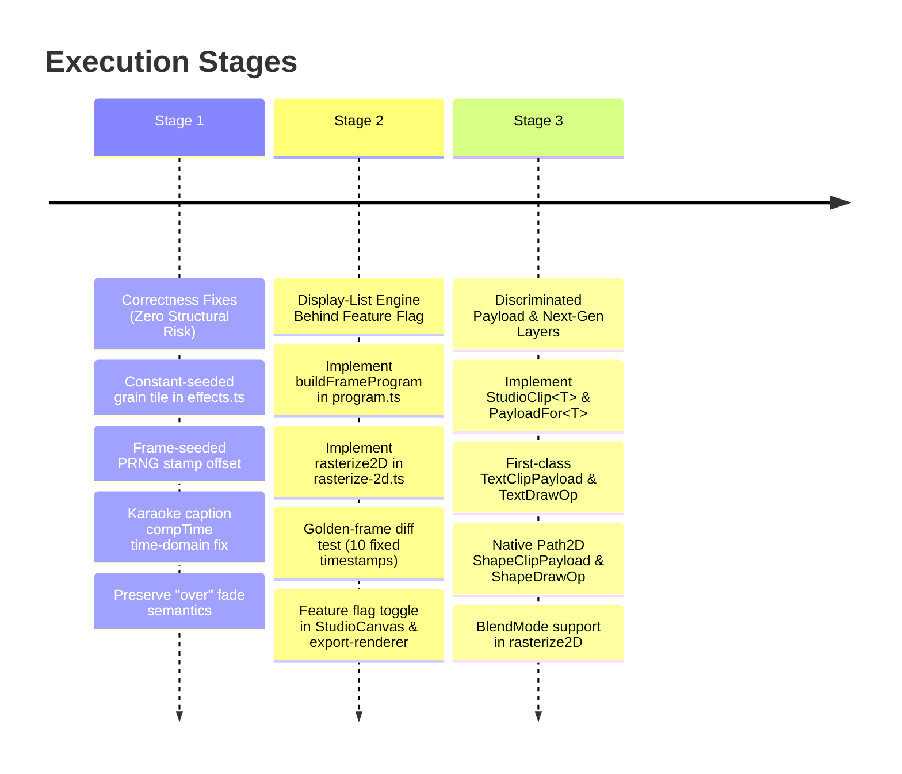

# Showcase Studio — Core Rendering Architecture & Specification

> **Document Type:** System Architecture Specification & Engineering Blueprint  
> **Status:** Production Specification (Grounded & Field-Validated)  
> **Target Audience:** Engineering, Product, and Graphics Engine Architects  
> **Reference File:** `docs/systems/showcase-studio-inspection-and-rendering-architecture.md`

---

## Table of Contents
1. [Executive Summary: The Display-List Imperative](#1-executive-summary-the-display-list-imperative)
2. [Codebase Reality: Validated Architectural Findings](#2-codebase-reality-validated-architectural-findings)
   - [2.1 Actual Compositing Order & Clipping Domains](#21-actual-compositing-order--clipping-domains)
   - [2.2 The Pseudo-Layer Problem: `compose.ts` as an Adapter](#22-the-pseudo-layer-problem-composets-as-an-adapter)
   - [2.3 Time-Domain Mismatches in Legacy Shims](#23-time-domain-mismatches-in-legacy-shims)
   - [2.4 Bit-Exact Determinism in Film Grain](#24-bit-exact-determinism-in-film-grain)
   - [2.5 NovaTrace & Video Decoder Bottlenecks](#25-novatrace--video-decoder-bottlenecks)
3. [The Core Rendering Specification: Tier 2.5 `FrameProgram`](#3-the-core-rendering-specification-tier-25-frameprogram)
   - [3.1 Builder Inputs & Aspect Ratio Resolution](#31-builder-inputs--aspect-ratio-resolution)
   - [3.2 The `FrameProgram` Schema](#32-the-frameprogram-schema)
   - [3.3 Typed Draw Operations (`DrawOp`)](#33-typed-draw-operations-drawop)
   - [3.4 The Three Clipping Domains (`ClipDomain`)](#34-the-three-clipping-domains-clipdomain)
   - [3.5 Transition Mathematics (The "Over" Fade & Blur)](#35-transition-mathematics-the-over-fade--blur)
   - [3.6 Pure Rasterization (Tier 3: `rasterize2D`)](#36-pure-rasterization-tier-3-rasterize2d)
4. [Type System Modernization: Discriminated Timeline Clip Union](#4-type-system-modernization-discriminated-timeline-clip-union)
   - [4.1 `StudioClip<T>` and `PayloadFor<T>`](#41-studioclipt-and-payloadfort)
   - [4.2 Payload Schemas by Item Type](#42-payload-schemas-by-item-type)
5. [Key Architectural Decisions](#5-key-architectural-decisions)
6. [Phased Implementation Roadmap](#6-phased-implementation-roadmap)

---

## 1. Executive Summary: The Display-List Imperative

The core rendering system for Showcase Studio is **not a backend choice first (WebGL vs. WebGPU vs. Skia)**. The foundational deliverable is an **immutable, backend-agnostic Display-List boundary (Tier 2.5: `FrameProgram`)**.

```
┌─────────────────────────────────────────────────────────────────────────┐
│ TIER 1: Domain Model (Discriminated StudioClip<T extends ItemType>)     │
└────────────────────────────────────┬────────────────────────────────────┘
                                     │
                                     ▼
┌─────────────────────────────────────────────────────────────────────────┐
│ TIER 2: Temporal Evaluation (evaluateEditorTimeline)                    │
│ Pure function: (tracks, compTime) → EditorTimelineFrame                 │
└────────────────────────────────────┬────────────────────────────────────┘
                                     │
                                     ▼
┌─────────────────────────────────────────────────────────────────────────┐
│ TIER 2.5: Frame Program Builder (buildFrameProgram)                    │
│ Pure function: (evalFrame, styling, assets, camera, crop) → FrameProgram│
│ Resolves: window frame, 2D affine matrices, clip domains, opacities,    │
│           filters, transition math, and ChromeDrawOp.                   │
│ Output: Immutable array of DrawOp primitives. ZERO DOM / ZERO CTX.     │
└────────────────────────────────────┬────────────────────────────────────┘
                                     │
                                     ▼
┌─────────────────────────────────────────────────────────────────────────┐
│ TIER 3: Pluggable Rasterizers                                           │
│ • rasterize2D(program, ctx, assetRegistry)      [Canvas 2D - Immediate] │
│ • rasterizeGL(program, gl, textureCache)        [WebGL2 - Future Swap]  │
└─────────────────────────────────────────────────────────────────────────┘
```

---

## 2. Codebase Reality: Validated Architectural Findings

### 2.1 Actual Compositing Order & Clipping Domains

In [layers.ts](file:///data/projects/docugent/docugent-desktop/src/lib/studio/timeline/layers.ts), tracks are declared as:
`TRACK_LANE_ORDER = ['effects', 'captions', 'transitions', 'overlays', 'video', 'audio']`  
with `trackPaintOrder()` returning bottom-to-top: `audio` → `video` → `overlays` → `transitions` → `captions` → `effects`.

However, the actual paint execution in [compose.ts](file:///data/projects/docugent/docugent-desktop/src/lib/studio/render/compose.ts#L87-L235) is:
1. `drawStudioBackground()`
2. `drawStudioWindowShadow()` (showcase mode)
3. Window clip applied: `ctx.roundRect()` + `ctx.clip()`
4. `drawMultiTrackClips()` (video & image clips in track order)
5. `drawStudioOverlays()` (PiP graphics)
6. `drawStudioEffects()` (canvas passes: spotlight, neon-glow, vignette, grain, scanlines)
7. `drawStudioWindowChrome()` (window header, buttons, device mockup frames)
8. **`ctx.restore()` — The window clipping path is unwound!**
9. `drawStudioCaption()` (captions painted at full canvas bounds over chrome)

**Consequences:**
- **Transitions are not a layer:** Transitions are evaluated pairwise on video clips during step 4; they never exist as an independent render pass.
- **Effects do not paint over captions:** Effects run in step 6; captions run in step 9.
- **Captions escape the window frame:** Captions are unclipped (`clip: 'none'`) and paint over the window chrome at canvas level.

### 2.2 The Pseudo-Layer Problem: `compose.ts` as an Adapter
`compose.ts` currently collapses Tier 2 and Tier 3:
- It calls `evaluateEditorTimeline` internally.
- It synthesizes legacy `StudioCaption[]` and `StudioEffect[]` arrays from clips.
- It branches on `if (!input.tracks)` to maintain legacy single-video compatibility.
*Deliverable:* Normalize legacy takes via `convertTakeToTracks()` up-front at the boundary so the builder consumes *only* `EditorTimelineFrame`, and `compose.ts` becomes a pure `rasterize2D` interpreter.

### 2.3 Time-Domain Mismatches in Legacy Shims
In `compose.ts` (line 228), caption clips are selected using composition time (`compTime`), but `drawStudioCaption()` is passed `timeMs` (**source time**). When dead-air cuts exist, source time diverges from composition time, causing karaoke highlights in `resolveActiveWordIndex` to drift off the audio.
*Deliverable:* When text becomes a first-class timeline clip, it evaluates with its own clip-local time (`localTimeMs = compTime - clip.startMs`), cleanly eliminating the drift.

### 2.4 Bit-Exact Determinism in Film Grain
In [effects.ts](file:///data/projects/docugent/docugent-desktop/src/lib/studio/render/effects.ts#L43-L143):
- `getGrainTile()` creates a 256×256 noise tile using unseeded `Math.random()`, cached at module scope.
- `drawFilmGrain()` offsets the pattern by `Math.random() * GRAIN_TILE_SIZE`.
*Deliverable:* Use a constant-seeded PRNG (e.g. Mulberry32 with seed `0x6d2b79f5`) to generate the tile texture once, and an explicit frame-seeded PRNG (`seed = Math.floor(compTimeMs * 0.06)`) for the stamp offset.

### 2.5 NovaTrace & Video Decoder Bottlenecks
- **NovaTrace (`src/lib/trace`):** Provides a declarative vector data model (`TraceElement`), SVG path parsing, and GSAP timeline compilation, but **contains zero Canvas 2D / `Path2D` rasterization code**. All canvas drawing routines must be written in the rasterizer.
- **Export Bottleneck:** In [export-renderer.ts](file:///data/projects/docugent/docugent-desktop/src/lib/studio/render/export-renderer.ts), wall-clock time is dominated by `await seekTo(video)` on DOM `<video>` decoders (15–50ms per frame) rather than canvas drawing (2–4ms). GPU compositing will not meaningfully accelerate export until video decoding is decoupled from DOM video elements.

---

## 3. The Core Rendering Specification: Tier 2.5 `FrameProgram`

### 3.1 Builder Inputs & Aspect Ratio Resolution

Window geometry depends on the aspect ratio of the active content. The builder must receive the resolved camera state, active video crop, dimensions, and asset metadata:

```typescript
export interface BuildFrameProgramInput {
  canvasWidth: number;
  canvasHeight: number;
  compTimeMs: number;
  styling: StudioStyling;
  evaluatedFrame: EditorTimelineFrame;
  /** Active camera state computed by stepCameraWithDelta (low-pass filter). */
  camera: StudioCameraState;
  videoCrop?: StudioVideoCrop;
  /** Probed asset dimensions and media elements for aspect ratio resolution. */
  assets: ReadonlyMap<string, { width: number; height: number }>;
  recordedVideoDimensions?: { width: number; height: number };
}
```

#### Aspect Ratio & Window Frame Derivation:
1. Identify the top-most active video clip in `evaluatedFrame.video`.
2. Determine `contentAspect`:
   - If clip references `mediaAssetId`, look up `assets.get(mediaAssetId)`. If `width > 0 && height > 0`, aspect = `width / height`.
   - Else if legacy recorded take: if `videoCrop && width > 0 && height > 0`, aspect = `videoCrop.width / videoCrop.height`.
   - Else if `recordedVideoDimensions && width > 0`, aspect = `recordedVideoDimensions.width / recordedVideoDimensions.height`.
   - Fallback: `16 / 9`.
3. Compute `StudioWindowFrame` via `computeStudioCanvasFrame(canvasWidth, canvasHeight, styling, contentAspect)`.

---

### 3.2 The `FrameProgram` Schema

```typescript
export interface FrameProgram {
  width: number;
  height: number;
  compTimeMs: number;
  background: {
    colorOrGradient: string;
    glow: boolean;
  };
  windowFrame?: {
    x: number;
    y: number;
    width: number;
    height: number;
    radius: number;
    shadow: boolean;
    headerHeight: number;
    contentX: number;
    contentY: number;
    contentWidth: number;
    contentHeight: number;
  };
  /**
   * The authoritative, strictly ordered paint list.
   * Index 0 is painted first (bottom); last index is painted last (top).
   */
  ops: readonly DrawOp[];
}
```

---

### 3.3 Typed Draw Operations (`DrawOp`)

```typescript
export type DrawOp =
  | VideoDrawOp
  | ImageDrawOp
  | TextDrawOp
  | ShapeDrawOp
  | EffectDrawOp
  | ChromeDrawOp
  | MotionCardDrawOp;

/** Pure string union for blend modes — decoupled from lib.dom.d.ts */
export type BlendMode =
  | 'source-over'
  | 'multiply'
  | 'screen'
  | 'overlay'
  | 'darken'
  | 'lighten'
  | 'color-dodge'
  | 'color-burn'
  | 'hard-light'
  | 'soft-light'
  | 'difference'
  | 'exclusion'
  | 'lighter';

/** The three distinct clipping domains in the rendering stack */
export type ClipDomain = 'none' | 'window' | 'content';

export interface BaseDrawOp {
  id: string;
  clipId?: string;
  /** 2D Affine Matrix: [a, b, c, d, tx, ty] representing scale, skew, and translate */
  transform: [number, number, number, number, number, number];
  opacity: number;
  blendMode: BlendMode;
  clip: ClipDomain;
  /**
   * Structured post-process filter. Stored as numbers, never a CSS string: a
   * GPU backend must not have to parse CSS. `filterToCss()` is the only place
   * the string form exists (Canvas 2D backend).
   */
  filter?: OpFilter;
}

export interface OpFilter {
  blurPx?: number;
  brightness?: number;
  contrast?: number;
  saturate?: number;
}

/**
 * Media provenance. The take's source recording is not a media-pool asset, so
 * it needs an explicit variant — a bare `assetId` cannot express `track-video`.
 */
export type MediaSource =
  | { kind: 'asset'; assetId: string; clipId?: string }
  | { kind: 'recorded' };

export interface VideoDrawOp extends BaseDrawOp {
  kind: 'video' | 'image';
  source: MediaSource;
  sourceRect: { x: number; y: number; width: number; height: number };
  destRect: { x: number; y: number; width: number; height: number; cornerRadius: number };
  deviceFrame?: ClipDeviceFrame;
}

/**
 * Picture-in-picture overlay. `destRect` is centred on the origin and applied
 * through `transform`; `imageOffset` carries the enter/exit animation offset.
 */
export interface OverlayDrawOp extends BaseDrawOp {
  kind: 'overlay';
  source: { kind: 'asset'; assetId: string; clipId: string };
  width: number;
  height: number;
  cornerRadius: number;
  imageOffset: { x: number; y: number };
  deviceFrame?: ClipDeviceFrame;
  shadow: boolean;
  border: boolean;
}

export interface ImageDrawOp extends BaseDrawOp {
  kind: 'image';
  assetId: string;
  sourceRect: { x: number; y: number; width: number; height: number };
  destRect: { x: number; y: number; width: number; height: number; cornerRadius: number };
}

export interface TextDrawOp extends BaseDrawOp {
  kind: 'text';
  text: string;
  fontFamily: string;
  fontSize: number;
  fontWeight: number | string;
  fill: string;
  stroke?: { color: string; width: number };
  shadow?: { color: string; blur: number; offsetX: number; offsetY: number };
  align: 'left' | 'center' | 'right';
  letterSpacing?: number;
  lineHeight?: number;
  /** Karaoke word highlight state */
  activeWordRange?: { startChar: number; endChar: number; highlightColor: string };
}

export interface ShapeDrawOp extends BaseDrawOp {
  kind: 'shape';
  pathData: string; // SVG path data (e.g. "M 0 0 L 100 100 Z")
  fill?: string;
  stroke?: { color: string; width: number };
  trim?: { start: number; end: number; offset: number };
}

export interface EffectDrawOp extends BaseDrawOp {
  kind: 'effect';
  effectType: 'spotlight' | 'neon-glow' | 'vignette' | 'film-grain' | 'scanlines';
  intensity: number;
  /** Deterministic seed parameters for noise tiles and scanline rolls */
  seedOffset: { x: number; y: number };
}

export interface ChromeDrawOp extends BaseDrawOp {
  kind: 'chrome';
  frameType: DeviceFrameType;
  title?: string;
  url?: string;
  theme?: 'dark' | 'light' | 'accent';
  showControls?: boolean;
}

export interface MotionCardDrawOp extends BaseDrawOp {
  kind: 'motion-card';
  cardType: 'intro' | 'outro';
  card: StudioMotionCard;
  totalDurationMs: number;
}
```

---

### 3.4 The Three Clipping Domains (`ClipDomain`)

A simple boolean `clippedToWindow` fails because the paint stack requires three separate clipping domains:
1. **`clip: 'window'`**: Clipped to the window rounded rectangle (`frame.x`, `frame.y`, `frame.width`, `frame.height`, `frame.radius`). Used by video clips, PiP overlays, and window chrome.
2. **`clip: 'content'`**: Clipped to the inner content box (`frame.contentX`, `frame.contentY`, `frame.contentWidth`, `frame.contentHeight`). Used by the light/film passes (`spotlight`, `vignette`, `scanlines`, `grain`). **`neon-glow` is the exception and uses `clip: 'window'`**: it strokes a rounded rect with `shadowBlur` up to `min(w,h) * 0.14` and relies on the window clip to bound the bloom. A content clip would cut the glow's falloff at the content edge.
3. **`clip: 'none'`**: Unclipped, rendering across the entire canvas bounds. Used by legacy subtitles, full-canvas titles, and global motion cards.
4. **Nested Video Clip Corner Radius**: In addition to `clip: 'window'`, a `VideoDrawOp` carries `destRect.cornerRadius`. Inside the rasterizer, video is clipped to its own local rounded rectangle before blitting.

---

### 3.5 Transition Mathematics (The "Over" Fade & Blur)

Transitions do not require an independent `TransitionDrawOp`. They resolve directly into properties on the participating `VideoDrawOp` instances:

1. **The Fade Transition is an "Over" Fade:**
   - Under standard `source-over` compositing, a symmetric crossfade (outgoing `0.5`, incoming `0.5`) produces an alpha of `0.75`, darkening the frame as the background bleeds through.
   - **Specification:** The outgoing participant's opacity is held at `1.0`. The incoming participant's opacity ramps from `0.0 → 1.0` over top of it:
     ```typescript
     outgoingOp.opacity = 1.0;
     incomingOp.opacity = transitionProgress;
     ```
2. **The Blur Transition:**
   - Applied to **both** participants of a paired transition (the legacy renderer sets `ctx.filter` for every active clip while a paired blur transition is running), on the incoming-only path only when the older `targetClipId` form is used.
   - Computes:
     ```typescript
     const blurPx = Math.sin(transitionProgress * Math.PI) * 12;
     incomingOp.filter = `blur(${blurPx.toFixed(2)}px)`;
     ```
3. **Slide and Scale Transitions:**
   - Resolves directly into the 2D affine matrix `transform` of the participating ops.

---

### 3.6 Pure Rasterization (Tier 3: `rasterize2D`)

`rasterize2D` is an unopinionated interpreter that walks the `program.ops` array:

```typescript
export function rasterize2D(
  ctx: CanvasRenderingContext2D,
  program: FrameProgram,
  assetRegistry: AssetRegistry,
): void {
  // 1. Paint background
  drawBackground(ctx, program.background, program.width, program.height);

  // 2. Window shadow
  if (program.windowFrame?.shadow) {
    drawWindowShadow(ctx, program.windowFrame);
  }

  // 3. Sequential DrawOp execution (Program order is authoritative)
  for (const op of program.ops) {
    ctx.save();

    // Apply clip domain
    if (op.clip === 'window' && program.windowFrame) {
      ctx.beginPath();
      ctx.roundRect(
        program.windowFrame.x,
        program.windowFrame.y,
        program.windowFrame.width,
        program.windowFrame.height,
        program.windowFrame.radius,
      );
      ctx.clip();
    } else if (op.clip === 'content' && program.windowFrame) {
      ctx.beginPath();
      ctx.rect(
        program.windowFrame.contentX,
        program.windowFrame.contentY,
        program.windowFrame.contentWidth,
        program.windowFrame.contentHeight,
      );
      ctx.clip();
    }

    // Apply affine matrix, opacity, blend mode, and filters
    ctx.transform(...op.transform);
    ctx.globalAlpha = op.opacity;
    ctx.globalCompositeOperation = mapBlendModeToComposite(op.blendMode);
    if (op.filter) {
      ctx.filter = op.filter;
    }

    switch (op.kind) {
      case 'video':
        renderVideoOp(ctx, op, assetRegistry.getVideo(op.assetId));
        break;
      case 'image':
        renderImageOp(ctx, op, assetRegistry.getImage(op.assetId));
        break;
      case 'text':
        renderTextOp(ctx, op);
        break;
      case 'shape':
        renderShapeOp(ctx, op);
        break;
      case 'effect':
        renderEffectOp(ctx, op, program.windowFrame);
        break;
      case 'chrome':
        renderChromeOp(ctx, op, program.windowFrame);
        break;
      case 'motion-card':
        renderMotionCardOp(ctx, op, program.width, program.height);
        break;
    }

    ctx.restore();
  }
}
```

---

## 4. Type System Modernization: Discriminated Timeline Clip Union

### 4.1 `StudioClip<T>` and `PayloadFor<T>`

In [types.ts](file:///data/projects/docugent/docugent-desktop/src/lib/studio/types.ts), `itemType` lives on `StudioClip`, not on `StudioClipPayload`. Defining a union on `StudioClipPayload` alone gives TypeScript no discriminant property. 

The type system is modernized using a mapped lookup:

```typescript
export interface PayloadTypeMap {
  video: VideoClipPayload;
  image: ImageClipPayload;
  text: TextClipPayload;
  shape: ShapeClipPayload;
  effect: EffectClipPayload;
  transition: TransitionClipPayload;
  audio: AudioClipPayload;
  overlay: ImageClipPayload | VideoClipPayload;
}

export type PayloadFor<T extends TimelineItemType> = PayloadTypeMap[T];

/**
 * A generic *interface* cannot discriminate. `PayloadTypeMap[union]` collapses
 * to a union of payloads, and `{ itemType: union; payload: union }` is not a
 * discriminated union — switching on `clip.itemType` would not narrow
 * `payload`. The discriminant must be distributed over the whole clip, which
 * requires a mapped type alias rather than an interface.
 */
export type TimelineClipOf<T extends TimelineItemType> = Omit<
  TimelineClip,
  'itemType' | 'payload'
> & { itemType: T; payload: PayloadFor<T> };

export type TypedTimelineClip = {
  [K in TimelineItemType]: TimelineClipOf<K>;
}[TimelineItemType];

export type StudioClipOf<T extends TimelineItemType> = Omit<
  StudioClip,
  'itemType' | 'payload'
> & { itemType: T; payload: PayloadFor<T> };

export type TypedStudioClip = {
  [K in TimelineItemType]: StudioClipOf<K>;
}[TimelineItemType];
```

The wide `TimelineClip` / `StudioClip` interfaces remain in place during the
migration — `payload` stays optional so the hundreds of `clip.payload?.x` reads
keep compiling. New code that wants narrowing imports `TypedTimelineClip`.

`TextClipPayload` also carries `words?: StudioCaptionWord[]` in **composition
time**, populated by the take → track converter. Dropping them (the previous
behaviour) silently downgraded karaoke from measured timings to a length-
proportional guess, and keeping source-time timings desynced the highlight
across dead-air cuts.

---

### 4.2 Payload Schemas by Item Type

```typescript
export interface BaseClipPayload {
  transform?: ClipTransform;
  keyframes?: StudioKeyframe[];
}

export interface VideoClipPayload extends BaseClipPayload {
  mediaAssetId?: string;
  speed?: number;
  opacity?: number;
  deviceFrame?: ClipDeviceFrame;
  cornerRadius?: number;
  enterAnimation?: ClipAnimation;
  exitAnimation?: ClipAnimation;
}

export interface ImageClipPayload extends BaseClipPayload {
  mediaAssetId: string;
  opacity?: number;
  cornerRadius?: number;
  enterAnimation?: ClipAnimation;
  exitAnimation?: ClipAnimation;
}

export interface TextClipPayload extends BaseClipPayload {
  text: string;
  fontFamily: string;
  fontSize: number;
  fontWeight: number | string;
  fill: string;
  strokeColor?: string;
  strokeWidth?: number;
  align: 'left' | 'center' | 'right';
  letterSpacing?: number;
  lineHeight?: number;
  animator?: 'none' | 'typewriter' | 'fade-words' | 'slide-up';
  words?: StudioCaptionWord[];
}

export interface ShapeClipPayload extends BaseClipPayload {
  shapeKind: 'rect' | 'circle' | 'arrow' | 'callout' | 'path';
  pathData: string;
  fill?: string;
  strokeColor?: string;
  strokeWidth?: number;
  trimStart?: number;
  trimEnd?: number;
}

export interface EffectClipPayload extends BaseClipPayload {
  /**
   * Optional because the effects lane also holds *kinetic zooms*, which are
   * disambiguated by an absent `effectType` (see `timeline/convert.ts`). A
   * required field here cannot represent a zoom clip.
   */
  effectType?: 'spotlight' | 'neon-glow' | 'vignette' | 'film-grain' | 'scanlines';
  intensity?: number;
  params?: Record<string, number | string>;
}

export interface TransitionClipPayload extends BaseClipPayload {
  transitionType: StudioCompositionTransitionType;
  fromClipId?: string;
  toClipId?: string;
  targetClipId?: string;
  transitionSide?: 'in' | 'out';
}

export interface AudioClipPayload extends BaseClipPayload {
  mediaAssetId: string;
  volume?: number;
  speed?: number;
  /** Runtime-only decoded buffer */
  audioBuffer?: AudioBuffer;
  waveformPeaks?: Float32Array;
}
```

---

## 5. Key Architectural Decisions

### Decision 1: Asset Dimensions vs. FrameProgram Purity
*Question:* Does `FrameProgram` carry asset handles, or does the builder receive pre-resolved dimensions?  
*Decision:* **The builder receives an `assets` metadata map (`{ width, height }`) and resolves all pixel layout.** `FrameProgram` stores string `assetId` references and resolved coordinates. `rasterize2D` looks up actual `HTMLVideoElement` / `HTMLImageElement` objects from the registry via `assetId`. This guarantees `FrameProgram` is 100% pure data with zero DOM handles.

### Decision 2: Text Stacking & Clipping
*Question:* Fixed unclipped lane above chrome, or true z-interleaving with video?  
*Decision:* **Full per-op flexibility via `ClipDomain`.**  
- Backward compatibility: Legacy subtitles emit `clip: 'none'` and are sorted above `ChromeDrawOp`.  
- Next-Gen Text: New text layers can specify `clip: 'window'` (clipped inside the window frame) or `clip: 'none'` (drawn across the canvas), sorted by their track row order.

### Decision 3: Fade Transition Semantics
*Question:* Preserve the "over" wipe or become a true crossfade?  
*Decision:* **Preserve the "over" wipe.** Outgoing alpha is held at `1.0`, while incoming ramps `0.0 → 1.0`. This prevents luminance/transparency dips under standard `source-over` compositing.

---

## 6. Phased Implementation Roadmap

To eliminate risk and guarantee parity at every step, implementation proceeds in three guarded stages:



### Stage 1: Correctness Fixes (Low Risk, Immediate)
- [ ] Fix `getGrainTile()` in `effects.ts`: Generate 256×256 noise buffer with fixed PRNG seed (`0x6d2b79f5`).
- [ ] Fix `drawFilmGrain()` in `effects.ts`: Derive `dx, dy` using PRNG seeded by `Math.floor(timeMs * 0.06)`.
- [ ] Fix `compose.ts`: Pass `compTime` instead of `timeMs` to `drawStudioCaption()`.

### Stage 2: Display-List Engine with Golden-Frame Parity (Medium Risk)
- [ ] Create `src/lib/studio/render/program.ts` implementing `buildFrameProgram()`.
- [ ] Create `src/lib/studio/render/rasterize-2d.ts` implementing `rasterize2D()`.
- [ ] Add golden-frame test in `src/__tests__/studio-display-list-parity.test.ts`: Render a fixture take at 10 fixed timestamps through both legacy `drawStudioFrame()` and the new `buildFrameProgram() + rasterize2D()` pipeline, asserting bit-identical pixel buffers.
- [ ] Gate behind `useDisplayListRenderer` flag in `StudioCanvas` and `export-renderer`.

### Stage 3: Discriminated Payload & First-Class Text/Shapes (High Blast Radius)
- [ ] Modernize `StudioClip<T>` and `PayloadFor<T>` in `types.ts`.
- [ ] Implement `TextClipPayload` and multi-instance canvas transform positioning.
- [ ] Implement `ShapeClipPayload` using native `Path2D` and NovaTrace path parsing math.
- [ ] Map `BlendMode` string union to `ctx.globalCompositeOperation`.
- [ ] Profile export with `STUDIO_EXPORT_PROFILE` before ever considering GPU migration.

---

*Authored & Validated against Docugent Desktop Codebase*  
*Document Ref: `docs/systems/showcase-studio-inspection-and-rendering-architecture.md`*
